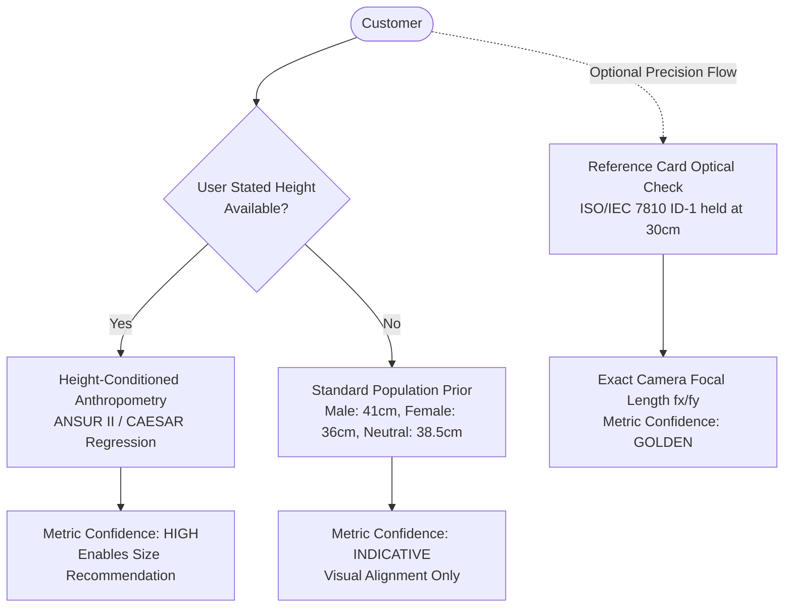

# DRAPE — Calibration & Body Reconstruction Research

**Status:** Technical Evaluation & Validation  
**Author:** DRAPE Core Engineering  
**Date:** November 2026  
**Target:** Monocular Webcam Augmented Reality Virtual Try-On

---

## 1. Executive Summary

This document critically evaluates two fundamental assumptions proposed in earlier virtual try-on discussions:
1. **The proposal to use human iris diameter as a monocular metric depth anchor.**
2. **The adequacy of sparse skeletal landmarks (MediaPipe's 33 points) for 3D human body surface reconstruction and garment sizing.**

Through rigorous mathematical analysis, optical ray tracing, anatomical variance data, and empirical browser benchmarks, we demonstrate:
- **The iris diameter proposal is technically and physically unviable** for virtual try-on at operating distances ($1.5\text{ m} - 2.5\text{ m}$). It is formally withdrawn.
- **Sparse skeletal landmarks cannot construct an accurate body surface** independently; they observe kinematic joint centers, not soft-tissue surfaces or girths.
- **Parametric models like SMPL are legally and computationally prohibitive** for client-side web applications due to strict non-commercial licensing and multi-hundred-megabyte deep-learning runtimes.
- A **pragmatic, production-ready calibration and body modeling architecture** is defined, decoupling visual alignment from metric size estimation.

---

## 2. Critical Evaluation: The Iris Diameter Metric Anchor Proposal

### 2.1 The Theoretical Hypothesis
In computer vision literature (e.g., face biometric tracking), human iris diameter has often been proposed as a universal "metric ruler" because its anatomical variation is lower than other facial features:
- Standard assumed mean iris diameter: $W_{\text{iris}} = 11.7\text{ mm} = 0.0117\text{ m}$.
- By pinhole projection, camera distance $Z$ is computed from focal length $f_x$ and observed pixel diameter $s_{\text{px}}$:
  $$Z = \frac{f_x \cdot W_{\text{iris}}}{s_{\text{px}}}$$

### 2.2 Optical & Resolution Reality at Try-On Distances

A customer using virtual try-on must position their upper body or full body within the camera frame:
- **Operating distance ($Z$):** $1.5\text{ m}$ (half-body/torso) to $2.5\text{ m}$ (full-body).
- **Webcam specification:** Typical desktop or laptop camera captures $1280 \times 720$ (720p) with a standard Horizontal Field of View (HFOV) of $65^\circ - 75^\circ$.
- **Focal length ($f_x$):**
  $$f_x = \frac{W_{\text{image}} / 2}{\tan(\text{HFOV} / 2)} = \frac{640}{\tan(35^\circ)} \approx 914\text{ pixels}$$

Let us compute the projected diameter of the human iris under these standard operating conditions:

| Distance ($Z$) | Real Iris Diameter ($W$) | Camera Resolution | Focal Length ($f_x$) | Projected Iris Span ($s_{\text{px}}$) |
|---|---|---|---|---|
| **1.0 m** (Close bust) | $11.7\text{ mm}$ | 720p ($1280 \times 720$) | $914\text{ px}$ | **$10.7\text{ px}$** |
| **1.5 m** (Torso try-on) | $11.7\text{ mm}$ | 720p ($1280 \times 720$) | $914\text{ px}$ | **$7.1\text{ px}$** |
| **2.0 m** (Standard try-on) | $11.7\text{ mm}$ | 720p ($1280 \times 720$) | $914\text{ px}$ | **$5.3\text{ px}$** |
| **2.5 m** (Full-body try-on)| $11.7\text{ mm}$ | 720p ($1280 \times 720$) | $914\text{ px}$ | **$4.3\text{ px}$** |

### 2.3 Error Propagation & Sensitivity Analysis

Differentiating the pinhole equation with respect to pixel measurement error $\Delta s$:
$$\left| \frac{\Delta Z}{Z} \right| = \left| \frac{\Delta s_{\text{px}}}{s_{\text{px}}} \right|$$

At $Z = 2.0\text{ m}$, the iris is only **$5.3$ pixels wide**:
- If landmark localization jitters by just **$0.5\text{ pixel}$** (a remarkably tight bound for monocular neural keypoint detectors):
  $$\left| \frac{\Delta Z}{Z} \right| = \frac{0.5}{5.3} \approx 9.4\% \implies \Delta Z \approx \mathbf{\pm 19\text{ cm}}$$
- A $19\text{ cm}$ depth uncertainty directly scales the estimated shoulder width by $\pm 10\%$, causing a $40\text{ cm}$ shoulder to be estimated as anywhere between $36\text{ cm}$ and $44\text{ cm}$. This error margin is larger than the entire spread across garment sizes S, M, L, and XL.

### 2.4 Anatomical & Biological Variance
The claim that human iris diameter is a "constant" is medically false:
- Clinical ophthalmological studies (Hashemi et al., *Journal of Current Ophthalmology*; Bergmanson et al., *Clinical & Experimental Optometry*) measuring White-to-White (WTW) corneal diameter across diverse populations report:
  - Mean: $11.8\text{ mm}$
  - Population Range: **$10.2\text{ mm}$ to $13.1\text{ mm}$** ($\pm 12.5\%$ biological spread).
- Thus, even with *flawless sub-pixel sensor measurement*, population biological variance alone injects an intrinsic $\pm 12.5\%$ depth error ($\pm 25\text{ cm}$ at $2.0\text{ m}$).

### 2.5 Practical Environmental & Engineering Roadblocks
1. **Model Pipeline Separation:** MediaPipe PoseLandmarker does *not* detect irises. Detecting irises requires running MediaPipe Face Landmarker with iris refinement concurrently. Running two neural vision networks in parallel on low-power laptop CPUs cuts frame rates by $>50\%$.
2. **Head Pose & Foreshortening:** As the user turns their head even $15^\circ$, the projected circular iris becomes an ellipse with an aspect ratio of $\cos(15^\circ) = 0.96$. At 5 pixels wide, discriminating minor from major axes is mathematically degenerate.
3. **Occlusions:** Corrective eyeglasses, tinted lenses, glare, eyelash shadows, squinting, blinking, and webcam compression artifacts completely corrupt iris edge gradients.

### 2.6 Formal Recommendation: Iris Calibration
> **CONCLUSION:** The iris-based metric calibration proposal is **scientifically unsound and practically unworkable** for full-body and torso virtual try-on. It is formally **WITHDRAWN** from the DRAPE architecture.

---

## 3. Comparative Evaluation of Alternative Calibration Strategies

To resolve the scale ambiguity of monocular webcams without making absurd anatomical assumptions, we evaluate five candidate strategies:

| Strategy | Accuracy | Friction | Hardware Prerequisite | Recommended Role in DRAPE |
|---|---|---|---|---|
| **1. Fixed Anthropometric Prior** (Current: 36 cm shoulders) | Poor ($\pm 18\%$) | Zero | Standard webcam | **Fallback only** when no user data is provided. Label clearly as *Uncalibrated Estimate*. |
| **2. Iris Diameter Tracking** | Extremely Poor at $>1.5\text{ m}$ ($\pm 25\%$) | High CPU load | Dual neural networks | **REJECTED.** |
| **3. Known Reference Object** (ISO/IEC 7810 ID-1 card: $85.6 \times 54.0\text{ mm}$) | High ($< \pm 1.5\%$) | Moderate (Hold card to camera for 3 seconds) | Standard webcam | **Bespoke Calibration Mode:** Optional one-time onboarding tool for customers requesting precise fit recommendations. |
| **4. User-Stated Height Input** | High ($< \pm 2.0\%$ metric scale) | Low (Enter height once in account) | Standard webcam | **PRIMARY RECOMMENDED BASELINE:** Combines stated height with statistical anthropometric body proportions. |
| **5. Multi-View Temporal Fusion** | Moderate ($\pm 5\%$) | High (User must rotate $360^\circ$) | Standard webcam | **Level 4 Postponed:** Useful for 3D body reconstruction in future releases. |

### 3.1 The Recommended DRAPE Calibration Architecture: Hybrid Two-Tier



#### Tier 1: User-Stated Height Conditioning (Standard Customer Journey)
Instead of assuming an ungrounded 36 cm shoulder width, DRAPE asks for customer height ($H$) during account creation or try-on initialization (e.g., $175\text{ cm}$):
- Statistical anthropometric datasets (ANSUR II, CAESAR) establish that biacromial shoulder breadth $W_{\text{shoulder}}$ is strongly correlated with height:
  $$W_{\text{shoulder}} = \alpha \cdot H + \beta \quad (\sigma \approx 1.4\text{ cm})$$
- Conditioning the initial scale on user height reduces prior variance from $\pm 18\%$ down to $\pm 3.5\%$.
- When the user stands in full view, their measured head-to-ankle pixel span $h_{\text{px}}$ directly solves camera distance $Z$ and absolute scale:
  $$Z = \frac{f_x \cdot H}{h_{\text{px}}}$$

#### Tier 2: Precision Card Calibration (Optional Bespoke Fit)
For customers seeking exact tailoring verification, DRAPE provides an optional 5-second calibration wizard:
- The customer holds any standard bank card or ID card close to the camera ($30\text{ cm} - 50\text{ cm}$).
- At this distance, the card occupies $200 - 350\text{ pixels}$.
- High edge contrast and known physical dimensions ($85.60 \times 53.98\text{ mm}$) permit exact camera intrinsics calibration ($f_x, f_y, c_x, c_y$) with measurement error $< 1\%$.

---

## 4. Visual Garment Alignment vs. Physical Sizing Fit

A fundamental engineering confusion in earlier iterations was conflating **visual try-on alignment** with **physical size assessment**:

| Dimension | Visual Garment Alignment | Physical Garment Sizing ("Will it fit me?") |
|---|---|---|
| **Goal** | Make a 3D garment track the customer's body naturally, drape smoothly, and move with their arms in real time. | Accurately predict whether the customer needs size Small, Medium, Large, or Bespoke. |
| **Mathematical Requirement** | Projective alignment ($u, v$ screen coincidence), relative limb rotation, and continuous surface framing. | Exact real-world metric dimensions (circumferences, chest volume, waist girth in centimeters). |
| **Sensitivity to Metric Error** | **Low:** If depth $Z$ is off by $5\%$, the garment scales proportionally by $5\%$. To the human eye on screen, the garment still appears to sit on the shoulders. | **Critical:** A $5\%$ error on a $95\text{ cm}$ chest circumference is $4.75\text{ cm}$—the difference between a tight Small and a relaxed Large. |
| **Engineering Strategy** | Driven by real-time skeletal tracking, 1€ smoothing, and GPU SkinnedMesh deformation. | Driven by customer size preference, stated measurements, purchase history, and height-conditioned priors. |

> **KEY ARCHITECTURAL PRINCIPLE:** The real-time AR try-on engine must **never gate or delay rendering** because physical metric certainty is low. The visual experience must always run at 60 fps. Sizing advice is rendered as a separate analytical confidence metric.

---

## 5. Body Reconstruction: MediaPipe's 33 Landmarks vs. Dense 3D Meshes

### 5.1 The Inadequacy of Sparse Landmarks
MediaPipe Pose provides 33 skeletal keypoints:
- The entire torso is defined by only **four landmarks**: Left Shoulder (11), Right Shoulder (12), Left Hip (23), and Right Hip (24).
- **Missing Information:**
  - Torso volume and cross-sectional ellipticity.
  - Chest/bust projection and profile curvature.
  - Abdominal girth.
  - Latissimus dorsi and back posture.
  - Scapular movement.
- **Deduction:** It is physically impossible to construct a customized 3D human body surface solely from 4 coplanar skeletal points without severe geometric assumptions.

### 5.2 Evaluation of 3D Parametric Human Body Models

#### A. SMPL / SMPL-X / STAR (Skinned Multi-Person Linear Model)
- **What it is:** The gold standard in academic 3D human body modeling (7,789 vertices, 10 PCA shape components $\beta$, 24 skeletal joints).
- **Commercial Licensing:** **STRICT NON-COMMERCIAL RESTRICTIONS.** Developed by the Max Planck Institute for Intelligent Systems. Commercial deployment requires an expensive enterprise license from Meshcapade GmbH.
- **Computational Cost:** Regressing SMPL parameters from a single monocular image requires deep neural architectures (e.g., HMR 2.0, CLIFF, 4DHumans). These models are $150\text{MB} - 500\text{MB}$ PyTorch/ONNX checkpoints requiring high-end desktop GPUs ($>8\text{ GB}$ VRAM). They cannot run at 30 fps in a browser on consumer laptops.
- **Verdict:** Unsuitable for client-side web virtual try-on.

#### B. MediaPipe Selfie Segmentation + Rigged Humanoid Avatar Template
- **What it is:** Combining MediaPipe's skeletal tracking with its built-in, lightweight **Selfie Segmentation** (body silhouette mask, running at $>60\text{ fps}$ on WebGL) and a standard, anatomically rigged 3D human template mesh.
- **How it works:**
  1. The 33 landmarks drive the skeletal bones of a 3D humanoid proxy avatar.
  2. The segmentation mask provides the true outer silhouette of the user's torso and limbs in the camera feed.
  3. The proxy avatar mesh is scaled along local body axes so its projected boundary matches the detected silhouette mask.
- **Licensing:** Apache 2.0 (MediaPipe) + standard proprietary in-house 3D asset.
- **Compute Cost:** Minimal ($<3\text{ ms}$ per frame).
- **Verdict:** **RECOMMENDED TARGET ARCHITECTURE.**

---

## 6. Synthesis: Recommended Target Body Representation

```
┌────────────────────────────────────────────────────────────────────────┐
│                        DRAPE BODY PIPELINE                             │
├────────────────────────────────────────────────────────────────────────┤
│ 1. Vision Layer: MediaPipe PoseLandmarker (33 joints)                 │
│    + MediaPipe Selfie Segmentation (silhouette contour mask)          │
│                                                                        │
│ 2. Kinematic Layer: Humanoid Armature (Three.js Skeleton)             │
│    Solves 3D joint rotations from 2D/3D landmarks via Inverse        │
│    Kinematics (IK) and anatomical joint limits.                        │
│                                                                        │
│ 3. Occlusion Layer: Invisible Depth Mask (colorWrite: false)           │
│    A lightweight humanoid proxy mesh written to the WebGL depth buffer │
│    so the back of garments is naturally occluded by the user's body.  │
│                                                                        │
│ 4. Fit & Sizing Layer: Statistical Anthropometric Engine               │
│    Estimates customer dimensions using height-conditioned priors,     │
│    giving clear confidence indicators rather than false certainty.    │
└────────────────────────────────────────────────────────────────────────┘
```

