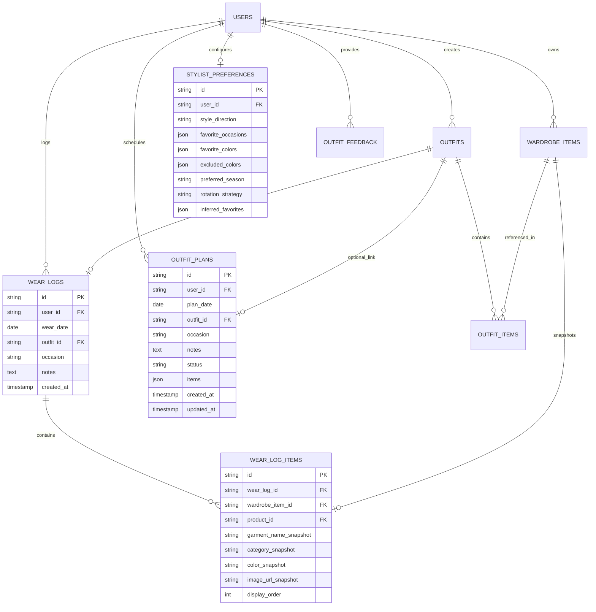

# DRAPE STUDIO — Technical Architecture & Specification
## Personal AI Fashion Stylist, Outfit Intelligence & Wear Tracking

---

## 1. Executive Summary

**DRAPE STUDIO** is the intelligent fashion companion and styling engine for DRAPE, connecting customer-owned digital wardrobe vaults with daily recommendation intelligence, historical wear logging, wardrobe rotation analytics, and scheduled outfit planning.

Unlike conventional e-commerce platforms that rely on generic algorithmic merchandising or superficial chatbots, DRAPE Studio is built upon:
1. **Deterministic, Explainable Scoring:** Recommendations are generated from customer-owned garments and scored across Category Compatibility (25%), Color Harmony (20%), Occasion Suitability (20%), Preference Match (15%), Rotation Health & Repeat Suppression (15%), and Novelty / Feedback (5%).
2. **Wear Diary & Historical Logging (`/wardrobe/history`):** Complete, timezone-safe wear diary with monthly calendar visualization and immutable garment snapshots that persist even if original items are altered or removed.
3. **Smart Repeat Prevention & Rotation Strategies:** Usage analytics tracking total wears, last worn dates, and 7/30-day frequency with configurable rotation strategies (`balanced`, `avoid_recent`, `max_variety`).
4. **Outfit Planning (`/wardrobe/planner`):** Forward-looking outfit scheduling with one-click conversion to permanent historical wear records.
5. **Personal Style Evolution:** Real-time synthesis of declared customer preferences and observed wear behaviors into transparent, editorial style insights.

---

## 2. System Architecture & Domain Model

### 2.1 Database Schema Additions (`0007_wear_logs_and_planner`)
- `wear_logs`: Stores historical outfit records with foreign key cascade to `users.id` and indexed `wear_date`.
- `wear_log_items`: Immutable snapshots containing `garment_name_snapshot`, `category_snapshot`, `color_snapshot`, and `image_url_snapshot` with `ondelete='SET NULL'` for `wardrobe_item_id` ensuring zero historical data loss.
- `outfit_plans`: Stores scheduled future outfits with `status` (`"planned"`, `"worn"`, `"cancelled"`).
- `stylist_preferences`: Extended with `rotation_strategy` (`VARCHAR(32)`, default `'balanced'`) and `inferred_favorites` (`JSON`).

---

## 3. Intelligent Recommendation Engine

The recommendation engine (`POST /api/v1/wardrobe/recommendations/generate`) operates entirely locally on customer-owned items in PostgreSQL. It executes in six distinct phases:

### 3.1 Scoring Formulation

$$\text{Final Score} = 0.25 C_{\text{cat}} + 0.20 H_{\text{color}} + 0.20 S_{\text{occ}} + 0.15 P_{\text{pref}} + 0.15 R_{\text{rot}} + 0.05 N_{\text{nov}}$$

1. **Category Compatibility ($C_{\text{cat}}$ - 25%):**
   - Top + Bottom pair, or Dress ensemble: $1.00$.
   - Single item fallback: $0.65$.
   - Unconventional combination: $0.75$.
2. **Color Harmony ($H_{\text{color}}$ - 20%):**
   - Monochrome or All-Neutral palette: $0.98$.
   - Neutral + Earth tone synergy: $0.92$.
   - Complementary palette: $0.85$.
   - Unbalanced tones: $0.78$.
3. **Occasion Suitability ($S_{\text{occ}}$ - 20%):**
   - Evaluates garment textiles and silhouettes against selected occasion (`casual`, `office`, `evening`, `formal`, `weekend`).
   - Tailored trousers + clean top for Office: $0.96$.
   - Dark slip/midi dress for Evening/Formal: $0.98$.
   - Heavyweight denim + cotton crew for Casual/Weekend: $0.98$.
4. **Preference Match ($P_{\text{pref}}$ - 15%):**
   - Base match: $0.80$.
   - Contains customer's favorite colors: $+0.20$.
   - Contains customer's excluded colors: $-0.40$.
   - Clamped within $[0.0, 1.0]$.
5. **Rotation Health & Repeat Suppression ($R_{\text{rot}}$ - 15%):**
   - Queries `WearLog` records over the past 30 days.
   - For each garment, calculates days since last worn ($D$):
     - $D \le 1$ day: item penalty $= 0.40$
     - $2 \le D \le 3$ days: item penalty $= 0.22$
     - $4 \le D \le 7$ days: item penalty $= 0.08$
     - $D > 7$ days or never worn: item penalty $= 0.00$
   - Computes average garment penalty across the ensemble, applying a stacking penalty ($+0.15$) if multiple pieces were worn recently.
   - Multiplies penalty by strategy multiplier:
     - `avoid_recent`: $1.8\times$ multiplier (strictly demotes recent pieces).
     - `max_variety`: $1.3\times$ multiplier, plus $+0.12$ bonus if all pieces are unworn $> 30$ days.
     - `balanced`: $1.0\times$ multiplier.
   - $R_{\text{rot}} = \text{clamp}(1.0 - \text{applied\_penalty} + \text{variety\_bonus}, 0.10, 1.0)$.
6. **Novelty & Feedback ($N_{\text{nov}}$ - 5%):**
   - Liked or saved combinations: $1.00$.
   - Previously skipped or disliked combinations: downweighted to $0.15$.
   - Unseen combinations: $0.85$.

### 3.2 Explainable Rationale Tags
Every recommendation returns an explicit list of editorial rationale tags (`reasons`) rendered as visual chips:
- `"Fresh Rotation (Unworn 30+ Days)"`
- `"Well Rotated (Resting > 7 Days)"`
- `"Monochrome / Neutral Harmony"`
- `"High Palette Synergy"`
- `"Tailored for Casual / Office"`
- `"Matches Favorite Palette"`

---

## 4. API Endpoints Reference

All endpoints conform to RFC 9457 error contracts and enforce strict customer IDOR isolation:

| Method | Path | Summary | Auth Required |
|---|---|---|---|
| `GET` | `/api/v1/wardrobe/stylist/daily` | Today's curated pick, greeting, weather context, and stylist tip | Yes (Bearer) |
| `POST` | `/api/v1/wardrobe/recommendations/generate` | Multi-factor scored outfit recommendations | Yes (Bearer) |
| `POST` | `/api/v1/wardrobe/recommendations/feedback` | Record customer action (like, dislike, save, worn) | Yes (Bearer) |
| `POST` | `/api/v1/wardrobe/wear-logs` | Record outfit worn with immutable garment snapshots | Yes (Bearer) |
| `GET` | `/api/v1/wardrobe/wear-logs` | Query wear logs with optional `days` / date filters | Yes (Bearer) |
| `GET` | `/api/v1/wardrobe/wear-logs/{id}` | Retrieve individual wear log | Yes (Bearer) |
| `DELETE` | `/api/v1/wardrobe/wear-logs/{id}` | Delete wear log | Yes (Bearer) |
| `GET` | `/api/v1/wardrobe/rotation` | Rotation analytics: most worn, least worn, usage status | Yes (Bearer) |
| `GET` | `/api/v1/wardrobe/planner` | List scheduled outfit plans | Yes (Bearer) |
| `POST` | `/api/v1/wardrobe/planner` | Schedule an outfit for an upcoming date | Yes (Bearer) |
| `PATCH` | `/api/v1/wardrobe/planner/{id}` | Update date, occasion, notes, or status of a plan | Yes (Bearer) |
| `DELETE` | `/api/v1/wardrobe/planner/{id}` | Cancel / delete planned outfit | Yes (Bearer) |
| `POST` | `/api/v1/wardrobe/planner/{id}/mark-worn` | Mark plan as worn and convert to a permanent `WearLog` | Yes (Bearer) |
| `GET` | `/api/v1/wardrobe/style-profile` | Behavioral profile: palette distribution & insights | Yes (Bearer) |
| `GET` | `/api/v1/wardrobe/preferences` | Retrieve stylist preferences | Yes (Bearer) |
| `PUT` | `/api/v1/wardrobe/preferences` | Update stylist preferences & rotation strategy | Yes (Bearer) |
| `GET` | `/api/v1/wardrobe/complete-look` | Gap analysis & genuine catalog suggestions | Yes (Bearer) |

---

## 5. Frontend Pages & User Journey

### 5.1 DRAPE Studio Overview (`/wardrobe/studio`)
- **Daily Stylist Briefing:**
  - Dynamic greeting based on customer first name and time of day.
  - Date banner and seasonal weather guidance.
  - Recent wear alert indicating items worn yesterday and how today's recommendation rotates to fresh silhouettes.
  - Hero "Today's Curated Pick": multi-garment presentation, harmony score, explainability chips, and action buttons:
    - **Wear Today:** Instantly logs the outfit to `WearLog` for today with success feedback.
    - **Save Outfit:** Saves to customer's permanent outfit archive.
    - **Shuffle Pick:** Generates an alternative daily combination.
    - **Feedback:** Heart (like) or Thumbs Down (dislike).
    - **3D Try-On:** Direct launch of virtual fitting for compatible garments.
- **Curated Occasions:**
  - Interactive occasion pills (Casual, Office, Evening, Formal, Weekend).
  - Multi-garment cards with score breakdowns and quick-action buttons.
- **Wardrobe Circulation & Rotation Health:**
  - Live rotation strategy switcher (`Balanced`, `Avoid Recent`, `Max Variety`).
  - Most Worn vs Candidates for Rotation (Unworn) showcase with wear count chips.
  - Quick action links to Wear Diary and Outfit Planner.
- **Personal Style Profile:**
  - Real-time color palette distribution bar charts.
  - Category breakdown.
  - Dynamic editorial observations.
- **Discover Your Next Piece:**
  - Automated wardrobe gap analysis highlighting under-represented categories.
  - Real catalog items with authentic pricing, photography, and 3D Try-On links.

### 5.2 Wear Diary & Visual Calendar (`/wardrobe/history`)
- Full interactive monthly calendar with previous/next month navigation.
- Days marked with visual indicators where outfits were logged.
- Clicking any date displays the exact historical outfits worn on that day.
- Timeframe filters: `7 Days`, `30 Days`, `90 Days`, `All Time`.
- "Log Worn Outfit" modal enabling retrospective or custom wear entry with multi-garment selector from customer's vault.

### 5.3 Outfit Planner (`/wardrobe/planner`)
- Forward-looking schedule view for upcoming dates.
- Relative date badges ("Today", "Tomorrow", "In 3 days").
- "Schedule Outfit" modal allowing customers to pick future dates, assign occasions, and select garments.
- Prominent **"Mark As Worn"** button that automatically converts the planned outfit into a permanent `WearLog` entry and updates the status to "Worn".

---

## 6. Verification & Test Evidence

| Test Suite | Tests Run | Result | Key Capabilities Verified |
|---|---|---|---|
| `test_drape_studio.py` | 7 | **7 Passed** | Daily stylist greeting, wear logging snapshots, rotation repeat suppression, rotation analytics, outfit planning, mark-worn conversion, style profile, IDOR security. |
| Backend Pytest Suite | 109 | **109 Passed** | Complete backend verification: auth, catalog, orders, cart, addresses, payments, wardrobe, stylist, security. |
| Commerce Suite (`test:commerce`) | 21 | **21 Passed** | Assortment integrity, integer currency, variant stock, search, filtering, and 3D garment registry mapping. |
| AR Fitting Baseline (`test:ar`) | 284 | **284 Passed** | 100% frozen AR baseline: calibration, camera intrinsics, instant depth, deformation, XPBD cloth dynamics. |
| 3D Garment Assets (`validate:garments`) | 8 | **8 Passed** | Canonical GLB meshes, vertex counts, anchors, and XPBD simulation data. |
| Next.js Production Build | 23 routes | **Compiled Clean** | TypeScript validation, static page generation, and zero ESLint warnings. |
