# DRAPE — Garment Asset Pipeline Specification

**Status:** Technical Specification & Engineering Standard  
**Author:** DRAPE 3D Studio & Core Engineering  
**Date:** November 2026  
**Target:** Production-Grade 3D Garment Authoring, Rigging & WebGL Deployment

---

## 1. Executive Summary

A virtual try-on engine cannot produce realistic fashion experiences from procedural geometric primitives. The 8 GLB models currently in `frontend/public/garments/` were generated by a procedural Node.js script (`generate-garments.mjs`). While sufficient for early mathematical sanity checks, they consist of primitive lofted cylinders and ellipses with artificial seams, unarticulated rigid sleeves, and non-draping topology.

This document defines the **DRAPE Garment Asset Pipeline**: an end-to-end specification for transforming authentic fashion patterns into high-performance, rigged, size-graded 3D digital garments optimized for real-time WebGL rendering.

---

## 2. Forensic Analysis: Current Procedural Assets vs. Production Requirements

| Feature | Current Procedural Assets (`generate-garments.mjs`) | Production Fashion Garment Requirement |
|---|---|---|
| **Geometry Source** | Extruded mathematical tubes (circles/ellipses) with synthetic parametric coordinates. | Authentic 2D sewing patterns (front/back bodice, sleeves, collars, yokes) simulated and draped. |
| **Sleeve Topology** | Rigid tubes pointing down at $43^\circ$. No internal armhole connection; seam bound via barycentric torso triangles. | Continuous manifold mesh with radial edge loops around the armhole seam, fully integrated into the bodice. |
| **Polygon Count** | $1,200 - 3,500$ triangles per garment. Very coarse; facet artifacts visible on curves. | $8,000 - 18,000$ optimized triangles. Captures natural fabric folds, lapels, and silhouettes. |
| **Materials & Shading** | Generic procedural three-color uniforms with synthetic canvas noise. | Baked PBR textures: Tangent-Space Normal, Micro-Sheen, Roughness, Metalness, Ambient Occlusion (AO). |
| **Arm Articulation** | **Zero.** Sleeves are unarticulated rigid bodies (`SleeveRig([])`). | **Full.** Rigged to a standard humanoid armature using GPU Linear Blend Skinning (LBS). |
| **Size Grading** | Uniform scaling multiplier ($s = 1.12 \cdot W_{\text{body}} / W_{\text{seam}}$). Distorts fabric proportions. | S, M, L, XL Morph Targets (Shape Keys) conforming to standard apparel grade rules. |

---

## 3. End-to-End Asset Creation Pipeline

```mermaid
flowchart LR
    A[Fashion CAD<br/>CLO3D / Marvelous Designer] -->|High-Poly Mesh<br/>Quad Draped Surface| B[DCC Retopology<br/>Blender 4.x]
    B -->|Clean Topology<br/>10k-15k Tris| C[PBR Material Baking<br/>Substance / Blender]
    C -->|Normal, Sheen, AO| D[Armature Rigging & Weighting<br/>Blender Humanoid Bones]
    D -->|Skinned Mesh| E[Size Grading Morphs<br/>S, M, L, XL Shape Keys]
    E -->|glTF 2.0 / GLB| F[Asset Validation CLI<br/>validate-garment.mjs]
    F -->|Validated Asset| G[CDN / Object Storage<br/>AWS S3 / Cloud Storage]
```



---

### Step 1: Pattern Authoring & Draping (CLO3D / Marvelous Designer)
Garment assets originate in industry-standard fashion CAD software (CLO3D or Marvelous Designer):
1. **True Pattern Construction:** Garments are drafted as real 2D pattern pieces (front panel, back panel, sleeves, collar, cuffs, pockets, facings) according to physical apparel specs.
2. **Fabric Physical Presets:** Fabrics are assigned authentic physical parameters:
   - Bending stiffness (warp/weft).
   - Stretch resistance (Hookean modulus).
   - Shear resistance.
   - Fabric weight ($\text{g/m}^2$).
3. **Avatar Draping:** The garment is sewn and relaxed around a standardized neutral humanoid avatar (T-pose or A-pose with arms angled at $35^\circ$).
4. **Export:** Exported as high-resolution triangulated/quad OBJ or FBX with physical seam boundaries preserved.

---

### Step 2: Retopology & UV Layout (Blender)
The raw simulation mesh from CLO3D is typically too dense ($150,000 - 300,000$ vertices) and unstructured for real-time mobile WebGL.
1. **Target Polygon Budget:**
   - **Tops / T-Shirts:** $8,000 - 12,000$ triangles.
   - **Tailored Jackets / Coats:** $14,000 - 20,000$ triangles.
   - **Skirts / Dresses:** $10,000 - 16,000$ triangles.
   - **Pants / Trousers:** $10,000 - 14,000$ triangles.
2. **Edge Flow & Deformation Loops:**
   - Circular edge loops must encircle the armhole and shoulder cap to permit distortion-free bending during arm raises.
   - Horizontal loops across the elbow and shoulder joints must be spaced to avoid pinching (bunching artifacts) under Linear Blend Skinning.
3. **UV Packing:** Single UDIM tile ($0, 1$) optimized for $2048 \times 2048$ PBR texture atlases with zero overlapping islands (except mirrored symmetric elements where appropriate).

---

### Step 3: Material & Texture Baking
To render luxury fabrics (cashmere, silk, heavy twill, ribbed cotton) with physical realism in Three.js `MeshPhysicalMaterial`:
1. **Tangent-Space Normal Map:** High-poly fabric folds, seams, stitches, and micro-weave are baked onto the low-poly mesh.
2. **Roughness & Metalness Map:** Encodes micro-reflectivity variations between fabric yarn, buttons, and metal zippers.
3. **Sheen Roughness & Sheen Color Map:** Critical for luxury textiles (velvet, silk, fine merino) to simulate retro-reflective edge sheen.
4. **Ambient Occlusion (AO):** Contact shadows in armpits, under collars, and inside folds.

---

### Step 4: Standardized Skeletal Rigging
The core limitation of previous implementations was treating sleeves as separate disconnected meshes. In DRAPE production assets, the garment is rigged to a **standard humanoid armature**:

```
Armature Root
 └── Pelvis (Root motion)
      ├── Spine_01 (Waist)
      │    └── Spine_02 (Chest)
      │         ├── Neck
      │         │    └── Head
      │         ├── Clavicle_L
      │         │    └── Shoulder_L (Glenohumeral joint)
      │         │         └── UpperArm_L
      │         │              └── Forearm_L
      │         │                   └── Hand_L
      │         └── Clavicle_R
      │              └── Shoulder_R
      │                   └── UpperArm_R
      │                        └── Forearm_R
      │                             └── Hand_R
      ├── Thigh_L (Hip joint)
      │    └── Calf_L
      └── Thigh_R
           └── Calf_R
```

#### Skinning Weight Painting Standards:
- **Torso / Chest:** Weighted $100\%$ to `Spine_02` and `Chest`.
- **Armhole Seam (Continuous Manifold):** Vertices directly along the armhole seam are weighted smoothly between `Spine_02` ($30\%$), `Clavicle_L` ($20\%$), and `UpperArm_L` ($50\%$).
- **Sleeves:** Upper sleeve weighted to `UpperArm_L`; forearm sleeve weighted to `Forearm_L`.
- **Zero-Tear Guarantee:** Because the torso and sleeve share vertex indices across the armhole, **the seam can never physically tear or separate**, regardless of arm rotation.

---

### Step 5: Size Grading via Morph Targets (Shape Keys)
Garments must fit different body dimensions without unnatural non-uniform stretching:
1. **Standard Garment Grading:** In fashion production, moving from Small to Large does not scale length and width identically. Sleeve lengths grow by $1.5\text{ cm}$, while chest circumferences grow by $6\text{ cm}$.
2. **Morph Targets in glTF:** Every production garment GLB includes four standard morph targets:
   - `size_XS`: Scaled down along grading rules.
   - `size_S`: Slim tailored profile.
   - `size_L`: Broad chest and relaxed waist profile.
   - `size_XL`: Plus-sized chest, waist, and sleeve girths.
3. **Runtime Interpolation:** Three.js dynamically blends morph weights ($w_{\text{S}}, w_{\text{M}}, w_{\text{L}}$) on the GPU based on user body proportions, achieving tailored sizing without CPU vertex recalculation.

---

## 4. Minimum Viable Garment Asset Specification (MVGAS v1)

All production 3D garments accepted by the DRAPE pipeline must conform to this schema:

### 4.1 File Format & Delivery
- **Container:** Binary glTF 2.0 (`.glb`).
- **Maximum File Size:** $\le 4.5\text{ MB}$ (uncompressed), $\le 1.8\text{ MB}$ with Draco or Meshopt compression.
- **Coordinates:** Standard glTF $+Y$ up, $+Z$ forward (out of chest), $+X$ wearer's right (model's left). Units: meters ($1.0 = 1\text{ meter}$).

### 4.2 Scene Graph & Node Structure
```
Garment_Root (Group)
 ├── Armature (Skeleton / Bones)
 │    └── Pelvis ... (Hierarchical bone nodes)
 └── Garment_Mesh (SkinnedMesh)
      ├── Geometry (Position, Normal, UV0, SkinIndex, SkinWeight, MorphAttributes)
      └── Material (MeshPhysicalMaterial with PBR textures)
```

### 4.3 Embedded Metadata Contract (`metadata.json`)
Accompanying each GLB, a validated `metadata.json` defines sizing and physics bindings:

```json
{
  "$schema": "https://drape.fashion/schemas/garment-v1.json",
  "id": "cashmere-crewneck-noir",
  "name": "Seamless Cashmere Crewneck",
  "category": "tops",
  "sku": "KNIT-CRW-001",
  "modelUrl": "/garments/cashmere-crewneck-noir/model.glb",
  "rigging": {
    "type": "skinned_humanoid_v1",
    "armatureRoot": "Armature",
    "primaryBones": ["Spine_02", "UpperArm_L", "UpperArm_R", "Forearm_L", "Forearm_R"],
    "hasSleeves": true,
    "sleeveLength": "long"
  },
  "grading": {
    "morphTargets": ["size_XS", "size_S", "size_L", "size_XL"],
    "baseSize": "M",
    "gradeDimensionsCm": {
      "S": { "chest": 92, "length": 66, "sleeve": 62 },
      "M": { "chest": 98, "length": 68, "sleeve": 64 },
      "L": { "chest": 104, "length": 70, "sleeve": 66 },
      "XL": { "chest": 112, "length": 72, "sleeve": 67 }
    }
  },
  "secondaryPhysics": {
    "enabled": true,
    "target": "hem_only",
    "simMeshName": "Garment_Mesh",
    "pinnedVertexThreshold": 0.85,
    "damping": 0.04,
    "stiffness": 0.75
  }
}
```

---

## 5. Automated Pipeline Validation CLI (`validate-garment.mjs`)

Before any asset is published to the catalog CDN, an automated script validates compliance:
1. Verifies that the GLB contains a valid `SkinnedMesh` with non-zero bone weights.
2. Checks that all vertex positions are in meters (bounding box height between $0.3\text{ m}$ and $1.8\text{ m}$).
3. Ensures texture resolutions do not exceed $2048 \times 2048$.
4. Validates that vertex normals are unit-length and watertight.
5. Rejects any asset containing loose disconnected sleeve meshes.

