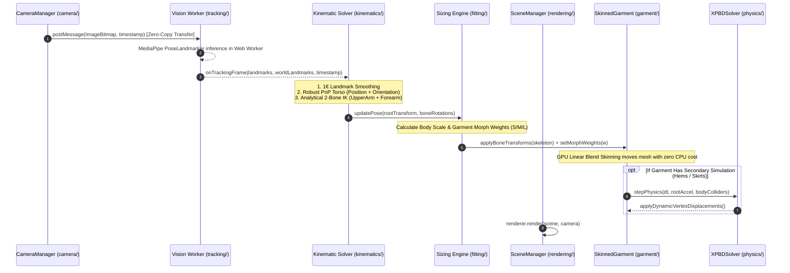

# DRAPE — Revised AR Virtual Try-On Architecture

**Status:** Target Architectural Specification (Approved for Milestone Construction)  
**Author:** DRAPE Core Engineering  
**Date:** November 2026  
**Target:** Modular, Production-Grade, Skinned WebGL AR Try-On Engine

---

## 1. Architectural Philosophy & Core Principles

The DRAPE AR Virtual Try-On Engine is designed around five non-negotiable architectural principles:

1. **Decoupled Subsystems with Typed Contracts:** Tracking, anthropometric sizing, skeletal kinematics, cloth simulation, and rendering are separate, independently testable layers. A tracking library swap (e.g. MediaPipe to an in-house model) must never require altering the rendering or physics code.
2. **GPU Skeletal Primary Motion, Localized Secondary Dynamics:** Garment sleeves and torsos are driven by standard GPU skeletal skinning (`SkinnedMesh`). Arm articulation is immediate and zero-CPU. Physical simulation (XPBD) is localized to hanging fabric hems and loose drapery.
3. **No Brute-Force Coordinate Overrides:** All 3D transformations are derived from verified pinhole camera geometry. Lateral "pinning" hacks and hardcoded scalar overrides are strictly prohibited.
4. **Off-Main-Thread Computer Vision:** Neural network inference executes inside a dedicated Web Worker, preventing frame drops on the UI and Three.js render thread.
5. **Frame-Synchronized Video Presentation:** The displayed video feed is synchronized with the pose inference timestamp to eliminate the visual "trailing garment" lag.

---

## 2. Target Directory & Subsystem Layout

```
frontend/src/lib/ar/
├── camera/                       # Hardware Camera Capture & Intrinsics
│   ├── camera-manager.ts         # getUserMedia stream lifecycle, device switching
│   ├── camera-intrinsics.ts      # Focal length prior (fx, fy), card calibration
│   └── display-transform.ts      # CSS object-fit: cover mapping & screen projection
├── tracking/                     # Computer Vision & Landmark Extraction
│   ├── worker/                   # Vision Web Worker (MediaPipe Tasks WASM)
│   │   ├── vision.worker.ts      # Worker message handler & neural model instance
│   │   └── transferable.ts       # ImageBitmap / VideoFrame transfer serialization
│   ├── tracking-bridge.ts        # Main-thread Worker client & promise messaging
│   └── landmark-filter.ts        # 1€ Filter for temporal jitter suppression
├── kinematics/                   # Skeletal Solvers & Joint Transforms
│   ├── humanoid-skeleton.ts      # Three.js Skeleton rig matching MediaPipe joints
│   ├── ik-arm-solver.ts          # Two-bone Analytical IK for arms (Shoulder-Elbow-Wrist)
│   └── robust-pnp-solver.ts      # Levenberg-Marquardt torso orientation & depth
├── fitting/                      # Anthropometric Modeling & Garment Sizing
│   ├── body-avatar.ts            # Parametric humanoid proxy & depth occluder
│   ├── anthropometry.ts          # Height-conditioned body dimension estimators
│   └── size-grading.ts           # S/M/L/XL morph target weight solver
├── garment/                      # 3D Garment Asset & Skinned Instances
│   ├── garment-loader.ts         # GLTF/GLB loader with DRACO/Meshopt decompression
│   ├── skinned-garment.ts        # SkinnedMesh instance, bone bindings & materials
│   └── fabric-materials.ts       # MeshPhysicalMaterial luxury PBR shaders
├── physics/                      # Secondary Dynamics & Cloth Physics
│   ├── xpbd-solver.ts            # Localized XPBD (distance, bending, collision)
│   ├── cloth-mesh-binding.ts     # Particle-to-vertex weight mapping
│   └── collision-proxy.ts        # Analytic capsule & torso SDF collisions
├── rendering/                    # Three.js WebGL Presentation Layer
│   ├── scene-manager.ts          # Three.js scene graph, renderer, lighting
│   └── render-loop.ts            # requestAnimationFrame driver & timing stats
├── session/                      # Diagnostic Recording & Replay Protocol
│   ├── session-recorder.ts       # In-memory tracking frame ring buffer
│   └── session-schema.ts         # Validated replay schema
└── types.ts                      # Shared public TypeScript interfaces
```

---

## 3. Subsystem Contracts & Execution Pipeline



---

## 4. Key Subsystem Specifications

### 4.1 Subsystem 1: Tracking & Web Worker Boundary (`tracking/`)
- **Worker Isolation:** The MediaPipe WASM binary and `pose_landmarker_lite.task` model are initialized inside a dedicated Web Worker (`vision.worker.ts`).
- **Zero-Copy Frame Transfer:** Video frames are grabbed on the main thread via `createImageBitmap(videoElement)` and transferred to the worker as `Transferable` objects.
- **Contract:** Emits a strongly typed `TrackingFrame`:
```typescript
export interface TrackingFrame {
  timestamp: number;
  landmarks2D: Array<{ x: number; y: number; z: number; visibility: number }>;
  worldLandmarks3D: Array<{ x: number; y: number; z: number }>;
  inferenceDurationMs: number;
}
```

### 4.2 Subsystem 2: Kinematic Rig & Arm IK (`kinematics/`)
- **Humanoid Armature:** A standard Three.js `Skeleton` representing the upper body:
  `Pelvis`, `Spine`, `Chest`, `Neck`, `Clavicle_L/R`, `Shoulder_L/R`, `UpperArm_L/R`, `Forearm_L/R`, `Wrist_L/R`.
- **Arm Articulation via Analytical Two-Bone IK:**
  Instead of attempting to compute full 3D limb rotations from noisy MediaPipe world landmarks, DRAPE implements a fast, closed-form **Two-Bone Analytical IK solver**:
  1. The shoulder joint is the fixed root origin.
  2. The target wrist position is determined by back-projecting the 2D wrist landmark along its estimated depth ray.
  3. The elbow position determines the swivel plane.
  4. Quaternions for `UpperArm` and `Forearm` are computed algebraically in $<0.1\text{ ms}$ on the CPU.
- **Elimination of Seam Tearing:** Because the garment mesh is skinned across these bones, **sleeves articulate naturally with the arms with zero seam tearing**.

### 4.3 Subsystem 3: Garment Asset & Skinned Instance (`garment/`)
- **GPU Skinning Execution:** Loaded garments are instances of Three.js `SkinnedMesh`.
- **Zero CPU Vertex Manipulation:** During regular movement, vertex transformations are computed entirely on the GPU vertex shader:
  $$v_{\text{skinned}} = \sum_{i=1}^4 w_i \cdot \left( M_i \cdot B_i^{-1} \right) v_{\text{rest}}$$
  This eliminates the CPU vertex buffers and normal recomputations that throttled previous implementations.

### 4.4 Subsystem 4: Localized XPBD Secondary Physics (`physics/`)
- **Simulation Scope:** Confined strictly to loose, non-skeletal garment elements (skirt hems, dress bottoms, loose coat tails).
- **Coupling Mechanism:**
  - Pinned particles are locked to the underlying skinned mesh positions.
  - Free particles undergo XPBD integration (Hookean distance, bending, gravity, and body collider SDF).
  - Particle displacements are added to the skinned mesh vertices via a dynamic vertex offset buffer.

---

## 5. Latency Budget & Synchronization Strategy

### 5.1 Pipeline Latency Breakdown
To achieve a visually convincing virtual try-on experience, end-to-end latency must remain below $60\text{ ms}$ (less than 2 video frames at 30 fps):

| Pipeline Stage | Processing Target | Execution Context | Optimization Strategy |
|---|---|---|---|
| **Camera Capture** | $0 - 1\text{ ms}$ | Hardware / Browser | Native `requestVideoFrameCallback` |
| **Frame Transfer** | $1 - 2\text{ ms}$ | Main $\to$ Worker | `createImageBitmap` Transferable transfer |
| **MediaPipe Pose** | $18 - 25\text{ ms}$ | Web Worker (WASM/GPU) | Lite model, confidence thresholds 0.5 |
| **Landmark 1€ Filter** | $< 0.2\text{ ms}$ | Web Worker / Main | Inlined mathematical filter |
| **Kinematic Arm IK** | $< 0.5\text{ ms}$ | Main Thread | Analytical closed-form trigonometry |
| **Morph Target Sizing** | $< 0.1\text{ ms}$ | GPU Shader | Uniform blend weights |
| **XPBD Cloth (Hems)** | $2 - 4\text{ ms}$ | Main Thread / Worker | Capped at $< 250$ particles |
| **Three.js WebGL Render**| $4 - 6\text{ ms}$ | GPU (Main Thread) | PBR materials, single draw call per garment |
| **TOTAL LATENCY** | **$26 - 38\text{ ms}$** | | **Stable 30-60 fps virtual try-on** |

### 5.2 Eradication of the "Trailing Garment" Lag
In the previous implementation, the `<video>` element rendered the live webcam feed with 0 ms display delay, while the garment was drawn from landmarks that were $35\text{ ms}$ old, causing the garment to trail behind the user's body.

**The Solution: Synchronized Video Presenter (`frame-presenter.ts`):**
1. Incoming camera frames are buffered in an `OffscreenCanvas` queue with their capture timestamps.
2. The video frame is rendered to the canvas **in the exact same animation tick as the corresponding garment pose render**.
3. The customer sees their own body and the virtual garment moving in perfect 1:1 temporal lockstep.

