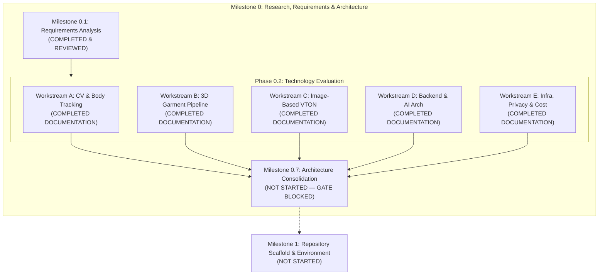

# DRAPE — AIDLC Agent Handoff and Takeover

**Document:** Formal Agent Handoff & Repository Baseline  
**Outgoing Agent:** Codex  
**Incoming Agent:** Antigravity  
**Takeover Date:** 2026-11-05  
**Current AIDLC Phase:** Phase 0.2 — Technology Evaluation  
**Current Milestone Position:** M0: Research, requirements and architecture (M0.7 Architecture Consolidation NOT started; M1 Repository Scaffold NOT started)  
**Implementation Authorization:** **NONE. No application implementation, scaffolding, package installation, database migration, cloud resource creation, or model execution is authorized.**

---

## 1. Project Overview

DRAPE is a web-first, global fashion e-commerce platform combining premium editorial discovery with four primary product pillars:

1. **Fashion E-Commerce:** Product catalog, collection navigation, search and filtering, variant selection, cart, checkout, and authenticated order history.
2. **Hybrid Virtual Try-On:**
   - *Live camera-based 3D try-on:* Real-time in-browser garment preview using WebGL/Three.js registered over pose landmarks.
   - *Image-based AI virtual try-on:* Asynchronous photo-based synthetic garment-on-person preview.
   - *Core principle:* All try-on capabilities are strictly visual previews, never physical fit, size, drape, comfort, or measurement guarantees.
3. **Smart Digital Wardrobe:** Private wardrobe populated automatically from completed orders and supplemented by user-entered garments; supports outfit composition and management.
4. **AI Fashion Stylist:** Personalized, explainable outfit and complement recommendations grounded strictly in owned wardrobe items, available catalog data, and stated user preferences.

DRAPE follows an explicit **AI-Driven Development Life Cycle (AIDLC)** with milestone-based research, independent review gates, and explicit human owner approval before moving between phases.

---

## 2. Current AIDLC Phase and Milestone

- **Current Phase:** Phase 0.2 — Technology Evaluation.
- **Current Milestone Position:** M0 (Research, requirements and architecture).
- **Completed Milestones:**
  - Milestone 0.1: Requirements Analysis (Completed 2026-11-04; external review completed and incorporated into foundation documents).
- **Completed Research Workstreams in Phase 0.2:**
  - Workstream A: Computer Vision and Body Tracking ([AR_RESEARCH.md](file:///Users/soham/Github/Drape/docs/research/AR_RESEARCH.md)).
  - Workstream B: 3D Rendering and Garment Engineering ([GARMENT_PIPELINE_RESEARCH.md](file:///Users/soham/Github/Drape/docs/research/GARMENT_PIPELINE_RESEARCH.md)).
  - Workstream C: Image-Based AI Virtual Try-On ([VTON_RESEARCH.md](file:///Users/soham/Github/Drape/docs/research/VTON_RESEARCH.md)).
  - Workstream D: Backend, Database and AI Architecture ([BACKEND_DATABASE_AI_ARCHITECTURE_RESEARCH.md](file:///Users/soham/Github/Drape/docs/research/BACKEND_DATABASE_AI_ARCHITECTURE_RESEARCH.md)).
  - Workstream E: Infrastructure, Privacy and Cost ([INFRASTRUCTURE_PRIVACY_COST_RESEARCH.md](file:///Users/soham/Github/Drape/docs/research/INFRASTRUCTURE_PRIVACY_COST_RESEARCH.md)).
- **Milestones Not Started:**
  - **M0.7 Architecture Consolidation:** NOT started. Awaiting external review and approval of Phase 0.2 reports.
  - **M1 Repository Scaffold and Environment:** NOT started.
  - **M2 through M7:** NOT started.

---

## 3. Repository State at Takeover

A complete audit of the repository was performed on 2026-11-05:

- **Repository Root:** `/Users/soham/Github/Drape`
- **Git Branch:** `main`
- **Commit History:** No commits exist yet on `main` (initial empty repository).
- **Git Status:** Working tree clean of tracked files; untracked documentation files and untracked reference prototype present.
- **Tracked Files:** 0.
- **Untracked Files (12 documentation files + 1 reference prototype):**
  - `prototype.html` (75,980 bytes, pre-existing legacy prototype).
  - `docs/aidlc/PROJECT_BRIEF.md`
  - `docs/aidlc/PRD.md`
  - `docs/aidlc/RISK_REGISTER.md`
  - `docs/aidlc/REQUIREMENTS_TRACEABILITY.md`
  - `docs/aidlc/NEXT_SESSION.md`
  - `docs/aidlc/ANTIGRAVITY_HANDOFF.md`
  - `docs/research/PHASE_0_2_RESEARCH_PLAN.md`
  - `docs/research/AR_RESEARCH.md`
  - `docs/research/GARMENT_PIPELINE_RESEARCH.md`
  - `docs/research/VTON_RESEARCH.md`
  - `docs/research/BACKEND_DATABASE_AI_ARCHITECTURE_RESEARCH.md`
  - `docs/research/INFRASTRUCTURE_PRIVACY_COST_RESEARCH.md`
- **Application Code:** None exists.
- **Build / Dependency Manifests:** None exist (`package.json`, `pyproject.toml`, etc. are absent).
- **Infrastructure / Cloud Resources:** None exist.

---

## 4. Completed Milestones and Workstreams

### Summary of Completed Workstreams

1. **Phase 0.1 Requirements Analysis:**
   - Formulated 18 Functional Requirements (`FR-001` to `FR-018`), 10 Non-Functional Requirements (`NFR-001` to `NFR-010`), 8 UX Requirements (`UX-001` to `UX-008`), and 7 Security/Privacy Requirements (`SEC-001` to `SEC-007`).
   - Identified and ranked 16 project risks (`RSK-001` to `RSK-016`).
   - Built full requirement-to-journey and milestone traceability matrix across M0–M7.
2. **Workstream A (CV & Body Tracking):**
   - Evaluated MediaPipe Tasks Vision Pose Landmarker (Lite/Full/Heavy), MoveNet (Lightning/Thunder), ONNX Runtime Web, and OpenCV.
   - Clarified that monocular 2D/world landmarks provide coarse visual registration only; they do not reconstruct 3D body volume or compute anthropometric measurements.
   - Defined on-device evaluation protocol for M3.
3. **Workstream B (3D Rendering & Garment Pipeline):**
   - Evaluated Three.js, React Three Fiber (R3F), and Babylon.js against WebGL 2 baseline; positioned WebGPU as progressive enhancement only.
   - Proposed strict asset contract for GLB/glTF with external provenance, license metadata, units, and axes.
   - Recommended authoring path: CLO/Marvelous Designer → Blender → GLB/glTF + external metadata contract.
   - Staged deformation: M4 static/skinned/morph; M5 compare skin/morph vs constrained PBD/mass-spring. Rejected full FEM cloth simulation.
4. **Workstream C (Image-Based Virtual Try-On):**
   - Conducted comprehensive rights and technical review of leading open VTON models (IDM-VTON, CatVTON, StableVITON, VITON-HD, Dress Code).
   - Verified that all major open models and datasets are governed by restrictive non-commercial licenses (CC BY-NC-SA 4.0 or private-company exclusions), blocking commercial production and fine-tuning.
   - Reviewed commercial API options (FASHN, Replicate), highlighting contractual data processing, manual request-record deletion caveats (`legal@fashn.ai`), and lack of immediate API deletion.
   - Decided NO-GO on commercial integration and DEFER on inference evaluation until rights-cleared models and datasets are established.
5. **Workstream D (Backend, Database and AI Architecture):**
   - Evaluated modular monolith vs. microservices; confirmed modular monolith as the preferred research baseline.
   - Established PostgreSQL as authoritative relational source of truth; restricted `jsonb` to non-authoritative evolving metadata.
   - Defined strict domain boundaries: Identity & Consent, Catalog & Commerce, Cart/Orders, Wardrobe/Outfits, Recommendation Provenance, and AI Job Orchestration.
   - Prioritized structured filters and PostgreSQL full-text search before vector retrieval; deferred pgvector.
   - Designed internal versioned job interface for asynchronous execution; deferred separate AI workers and GPU runtimes.
6. **Workstream E (Infrastructure, Privacy and Cost):**
   - Evaluated minimal managed deployment primitives (managed web app, managed PostgreSQL, private object storage).
   - Established browser-local processing as primary privacy strategy; any future remote processing requires explicit consent, approved retention-limited isolated storage, documented deletion rules, and appropriate provider/privacy review.
   - Formulated deletion propagation strategy (primary DB, object storage, CDN cache purge, derived vectors, provider requests, backup lifecycles).
   - Modeled cost sensitivity scenarios and defined measurable scaling triggers before introducing queues, separate workers, or GPUs.

---

## 5. Required Document Index

| Category | Path | Purpose & Scope |
|---|---|---|
| **Foundation** | [`docs/aidlc/PROJECT_BRIEF.md`](file:///Users/soham/Github/Drape/docs/aidlc/PROJECT_BRIEF.md) | High-level framing, product pillars, confirmed decisions, aesthetic direction, success criteria. |
| **Foundation** | [`docs/aidlc/PRD.md`](file:///Users/soham/Github/Drape/docs/aidlc/PRD.md) | Complete functional, non-functional, UX, and security requirements; user personas and journeys. |
| **Foundation** | [`docs/aidlc/RISK_REGISTER.md`](file:///Users/soham/Github/Drape/docs/aidlc/RISK_REGISTER.md) | 16 identified risks across technical, product, licensing, privacy, operational, and commerce domains. |
| **Foundation** | [`docs/aidlc/REQUIREMENTS_TRACEABILITY.md`](file:///Users/soham/Github/Drape/docs/aidlc/REQUIREMENTS_TRACEABILITY.md) | Verification mappings from PRD requirements to M0–M7 milestones and user journeys. |
| **Foundation** | [`docs/aidlc/NEXT_SESSION.md`](file:///Users/soham/Github/Drape/docs/aidlc/NEXT_SESSION.md) | Session continuity ledger, recorded decisions, open questions, and next recommended actions. |
| **Foundation** | [`docs/aidlc/ANTIGRAVITY_HANDOFF.md`](file:///Users/soham/Github/Drape/docs/aidlc/ANTIGRAVITY_HANDOFF.md) | Formal agent handoff, repository baseline, constraint extraction, and takeover acceptance. |
| **Research** | [`docs/research/PHASE_0_2_RESEARCH_PLAN.md`](file:///Users/soham/Github/Drape/docs/research/PHASE_0_2_RESEARCH_PLAN.md) | Execution methodology, primary-source register, prototype inspection, evidence rules. |
| **Research** | [`docs/research/AR_RESEARCH.md`](file:///Users/soham/Github/Drape/docs/research/AR_RESEARCH.md) | Workstream A: Computer Vision, MediaPipe/MoveNet comparison, on-device protocol. |
| **Research** | [`docs/research/GARMENT_PIPELINE_RESEARCH.md`](file:///Users/soham/Github/Drape/docs/research/GARMENT_PIPELINE_RESEARCH.md) | Workstream B: Three.js/R3F, glTF/GLB asset contract, deformation, rights. |
| **Research** | [`docs/research/VTON_RESEARCH.md`](file:///Users/soham/Github/Drape/docs/research/VTON_RESEARCH.md) | Workstream C: Image VTON model licensing, input/output contract, evaluation methodology. |
| **Research** | [`docs/research/BACKEND_DATABASE_AI_ARCHITECTURE_RESEARCH.md`](file:///Users/soham/Github/Drape/docs/research/BACKEND_DATABASE_AI_ARCHITECTURE_RESEARCH.md) | Workstream D: Modular monolith boundaries, PostgreSQL source of truth, retrieval, job port. |
| **Research** | [`docs/research/INFRASTRUCTURE_PRIVACY_COST_RESEARCH.md`](file:///Users/soham/Github/Drape/docs/research/INFRASTRUCTURE_PRIVACY_COST_RESEARCH.md) | Workstream E: Deployment primitives, privacy lifecycle, deletion propagation, cost model. |
| **Reference** | [`prototype.html`](file:///Users/soham/Github/Drape/prototype.html) | Legacy client-side prototype. Reference material only; NOT approved architecture. |

---

## 6. Current Architecture Research Baseline

The current technical direction represents **research preferences and evaluation baselines**, not finalized implementation choices:

| Layer | Research Baseline | Status & Boundaries |
|---|---|---|
| **Frontend** | Next.js, React, TypeScript | Evaluation candidate. Web-first, accessible, responsive. |
| **Backend** | Python, FastAPI | Evaluation candidate. Structured as a modular monolith. |
| **Database** | PostgreSQL | Authoritative relational source of truth for commerce, users, wardrobe, job state. |
| **Metadata** | PostgreSQL `jsonb` | Allowed strictly for non-authoritative, evolving metadata. Never for money, orders, or consent. |
| **Text Search** | PostgreSQL Full-Text Search | Baseline for catalog and wardrobe search before considering external search engines. |
| **Vector Retrieval** | pgvector (conditional) | Deferred. Only to be evaluated if structured filters and text search fail measured semantic needs. |
| **3D Rendering** | Three.js + React Three Fiber | WebGL 2 baseline. WebGPU is strictly progressive enhancement where available. |
| **Computer Vision** | MediaPipe Tasks Vision | On-device Worker-based pose landmarking. MoveNet benchmark comparator. OpenCV utility only. |
| **Model Runtime** | PyTorch / ONNX Runtime | CPU baseline. ORT conditional on export parity and measured deployment gains. |
| **Asset Format** | GLB / glTF 2.0 | Paired with external versioned provenance and rights metadata contract. |
| **System Boundary** | Modular Monolith | One deployable unit initially. Separate AI service only with measured workload/security justification. |
| **AI Execution** | Asynchronous Job Port | Browser-first where practical; queue-backed background worker only when justified. |

---

## 7. Approved Decisions and Constraints

### Product Truthfulness and Accuracy
- Virtual try-on is strictly a **visual preview**, never a physical fit, size, drape, comfort, or measurement guarantee (`FR-013`, `RSK-001`, `RSK-002`).
- Monocular camera landmarks do not provide exact 3D body measurements or complete 3D body reconstruction.
- No synthetic fit scores, accuracy percentages (such as the legacy prototype's "98% accuracy"), or body measurement predictions may be presented.
- Commerce core functionality must remain fully operational when AI, camera, or 3D features fail or are unavailable (`NFR-003`).

### Licensing and Commercial Rights
- Every software package, model checkpoint, dataset, font, texture, photograph, and 3D asset must have documented, verified commercial rights (`NFR-010`, `RSK-010`).
- Open-source code licenses (e.g. Apache-2.0 or MIT) do not clear model weights, training datasets, or generated outputs.
- Sonia Rykiel and Nudie Jeans are visual and typographic references only. Their proprietary logos, fonts, trademarks, and copyrighted photography must NOT be copied or reused (`UX-001`, `UX-002`).

### Privacy and Security
- DRAPE maintains an internal project policy of treating user photographs, body landmarks, and camera feeds as sensitive data (`SEC-001`–`SEC-007`, `RSK-008`), while recognizing that their formal legal classification (e.g. as biometric or special-category data) depends on jurisdiction, regulatory context, and applicable law.
- Processing defaults to on-device memory where practical. Any future remote processing requires explicit consent, approved retention-limited isolated storage, documented deletion rules, and appropriate provider/privacy review.
- No default model training or reuse of customer inputs, photos, or generated outputs.
- Sensitive data, signed URLs, raw photos, prompts, and tokens must never appear in ordinary application logs or error telemetry.
- Deletion requests must propagate across databases, object storage, CDN caches, vector stores, third-party providers, and backup lifecycles.

### Architecture and Process
- Maintain a modular-monolith starting point. Do not introduce microservices, Kubernetes, GPUs, queues, or dedicated vector databases without measured evidence.
- The project follows strict AIDLC discipline: work milestone by milestone, respect review gates, and never skip phases.
- Do not commit, push, rename, delete, or reorganize files without explicit authorization.

---

## 8. NO-GO and DEFER Decisions

### Explicit NO-GO Decisions
1. **NO-GO on Commercial Open VTON Models:** IDM-VTON, CatVTON, StableVITON, VITON-HD, and Dress Code are prohibited from commercial deployment or fine-tuning under their current CC BY-NC-SA 4.0 or private-company restrictions.
2. **NO-GO on Unconsented Model Training:** Customer photographs, video frames, or generated previews must never be used to train or fine-tune models without independent rights clearance and explicit user consent.
3. **NO-GO on Fit/Measurement Representations:** Presenting visual try-on as a size recommendation, measurement tool, or drape simulation is strictly prohibited.
4. **NO-GO on In-Process Heavy GPU Inference:** Heavy inference or model loading directly inside FastAPI web request workers is prohibited to prevent memory multiplication and worker starvation.
5. **NO-GO on Dedicated Vector/Search Infrastructure:** Dedicated vector databases (e.g., Pinecone, Milvus) and dedicated search engines (e.g., Elasticsearch) are rejected until PostgreSQL and pgvector fail approved benchmarks.
6. **NO-GO on Production Infrastructure Deployment:** No cloud resources, accounts, or production infrastructure may be created at this phase.
7. **NO-GO on Mandatory WebGPU:** WebGPU must not be a hard requirement; WebGL 2 must remain the functional baseline.
8. **NO-GO on Prototype Reuse:** `prototype.html` code, CDN scripts, and synthetic fit claims must not be incorporated into the production architecture.

### Explicit DEFER Decisions
1. **DEFER M0.7 Architecture Consolidation:** Deferred pending external review and approval of Phase 0.2 research documentation.
2. **DEFER M1 Repository Scaffold:** Deferred until M0.7 is fully authorized and completed.
3. **DEFER M3/M4/M5 Implementation:** Deferred pending execution of bounded, rights-cleared evaluation protocols.
4. **DEFER Separate AI Worker Service:** Deferred until measured memory, GPU, queue, or security requirements demonstrate that in-monolith execution is inadequate.
5. **DEFER pgvector Integration:** Deferred until a specific semantic retrieval use case demonstrates measured relevance gains over structured filters and text search.
6. **DEFER ONNX Runtime / CUDA / TensorRT:** Deferred until rights-cleared models demonstrate export parity and measured deployment improvements on target hardware.
7. **DEFER Provider Selection:** Selection of hosting (Vercel, Render), database (Supabase, Neon, AWS RDS), storage (Cloudflare R2, S3), and VTON APIs (FASHN, Replicate) is deferred.
8. **DEFER Dynamic Cloth Simulation:** Real-time PBD or mass-spring cloth simulation is deferred to M5 research after M4 static/morph gates pass.

---

## 9. Unresolved Questions

The following questions remain unresolved and require human owner decisions, legal counsel, or procurement input:

1. **Commerce Operations & Markets:**
   - Initial launch countries, legal entity, merchant of record, supported currencies, languages, tax/VAT handling, shipping carriers, and returns policy.
2. **Catalog & Product Data:**
   - Catalog source-of-truth, inventory management integration, product photography rights, and digital asset management (DAM).
3. **3D Garment Asset Supply Chain:**
   - Production pipeline for 3D garment models (in-house commissioning vs. brand-supplied assets), asset QA standards, and licensing agreements for commercial rendering.
4. **Identity & Governance:**
   - Authentication provider, minimum age policy, accessibility compliance standard (e.g. WCAG 2.1 AA), and data retention/deletion timeframes.
5. **Legal & Regulatory Strategy:**
   - Applicable privacy regimes (GDPR, India DPDP, CCPA/CPRA), Data Protection Impact Assessment (DPIA), and third-party data processing agreements (DPAs).
6. **Try-On Prioritization:**
   - Sequence and release priority between Live Camera 3D try-on vs. Image-based AI try-on.
7. **Commercial Baselines:**
   - Target metrics for conversion, return reduction, customer acquisition cost, and allowable cost per try-on generation.

---

## 10. Critical Risks

The 16 project risks are cataloged in [`docs/aidlc/RISK_REGISTER.md`](file:///Users/soham/Github/Drape/docs/aidlc/RISK_REGISTER.md). The critical risks requiring immediate governance attention include:

- **RSK-001 (Critical):** Monocular webcam estimation cannot reliably derive exact 3D body measurements. *Mitigation:* Strictly scope output as visual preview; eliminate fit scores.
- **RSK-002 (Critical):** Customers may mistake visual previews for size/fit guarantees. *Mitigation:* Persistent contextual disclosures, separate size charts, zero predictive claims.
- **RSK-003 (Critical):** Garment deformation, clipping, and occlusion may look unnatural. *Mitigation:* Staged research gates (M4 static → M5 deformation); explicit fallback to product imagery.
- **RSK-004 (Critical):** 3D garment assets may be costly, slow to produce, or unlicensed. *Mitigation:* Standardized glTF contract, pilot commissioning, brand asset intake workflow.
- **RSK-005 (Critical):** Image-based VTON may distort customer identity, alter garments, or produce offensive outputs. *Mitigation:* Rigorous input validation, safety filters, human escalation, transparent failure handling.
- **RSK-008 (Critical):** Camera feeds and user photographs create high privacy liabilities. *Mitigation:* On-device processing default, explicit opt-in, strict retention limits, end-to-end deletion orchestration.
- **RSK-010 (Critical):** Model weights, training datasets, and 3D assets may restrict commercial exploitation. *Mitigation:* Comprehensive legal/provenance register; strict exclusion of non-commercial assets (e.g. CC BY-NC-SA).
- **RSK-011 (Critical):** Cross-border tax, customs, privacy, and consumer protection laws vary by market. *Mitigation:* Explicit, phased market rollout matrix.
- **RSK-012 (Critical):** Incomplete or inaccurate catalog metadata damages commerce and recommendations. *Mitigation:* Strict data contracts and catalog validation before ingestion.

---

## 11. Current Prototype Status

- **Location:** Untracked file [`prototype.html`](file:///Users/soham/Github/Drape/prototype.html) (75,980 bytes).
- **Architecture:** Client-side single-page demonstration loading Google Fonts and MediaPipe libraries (`camera_utils`, `control_utils`, `drawing_utils`, `pose`) via unpinned JSDelivr CDN links.
- **Rendering:** 2D HTML5 canvas procedural silhouette rendering based on shoulder/hip landmark positions and manual scale offsets. No 3D meshes, WebGL, glTF/GLB, depth, or occlusion.
- **Commerce State:** In-memory mockup catalog and cart with no backend, database, authentication, or persistence.
- **Claims & Disclosures:** Displays synthetic "AR Fit Score" percentages and claims "exact fit" and "98% accuracy."
- **Handoff Disposition:**
  - **Reference material only.**
  - **Do NOT modify, delete, rename, stage, or commit it.**
  - **Do NOT promote it to the production codebase.**
  - **Do NOT reuse its CDN scripts, 2D rendering approach, or misleading fit-score claims.**

---

## 12. Exact Next Recommended Action

1. **Await External Review:** Submit the completed Phase 0.2 research documentation (Workstreams A through E) to the human project owner and external reviewer (ChatGPT) for review and sign-off.
2. **Address Review Feedback:** If review identifies evidence gaps or necessary adjustments, update the research documentation accordingly.
3. **Obtain Explicit Authorization for M0.7:** Only after external review approval may Milestone 0.7 (Architecture Consolidation) be initiated.
4. **Do NOT begin implementation or repository scaffolding.**

---

## 13. Explicit Statement of Non-Authorization

> [!IMPORTANT]
> **No implementation is authorized.**
> 
> Under the rules of the DRAPE AIDLC:
> - **M0.7 Architecture Consolidation has NOT started.**
> - **M1 Repository Scaffold has NOT started.**
> - The agent is strictly prohibited from creating application code, scaffolding directories, generating boilerplate, installing packages, creating database schemas, provisioning cloud infrastructure, creating provider accounts, downloading models, or running VTON/CV benchmarks.
> - The agent must not commit, push, rename, or delete files without explicit human authorization.

---

## 14. Instructions for the Next Antigravity Session

When a future Antigravity agent session starts:

1. **Verify Session Continuity:**
   - Read [`docs/aidlc/NEXT_SESSION.md`](file:///Users/soham/Github/Drape/docs/aidlc/NEXT_SESSION.md) and [`docs/aidlc/ANTIGRAVITY_HANDOFF.md`](file:///Users/soham/Github/Drape/docs/aidlc/ANTIGRAVITY_HANDOFF.md).
   - Check `git status` to ensure the repository remains in its expected clean/untracked state.
2. **Check for Milestone Approvals:**
   - Ask the human user if Phase 0.2 has received external review approval and whether authorization has been granted to begin **Milestone 0.7 (Architecture Consolidation)**.
   - Do NOT assume approval has been granted.
3. **Preserve Constraints:**
   - Never generate application code or scaffold `src/`, `app/`, `backend/`, etc. until Milestone 1 is explicitly reached and approved.
   - Treat all virtual try-on as a visual preview only.
   - Preserve the modular-monolith research preference; final architecture selection remains pending M0.7.
4. **Follow the Established Roadmap:**
   - Proceed only through authorized milestone gates: M0.7 → M1 → M2 → M3 → M4 → M5 → M6 → M7.

---

## 15. Handoff Acceptance Checklist

| Item | Status | Verification Note |
|---|---|---|
| Repository state audited | **VERIFIED** | Clean git state; no commits on `main`; 12 docs + 1 prototype untracked. |
| Mandatory foundation documents inspected | **VERIFIED** | `PROJECT_BRIEF.md`, `PRD.md`, `RISK_REGISTER.md`, `REQUIREMENTS_TRACEABILITY.md`, `NEXT_SESSION.md` read completely. |
| Mandatory research documents inspected | **VERIFIED** | `PHASE_0_2_RESEARCH_PLAN.md`, `AR_RESEARCH.md`, `GARMENT_PIPELINE_RESEARCH.md`, `VTON_RESEARCH.md`, `BACKEND_DATABASE_AI_ARCHITECTURE_RESEARCH.md`, `INFRASTRUCTURE_PRIVACY_COST_RESEARCH.md` read completely. |
| Prototype disposition verified | **VERIFIED** | `prototype.html` inspected, unmodified, isolated as reference-only. |
| Decisions and constraints extracted | **VERIFIED** | Product, technical, privacy, licensing, and architectural boundaries recorded. |
| NO-GO and DEFER decisions confirmed | **VERIFIED** | Commercial VTON models excluded; modular monolith preserved; scaling deferred. |
| Unresolved questions identified | **VERIFIED** | Governance, catalog, commercial, and legal open questions inventoried. |
| Documentation consistency checked | **VERIFIED** | No contradictions between Phase 0.1 and Phase 0.2; terminology aligned. |
| Session continuity file updated | **VERIFIED** | `NEXT_SESSION.md` updated with Antigravity takeover details. |
| Non-authorization acknowledged | **VERIFIED** | M0.7 and M1 confirmed not started; no implementation performed. |
| Git working tree untouched by commits | **VERIFIED** | No commits, pushes, staging, or deletions performed. |

