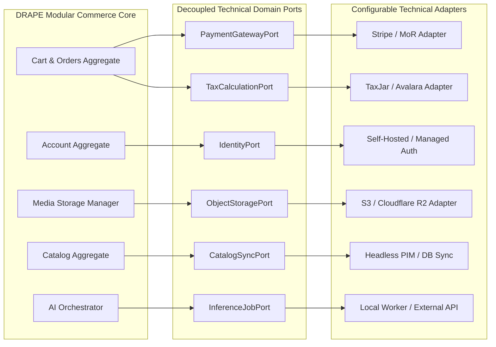

# DRAPE — Milestone 0.7 Architecture Consolidation Execution Plan

**Document:** Proposed M0.7 Execution Plan  
**Date:** 2026-11-05  
**AIDLC Phase:** Phase 0.2 Closeout -> Milestone 0.7 Initiation Gate  
**Status:** **AUTHORIZED AND EXECUTED (2026-11-05)**  
**Execution Authorization:** Formally authorized by Human Project Owner on 2026-11-05. All Milestone 0.7 Architecture Consolidation deliverables produced. Milestone 1 has NOT started; awaiting explicit post-M0.7 review and authorization.

---

## 1. Purpose and Scope

The objective of **Milestone 0.7 (Architecture Consolidation)** is to synthesize the requirements from Phase 0.1, the research findings from Phase 0.2 (Workstreams A–E), and the governance boundaries from [`docs/aidlc/PHASE_0_2_RECONCILIATION.md`](file:///Users/soham/Github/Drape/docs/aidlc/PHASE_0_2_RECONCILIATION.md) into an authoritative, consolidated architectural baseline.

M0.7 bridges the gap between exploratory research and production engineering:
- It transitions research preferences (modular monolith, PostgreSQL, Three.js, MediaPipe) into formal, bounded Architecture Decision Records (ADRs).
- It designs clean hexagonal domain ports and adapters that isolate the unresolved business and regulatory decisions cataloged in [`docs/aidlc/OPEN_DECISIONS_REGISTER.md`](file:///Users/soham/Github/Drape/docs/aidlc/OPEN_DECISIONS_REGISTER.md).
- It provides the finalized architectural contracts required for **Milestone 1 (Repository Scaffold and Environment)** to proceed without ambiguity.

---

## 2. Proposed Architecture Deliverables

M0.7 will produce a structured architecture documentation package in `docs/architecture/`:

```
docs/architecture/
├── SYSTEM_ARCHITECTURE.md                # Master System Architecture Document (SAD)
├── adr/                                  # Formal Architecture Decision Records
│   ├── ADR-001-backend-modular-monolith.md
│   ├── ADR-002-database-source-of-truth.md
│   ├── ADR-003-3d-garment-webgl-pipeline.md
│   ├── ADR-004-cv-body-tracking-architecture.md
│   ├── ADR-005-asynchronous-ai-job-port.md
│   ├── ADR-006-privacy-media-lifecycle-deletion.md
│   └── ADR-007-catalog-retrieval-search-strategy.md
└── interfaces/                           # Published domain contracts and port schemas
    ├── payment_port.md
    ├── identity_port.md
    ├── object_storage_port.md
    └── inference_job_port.md
```

### 2.1 System Architecture Document (`SYSTEM_ARCHITECTURE.md`)
A comprehensive master document containing:
1. **System Overview & Architectural Principles:** Truthful AI, editorial-first design, modular monolith, defense-in-depth security, and privacy by design.
2. **Logical Architecture:** Domain decomposition, aggregate ownership boundaries, and inter-module event communication.
3. **Physical / Deployment Baseline:** One-region minimal managed primitives (web layer, API core, managed database, private object storage) with conditional scaling triggers.
4. **Data Architecture:** Authoritative relational schema strategy (PostgreSQL), `jsonb` boundary rules, and derived-data invalidation lifecycles.
5. **AI & Job Architecture:** Decoupled asynchronous job orchestration, queue isolation, concurrency controls, and fallback state handling.
6. **Security & Authorization Model:** Application-level tenant scoping, token lifecycle, secrets management, and RLS defense-in-depth.
7. **Privacy & Media Lifecycle Architecture:** On-device camera isolation, presigned upload/delivery, retention automation, and coordinated deletion orchestration.
8. **Observability & Incident Framework:** Structured logging, metrics, tracing, health checks, error sanitization, and disaster recovery objectives (RPO/RTO).

### 2.2 Architecture Decision Records (ADRs)
Formal decisions following the MADR structure:
- **`ADR-001` (Backend Monolith Topology):** Consolidate FastAPI modular monolith core; establish conditions and metrics for future worker/service extraction.
- **`ADR-002` (Database Source of Truth):** Establish PostgreSQL as canonical relational authority; restrict `jsonb` to non-authoritative metadata.
- **`ADR-003` (3D Garment Pipeline & Asset Format Baseline):** Select WebGL 2 as baseline rendering target via Three.js/R3F; establish WebGPU as progressive-only; evaluate GLB/glTF 2.0 as provisional runtime asset baseline subject to M4 validation.
- **`ADR-004` (Client-Side CV Architecture):** Design browser-side pose estimation in Web Worker using MediaPipe; establish non-camera fallback and volatile-only frame handling with best-effort cleanup.
- **`ADR-005` (Asynchronous AI Job Port):** Define versioned interface for image processing and inference jobs with idempotent submissions, status polling, and cancellation.
- **`ADR-006` (Privacy Lifecycle, Media Storage & Asynchronous Deletion):** Codify asynchronous deletion lifecycle across databases, object storage, CDN caches, derived vectors, external providers, and backup archives. Explicitly distinguish three completion conditions: (1) Active DRAPE storage deletion completed, (2) external provider deletion confirmed vs merely submitted or acknowledged (ticket ID or receipt is submission evidence only, not proof of deletion), and (3) backup retention expiry reached vs backup still within approved retention period (with disaster recovery tombstone re-sync upon restore). Define multi-dimensional status fields (`active_store_status`, `external_provider_status`, `backup_retention_status`), lifecycle states, timestamps, retries, failure escalation, and verifiable completion criteria according to approved retention and legal policy.
- **`ADR-007` (Catalog Retrieval & Search):** Mandate structured relational filters and PostgreSQL full-text search as primary discovery baseline; establish empirical benchmark criteria for pgvector adoption.

---

## 3. Standardized Decision-Record Format

Every ADR created during M0.7 will adhere strictly to the following markdown template:

```markdown
# [Short title of solved problem and decision]

* **Status:** [proposed | rejected | accepted | deprecated | superseded]
* **Deciders:** [list everyone involved in the decision]
* **Date:** [YYYY-MM-DD]
* **Technical Story:** [link to PRD requirement or Risk Register ID]

## Context and Problem Statement
[Describe the context and problem being faced in 2-3 sentences.]

## Decision Drivers
* [driver 1, e.g. license compliance, latency budget, cost guardrails]
* [driver 2, e.g. low-ops modular monolith requirement]

## Considered Options
* [option 1]
* [option 2]
* [option 3]

## Decision Outcome
Chosen option: "[option 1]", because [justification. e.g., only option that meets license requirements].

### Positive Consequences
* [positive consequence 1]
* [positive consequence 2]

### Negative Consequences / Trade-offs
* [negative consequence 1]
* [mitigation strategy]

## Pros and Cons of the Options
### [option 1]
* Good, because [argument a]
* Bad, because [argument b]

### [option 2]
* Good, because [argument a]
* Bad, because [argument b]

## Compliance and Verification
* [How will this decision be verified in later milestones (M1–M7)?]
```

---

## 4. Required Architecture Diagrams (Mermaid)

The System Architecture Document will include five validated Mermaid diagrams:

1. **System Context Diagram (C4 Level 1):** Customer interactions, public browsing, authenticated wardrobe, camera stream, and third-party commerce/payment boundaries.
2. **Container Architecture (C4 Level 2):** Next.js frontend, FastAPI modular core, PostgreSQL database, object storage, and conditional background worker.
3. **Data Ownership & Domain Boundaries:** Explicit boundaries between Identity, Catalog, Commerce, Wardrobe, Recommendations, and AI Orchestration.
4. **AI Job Lifecycle State Machine:** Transitions between `queued`, `running`, `completed`, `failed`, `cancelled`, and `expired`.
5. **Privacy Lifecycle & Deletion Flow:** Upload opt-in, presigned access, retention expiration, and multi-tier deletion progression (distinguishing Active DRAPE store completion, external provider submission vs confirmation, and backup retention window expiry with Tombstone Ledger synchronization).

---

## 5. Unresolved Inputs and Decoupling Strategy

M0.7 will NOT make unilateral business, legal, operational, or commercial choices for the 26 items in [`docs/aidlc/OPEN_DECISIONS_REGISTER.md`](file:///Users/soham/Github/Drape/docs/aidlc/OPEN_DECISIONS_REGISTER.md). The architecture distinguishes between technical integrations and real-world dependencies:

### 5.1 Ports & Adapters for Replaceable Technical Integrations
Hexagonal ports and adapters apply **strictly to replaceable technical integrations** to decouple DRAPE's core business domains from vendor SDKs and volatile external protocols:



### 5.2 Real-World Dependencies (Preserved as Explicit Inputs)
Software interfaces cannot eliminate business, legal, operational, or commercial dependencies. M0.7 will document these as explicit inputs with their own blocking milestone gates:
- **Business / Product Decisions (`DEC-MKT-001`, `DEC-MKT-006`, etc.):** Launch country lists, supported languages, age limits, and retention windows require human owner policy decisions before M2/M7 release.
- **Legal / Privacy Decisions (`DEC-PRV-001`–`004`, etc.):** Jurisdiction definitions, biometric legal classification, and lawful basis require formal legal counsel review and signed DPAs before personal data collection.
- **Operational Decisions (`DEC-MKT-005`, `DEC-CAT-003`–`004`, etc.):** 3PL partner contracts, 3D asset authoring pipelines, and disaster recovery restore drills require operational execution and vendor agreements.
- **Commercial / Economic Decisions (`DEC-MKT-002`, `DEC-AI-002`–`003`):** Merchant of Record models, unit economics caps ($/try-on), and target conversion rates require business model validation.

---

## 6. M0.7 Review Gates and Acceptance Criteria

Milestone 0.7 will be considered complete and ready for external review only when:

| Item | Acceptance Criterion | Verification Method |
|---|---|---|
| **SAD Completeness** | `SYSTEM_ARCHITECTURE.md` covers all 8 architectural sections. | Document review against PRD & Research Plan. |
| **ADR Suite Complete** | All 7 ADRs (`ADR-001` through `ADR-007`) are authored in full MADR format. | Peer review of decision rationale and trade-offs. |
| **No Premature Decisions** | Replaceable technical integrations are isolated behind ports; business, legal, operational, and commercial decisions are tracked as unresolved inputs with explicit blocking milestones. | Audit of domain ports, adapter specifications, and open decisions register. |
| **Diagram Validation** | All Mermaid diagrams render without syntax errors. | Visual inspection and syntax parse check. |
| **Benchmark Integrity** | No vendor claim is represented as a DRAPE benchmark. | Cross-check against `PHASE_0_2_RECONCILIATION.md`. |
| **Traceability Maintained** | All PRD requirements (`FR`, `NFR`, `UX`, `SEC`) cite an architecture home. | Update `REQUIREMENTS_TRACEABILITY.md` if necessary. |
| **Zero Code Implementation** | No application code, schemas, or packages are created. | `git status` check confirms docs-only additions. |
| **External Sign-off** | Human Project Owner and external reviewer approve SAD and ADRs. | Written sign-off in session record. |

---

## 7. Immediate Next Action

> [!IMPORTANT]
> **Action Required from Human Project Owner:**
> 
> Review this proposed M0.7 execution plan.  
> - If approved, authorize the start of **Milestone 0.7: Architecture Consolidation**.
> - If adjustments are desired, specify required revisions.
> 
> **Antigravity will hold at this gate and will NOT begin M0.7 or M1 until explicit authorization is received.**

