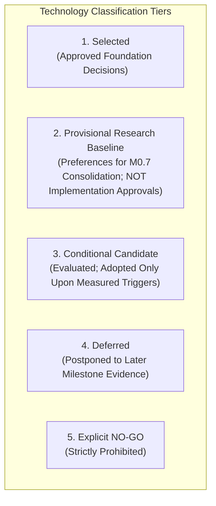
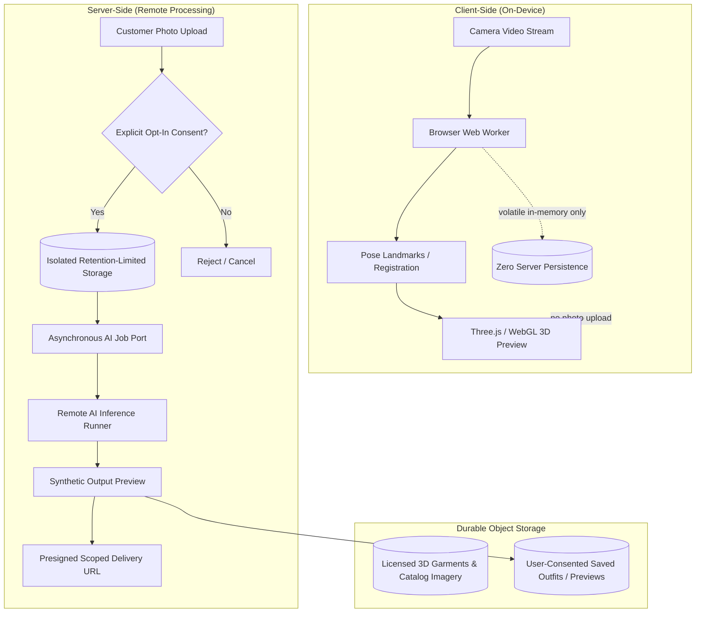

# DRAPE — Phase 0.2 Research Reconciliation

**Document:** Phase 0.2 Post-Review Documentation Reconciliation  
**Date:** 2026-11-05  
**AIDLC Phase:** Phase 0.2 — Technology Evaluation (Completed with CONDITIONAL GO recommendation for M0.7)  
**Current Milestone Position:** M0 (Research, requirements and architecture) — M0.7 NOT started; M1 NOT started  
**Scope:** Reconcile all Phase 0.2 research outcomes with Phase 0.1 foundation artifacts and establish strict governance boundaries before M0.7.

---

## 1. Executive Summary and Review Outcome

The external consolidated architecture review of Phase 0.2 (Workstreams A through E) by the project owner and external reviewer (ChatGPT) concluded with a **CONDITIONAL GO** recommendation for **Milestone 0.7: Architecture Consolidation**.

The research documentation is accepted as substantially complete. Before M0.7 can be initiated, this reconciliation document formally records:
1. Cross-artifact consistency verification between Phase 0.1 and Phase 0.2.
2. Strict classification of all technologies (Selected, Provisional Baseline, Conditional Candidate, Deferred, NO-GO) to prevent premature promotion of research preferences into implementation decisions.
3. Precise architectural decoupling of on-device camera processing, remote customer-image processing, remote AI inference, and persistent media storage.
4. An explicit disclaimer that **no DRAPE-specific performance benchmarks have been performed**; upstream vendor/paper figures remain reference context only.
5. Linkage to the consolidated [`docs/aidlc/OPEN_DECISIONS_REGISTER.md`](file:///Users/soham/Github/Drape/docs/aidlc/OPEN_DECISIONS_REGISTER.md) and proposed [`docs/aidlc/M0_7_EXECUTION_PLAN.md`](file:///Users/soham/Github/Drape/docs/aidlc/M0_7_EXECUTION_PLAN.md).

---

## 2. Cross-Artifact Consistency Verification

All five Phase 0.2 research reports have been verified against Phase 0.1 foundation documents:
- [`docs/aidlc/PROJECT_BRIEF.md`](file:///Users/soham/Github/Drape/docs/aidlc/PROJECT_BRIEF.md)
- [`docs/aidlc/PRD.md`](file:///Users/soham/Github/Drape/docs/aidlc/PRD.md)
- [`docs/aidlc/RISK_REGISTER.md`](file:///Users/soham/Github/Drape/docs/aidlc/RISK_REGISTER.md)
- [`docs/aidlc/REQUIREMENTS_TRACEABILITY.md`](file:///Users/soham/Github/Drape/docs/aidlc/REQUIREMENTS_TRACEABILITY.md)
- Approved M0–M7 Roadmap

### Verification Matrix

| Foundation Dimension | Phase 0.1 Baseline | Phase 0.2 Research Reconciliation | Consistency Status |
|---|---|---|---|
| **Product Purpose & Pillars** | 4 Pillars: E-Commerce, Hybrid VTON, Smart Wardrobe, AI Stylist. Focus on visual preview, not physical fit. | Workstreams A–E maintain strict separation between visual exploration and physical fit claims (`FR-013`, `RSK-001`, `RSK-002`). | **Consistent** |
| **Aesthetic & Brand Direction** | Sonia Rykiel-inspired centered header, Nudie Jeans-inspired single dominant editorial hero, ivory/black palette (`#F4F0E8`, `#111111`) with blue/lime accents (`UX-001`–`004`). | Retained as design constraints. Proprietary assets/fonts are strictly directional; zero third-party assets copied. | **Consistent** |
| **Computer Vision (Workstream A)** | Camera calibration and body tracking for live 3D try-on (`FR-012`, `FR-013`, `RSK-001`, `RSK-007`). Informs M3. | Evaluated MediaPipe and MoveNet. World landmarks confirmed as hip-relative registration markers, NOT anthropometric body scans. Defined on-device Worker evaluation protocol. | **Consistent** |
| **3D Garment Pipeline (Workstream B)** | glTF/GLB garment rendering, deformation, and occlusion (`FR-012`, `FR-013`, `RSK-003`, `RSK-004`). Informs M4/M5. | Three.js/R3F WebGL 2 baseline; WebGPU progressive only. Standardized glTF asset contract with external provenance. Staged deformation: M4 static/morph → M5 skin/morph vs constrained PBD/mass-spring. FEM rejected. | **Consistent** |
| **Image-Based VTON (Workstream C)** | Asynchronous synthetic preview from customer photo (`FR-014`–`016`, `RSK-005`, `RSK-006`, `RSK-010`). Conditional M7. | Comprehensive rights review: open models (IDM-VTON, CatVTON, etc.) excluded under CC BY-NC-SA terms. Commercial APIs flagged for manual deletion routes. Commercial deployment NO-GO; inference evaluation deferred. | **Consistent** |
| **Backend & AI Architecture (Workstream D)** | Web-first modular monolith, PostgreSQL, graceful degradation when AI fails (`NFR-003`, `RSK-016`). Informs M2, M6. | Modular monolith confirmed as preferred baseline. Strict domain boundaries defined. Relational mandatory for commerce; `jsonb` for non-authoritative metadata. Full-text search before vector. Internal versioned job interface. | **Consistent** |
| **Infrastructure & Privacy (Workstream E)** | On-device first, data minimization, consent, cost telemetry, auditable deletion (`SEC-001`–`007`, `RSK-006`, `RSK-008`). Informs M1, M7. | Minimal managed primitives for evaluation. Browser-local default. Coordinated deletion propagation (DB, objects, CDN, vectors, provider requests, backups). Cost sensitivity models established. | **Consistent** |
| **Roadmap Alignment** | M0 (Research & Arch) → M1 (Scaffold) → M2 (Commerce) → M3 (CV) → M4 (3D Try-On) → M5 (Deformation) → M6 (Wardrobe/Stylist) → M7 (Hardening). | All workstream reports preserve M0–M7 roadmap sequence without renumbering or inserting unapproved intermediate milestones. | **Consistent** |

---

## 3. Technology Choice Classification Matrix

To maintain strict AIDLC discipline, all candidate technologies are categorized into five precise governance tiers:

> [!NOTE]
> **Tier 1 (Selected)** covers only confirmed product and brand foundation constraints from Phase 0.1. No runtime technology, engine, database, or asset format is an approved implementation decision prior to M0.7 consolidation and empirical milestone verification. GLB/glTF 2.0 is retained as an intended research baseline, not an approved implementation commitment.



| Technology / Component | Classification | Governance Rationale & Usage Boundary |
|---|---|---|
| **Web-First Platform Strategy** | **Selected** | Confirmed Phase 0.1 architectural direction (`PROJECT_BRIEF.md`). |
| **Editorial Brand Direction** | **Selected** | Sonia Rykiel header treatment, Nudie Jeans hero layout, palette (`#F4F0E8`, `#111111`, `#294BFF`, `#D7E65A`). No proprietary assets copied. |
| **GLB / glTF 2.0 Asset Format** | **Provisional Baseline** | Intended runtime garment asset format direction (`PROJECT_BRIEF.md`, `GARMENT_PIPELINE_RESEARCH.md`). Subject to asset contract, authoring feasibility, and M4 performance verification; not an approved implementation selection. |
| **Next.js, React, TypeScript** | **Provisional Baseline** | Preferred frontend evaluation stack. To be consolidated in M0.7; implementation deferred to M1. |
| **Python, FastAPI (Modular Monolith)** | **Provisional Baseline** | Preferred backend evaluation stack. Single deployable unit with internal domain boundaries. |
| **PostgreSQL (Relational Core)** | **Provisional Baseline** | Authoritative source of truth for accounts, orders, catalog references, wardrobe, consent, and job states. |
| **PostgreSQL Full-Text Search** | **Provisional Baseline** | Primary text search baseline for catalog and wardrobe discovery before external search engines. |
| **Three.js + React Three Fiber (R3F)** | **Provisional Baseline** | Preferred 3D rendering evaluation stack. Imperative Three.js retained as minimal control baseline. |
| **WebGL 2** | **Provisional Baseline** | Baseline rendering context for cross-browser device compatibility. |
| **MediaPipe Tasks Vision Pose Landmarker** | **Provisional Baseline** | Primary candidate for browser-side pose tracking in dedicated Web Worker for M3 evaluation. |
| **CPU Execution Baseline** | **Provisional Baseline** | Baseline evaluation runtime for API and early inference workloads. |
| **PostgreSQL `jsonb`** | **Conditional Candidate** | Permitted strictly for bounded, evolving, non-authoritative metadata. Never for financial, order, or consent data. |
| **pgvector** | **Conditional Candidate** | Evaluated in Workstream D; conditional upon measured semantic retrieval need exceeding structured filters and full-text search. |
| **MoveNet (Lightning / Thunder via TFJS)** | **Conditional Candidate** | Secondary pose tracking comparator for M3 evaluation protocol. |
| **ONNX Runtime (ORT Web / Server)** | **Conditional Candidate** | Conditional upon a rights-cleared model exhibiting clean ONNX export parity and measured performance gain over CPU baseline. |
| **OpenCV** | **Conditional Candidate** | Supporting geometric and camera calibration utility only; never a learned pose estimator. |
| **Position-Based Dynamics (PBD) / Mass-Spring** | **Conditional Candidate** | Constrained evaluation candidate for M5 deformation research after M4 static gates pass. |
| **WebGPU** | **Conditional Candidate** | Progressive enhancement only where supported; never a hard requirement. |
| **Minimal Managed Cloud Primitives** | **Conditional Candidate** | Evaluation candidates (e.g. Vercel/Render, Supabase/Neon/RDS, Cloudflare R2/S3); no provider selection authorized. |
| **Separate AI Worker / Service** | **Deferred** | Deferred until measured GPU memory conflict, queue starvation, or sensitive data boundary justifies splitting the monolith. |
| **Dedicated GPU Inference Infrastructure** | **Deferred** | Deferred until a rights-cleared model demonstrates measured quality/latency gains that justify GPU operating costs. |
| **CUDA / TensorRT Execution Providers** | **Deferred** | Deferred until target model and hardware architecture are selected and benchmarked. |
| **Dedicated Vector Database (Pinecone, Milvus)** | **Deferred** | Deferred. Prohibited until PostgreSQL/pgvector fails approved relevance, latency, or scale benchmarks. |
| **Dedicated Search Engine (Elasticsearch)** | **Deferred** | Deferred. Prohibited until PostgreSQL full-text search fails approved catalog retrieval benchmarks. |
| **Commercial VTON APIs (FASHN, Replicate)** | **Deferred** | Deferred. Unselected pending legal, privacy, DPA, deletion verification, and unit economics review. |
| **Multi-Region Architecture** | **Deferred** | Deferred until international traffic volume, residency laws, and recovery objectives require it. |
| **Kubernetes / Microservices** | **Deferred** | Deferred. Excluded from early milestones to preserve low-cost, low-complexity modular monolith. |
| **Full FEM Cloth Simulation** | **Deferred / Excluded** | Excluded from web try-on baseline due to computational and authoring complexity. |
| **Commercial Open VTON Models (IDM-VTON, CatVTON, etc.)** | **Explicit NO-GO** | Prohibited from commercial deployment or fine-tuning under current CC BY-NC-SA 4.0 / non-commercial restrictions. |
| **Unconsented Model Training on Customer Data** | **Explicit NO-GO** | Customer photographs, frames, and previews must never be used for model training or derivative models by default. |
| **Fit Scores and Anthropometric Predictions** | **Explicit NO-GO** | Generating synthetic fit percentages, sizing certainty, or body measurement outputs is strictly prohibited (`RSK-001`, `RSK-002`). |
| **In-Process Heavy GPU Inference in Web Workers** | **Explicit NO-GO** | Prohibited inside web request handler processes to prevent memory bloat and worker starvation. |
| **Production Adoption of `prototype.html`** | **Explicit NO-GO** | Legacy prototype code, unpinned CDN dependencies, and 2D procedural rendering must not be promoted to production. |
| **Mandatory WebGPU Requirement** | **Explicit NO-GO** | WebGPU must never be a hard dependency for user access. |
| **Production Cloud Resource Deployment** | **Explicit NO-GO** | No cloud provisioning, infrastructure creation, or customer data collection is authorized at this phase. |

---

## 4. Architectural Separation: Processing Modes and Storage

To prevent architectural and privacy conflation, DRAPE enforces strict conceptual and operational boundaries across four distinct data-handling modes:



### Detailed Mode Specifications

```
+---------------------------------------------------------------------------------------------------+
| 1. ON-DEVICE CAMERA PROCESSING                                                                    |
+---------------------------------------------------------------------------------------------------+
| Scope:       Real-time pose estimation and visual landmark tracking for live 3D try-on (M3/M4).    |
| Execution:   Client-side in browser Web Worker using WASM / WebGL.                                 |
| Data Flow:   Volatile video frames processed in temporary client-side memory buffers.             |
| Network:     DEFAULT NON-TRANSMISSION: Zero camera frames, raw images, or landmarks leave the     |
|              user's device or touch DRAPE servers by default.                                     |
| Termination: Session stop explicitly halts all MediaStreamTrack camera capture and releases       |
|              Worker/renderer references with best-effort resource disposal (e.g. dispose() calls).|
| Memory Note: Reclamation of volatile client memory is governed by the browser JavaScript/WASM     |
|              engine and garbage collection; no claim of guaranteed instantaneous hardware zeroing.|
| Governance:  Contextual permission prompt; instant user Stop control; non-camera fallback.        |
+---------------------------------------------------------------------------------------------------+

+---------------------------------------------------------------------------------------------------+
| 2. REMOTE CUSTOMER-IMAGE PROCESSING                                                               |
+---------------------------------------------------------------------------------------------------+
| Scope:       Voluntary customer photo submission for asynchronous image-based virtual try-on.     |
| Execution:   Server-side validation, normalization, and staging for model inference.             |
| Data Flow:   Direct upload via short-lived, single-purpose presigned URLs into private bucket.    |
| Network:     TLS-encrypted transit; tenant-scoped authorization on every request.                  |
| Retention:   Isolated, retention-limited temporary storage with automated expiration clocks.      |
| Governance:  Granular, explicit opt-in required prior to upload; not logged in ordinary logs.     |
+---------------------------------------------------------------------------------------------------+

+---------------------------------------------------------------------------------------------------+
| 3. REMOTE AI INFERENCE                                                                            |
+---------------------------------------------------------------------------------------------------+
| Scope:       Execution of diffusion/inpainting models to synthesize garment-on-person preview.     |
| Execution:   Asynchronous background job worker (self-hosted or approved commercial provider).    |
| Data Flow:   Decoupled job submit -> queue/status polling -> result reference delivery.           |
| Governance:  Opaque job IDs; concurrency quotas; execution timeouts; retry policies.              |
| Training:    STRICTLY PROHIBITED from using customer inputs or outputs for model training.         |
| Output:      Explicitly labeled "Synthetic Preview — Not Physical Fit Validation".                 |
+---------------------------------------------------------------------------------------------------+

+---------------------------------------------------------------------------------------------------+
| 4. PERSISTENT MEDIA STORAGE                                                                       |
+---------------------------------------------------------------------------------------------------+
| Scope:       Durable assets: licensed catalog photos, 3D GLBs, and user-consented saved previews. |
| Execution:   Governed object storage (e.g. S3/R2 class) with lifecycle rules.                      |
| Catalog:     Public CDN distribution backed by rights-provenance contracts.                       |
| User Media:  Private tenant-isolated storage; access exclusively via authenticated presigned URLs.|
| Deletion:    Asynchronous deletion lifecycle: tombstone -> object purge -> CDN cache purge ->     |
|              derived vector invalidation -> provider notification -> backup retention expiration. |
+---------------------------------------------------------------------------------------------------+
```

### 4.1 Asynchronous Deletion Architecture & Lifecycle Specification

Deletion across DRAPE is an asynchronous, multi-stage lifecycle across heterogeneous stores. It avoids false claims of instantaneous deletion from external providers or backup archives by explicitly separating active-store deletion, external provider confirmation, and backup retention expiration:

```mermaid
stateDiagram-v2
    [*] --> REQUESTED: User / policy requests deletion
    REQUESTED --> TOMBSTONED: Primary relational access blocked immediately
    TOMBSTONED --> ACTIVE_PURGING: Asynchronous deletion coordinator dispatched
    ACTIVE_PURGING --> ACTIVE_DELETION_COMPLETED: Primary DB, objects, CDN, vectors verified purged
    ACTIVE_PURGING --> FAILED_ESCALATED: Active store retry limit exceeded; on-call alerted
    FAILED_ESCALATED --> TOMBSTONED: Manual remediation; access remains blocked
    ACTIVE_DELETION_COMPLETED --> DOWNSTREAM_PENDING: External confirmation pending OR backup within retention
    DOWNSTREAM_PENDING --> FULLY_PURGED_AND_EXPIRED: Active purged, external confirmed (if applicable), and backup expiry reached
    FULLY_PURGED_AND_EXPIRED --> [*]
```

#### 1. Independent Status Vectors (Multi-Dimensional Tracking)
Each deletion record in the persistent Tombstone / Deletion Ledger maintains three distinct, truthful status fields to prevent conflating internal purge with third-party or backup lifecycles:

- **`active_store_status`:**
  - `PENDING`: Purge tasks queued.
  - `IN_PROGRESS`: Actively deleting primary relational records, private object storage files, CDN cache entries, and derived vector indices.
  - `COMPLETED`: **Active DRAPE storage deletion completed.** Primary DB, object storage, CDN cache, and derived vectors are verified deleted.
  - `FAILED_ESCALATED`: Active store purge failed after maximum retries (exponential backoff with jitter); operational alert raised for manual operator remediation while access remains strictly tombstoned.
- **`external_provider_status`:**
  - `NOT_APPLICABLE`: No third-party AI provider was used for this media.
  - `REQUEST_SUBMITTED`: Deletion request dispatched via provider API or manual email (e.g. FASHN `legal@fashn.ai`) with logged dispatch timestamp and provider ticket/prediction ID. **Crucial Rule:** A ticket ID or notification receipt is evidence of request submission only, NOT proof of deletion.
  - `REQUEST_ACKNOWLEDGED`: Provider has confirmed receipt of the deletion request, but affirmative deletion has not yet occurred or been verified.
  - `DELETION_CONFIRMED`: Provider has formally and affirmatively verified complete deletion per contract, verification callback, or verified audit log.
  - `MANUAL_FOLLOWUP_REQUIRED`: Provider failed to acknowledge or confirm deletion within agreed SLA; escalates to legal/procurement for manual follow-up.
- **`backup_retention_status`:**
  - `WITHIN_RETENTION_PERIOD`: Pre-deletion snapshots containing the data remain in the active backup archive until their policy-governed retention period expires. **Crucial Rule:** Backup expiry must never be marked as completed while any relevant backup snapshot remains within its approved retention schedule.
  - `EXPIRY_REACHED`: All backup snapshots created prior to the tombstone timestamp have naturally aged out and been purged according to approved retention schedules.

#### 2. Explicit Overall Lifecycle States
The overall deletion lifecycle transitions truthfully based on the composite status fields:
- `REQUESTED`: Deletion request authenticated and logged with UTC timestamp and actor.
- `TOMBSTONED`: Access to the target record is immediately revoked at the application/API layer. The user and public APIs can no longer view, download, or reference the item.
- `ACTIVE_PURGING`: Deletion coordinator actively purging database, object storage, CDN cache, and derived vectors.
- `ACTIVE_DELETION_COMPLETED`: Truthful state indicating **active DRAPE storage deletion is complete**, allowing the system to confirm internal deletion to the user while downstream obligations remain tracked.
- `DOWNSTREAM_PENDING`: Explicit intermediate state indicating active stores are completely purged, but `external_provider_status` is `REQUEST_SUBMITTED`/`REQUEST_ACKNOWLEDGED` (pending confirmation) and/or `backup_retention_status` is `WITHIN_RETENTION_PERIOD`.
- `FULLY_PURGED_AND_EXPIRED`: Final terminal state achieved only when active stores are completed, external provider deletion is affirmatively `DELETION_CONFIRMED` (or `NOT_APPLICABLE`), and backup retention `EXPIRY_REACHED` is verified according to approved retention and legal policy.
- `FAILED_ESCALATED`: Active purge failed after retries; manual intervention required while resource remains tombstoned.

#### 3. Verifiable Completion Criteria Defined by Policy
- *Active DRAPE Storage Deletion Completed:*
  - Primary Relational Database: Primary media row deleted or anonymized; persistent tombstone entry preserved in the Deletion Ledger.
  - Object Storage: Target S3/R2 object verified absent via 404 response or confirmed `DeleteObject` event.
  - CDN Cache: Purge API endpoint returns verified success with purge confirmation ID.
  - Derived Data: Embeddings and intermediate representation vectors in pgvector/search tables verified deleted.
- *External Provider Deletion Confirmation:*
  - A dispatch log, email receipt, or ticket ID is strictly classified as `REQUEST_SUBMITTED`, never `DELETION_CONFIRMED`.
  - Confirmation requires an explicit affirmative API response, verification callback, or written contractual confirmation from the provider.
- *Backup Retention Expiration:*
  - Backup snapshots cannot be selectively mutated in place without compromising archive integrity.
  - Backup completion is determined solely by the chronological passage of the approved legal and backup retention window (`DEC-RET-004`). Until that exact milestone/policy-defined retention boundary is crossed, backups are truthfully reported as `WITHIN_RETENTION_PERIOD`.
- *Disaster Recovery Tombstone Re-Sync:*
  - In the event of a disaster recovery restore from backup snapshots, an automated post-restore pipeline re-applies the immutable Tombstone Ledger to re-purge all restored records before the platform resumes serving traffic.

---

## 5. Benchmark and Performance Disclaimer

> [!IMPORTANT]
> **No DRAPE-Specific Performance Benchmarks Have Been Executed.**
> 
> All performance figures, parameter sizes, latency metrics, and memory footprints cited in Phase 0.2 research documents are **published upstream reference data or vendor claims only**. Specifically:
> - **MediaPipe Pose Landmarker:** Package sizes (~3 MB Lite, ~6 MB Full, ~26 MB Heavy) and synchronous `detectForVideo` behaviors are Google AI Edge published documentation values.
> - **MoveNet:** 17-keypoint outputs, 192×192 / 256×256 input resolutions, and historical FPS tables are TensorFlow upstream documentation references.
> - **CatVTON:** 899M parameters and `<8 GB` VRAM at 1024×768 are claims from the original academic paper (ICLR 2025).
> - **FASHN API v1.6:** 864×1296 processing dimensions, 5–17 second mode times, and 1 credit per output are vendor-published API figures.
> - **Cloudflare R2:** Pricing tiers ($0.015/GB-month) are vendor-published documentation values from October 2026.
> 
> **Zero empirical benchmarks have been conducted on DRAPE hardware, target client devices, network profiles, or catalog assets.** Vendor figures must never be cited as DRAPE performance baselines. All actual performance budgets remain **TBD — requires approved measurement protocols during later milestones (M3, M4, M5).**

---

## 6. Open Decisions and M0.7 Alignment

All unresolved questions concerning launch markets, commercial operating models, legal jurisdictions, authentication, data retention/deletion timeframes, and accessibility standards have been consolidated into:
- [`docs/aidlc/OPEN_DECISIONS_REGISTER.md`](file:///Users/soham/Github/Drape/docs/aidlc/OPEN_DECISIONS_REGISTER.md)

The detailed architecture consolidation roadmap, deliverables, and review gates for Milestone 0.7 are documented in:
- [`docs/aidlc/M0_7_EXECUTION_PLAN.md`](file:///Users/soham/Github/Drape/docs/aidlc/M0_7_EXECUTION_PLAN.md)

---

## 7. Reconciliation Checklist and Gate Status

| Reconciliation Gate | Status | Notes |
|---|---|---|
| Phase 0.1 vs Phase 0.2 Consistency | **VERIFIED** | No contradictions; visual preview boundary strictly preserved. |
| Technology Tiers Classified | **VERIFIED** | 5 distinct tiers; recommendations strictly separated from approvals. |
| Processing & Storage Boundaries Decoupled | **VERIFIED** | On-device vs remote image vs AI inference vs persistent media defined. |
| Benchmark Status Formally Disclaimed | **VERIFIED** | Upstream vendor data confirmed as non-DRAPE measurements. |
| Consolidated Open-Decisions Register Created | **VERIFIED** | Linked to `OPEN_DECISIONS_REGISTER.md`. |
| Proposed M0.7 Execution Plan Prepared | **VERIFIED** | Linked to `M0_7_EXECUTION_PLAN.md`. |
| Existing `prototype.html` Preserved | **VERIFIED** | Unmodified, uncommitted, reference-only. |
| Implementation / Scaffolding Prohibited | **VERIFIED** | M0.7 not started; M1 not started; zero application code added. |

