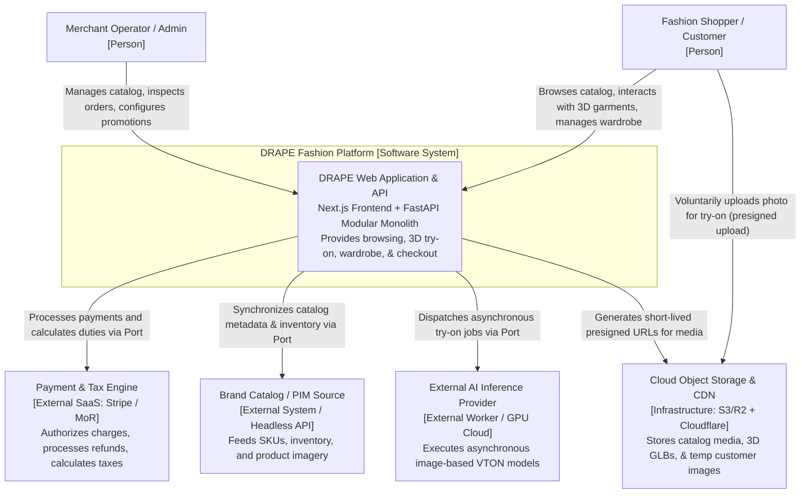
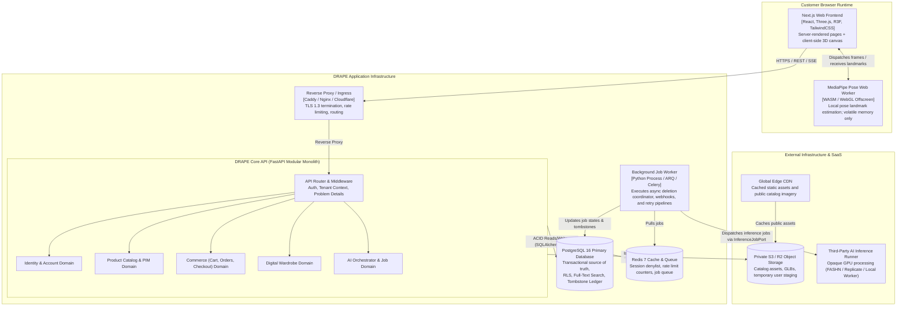
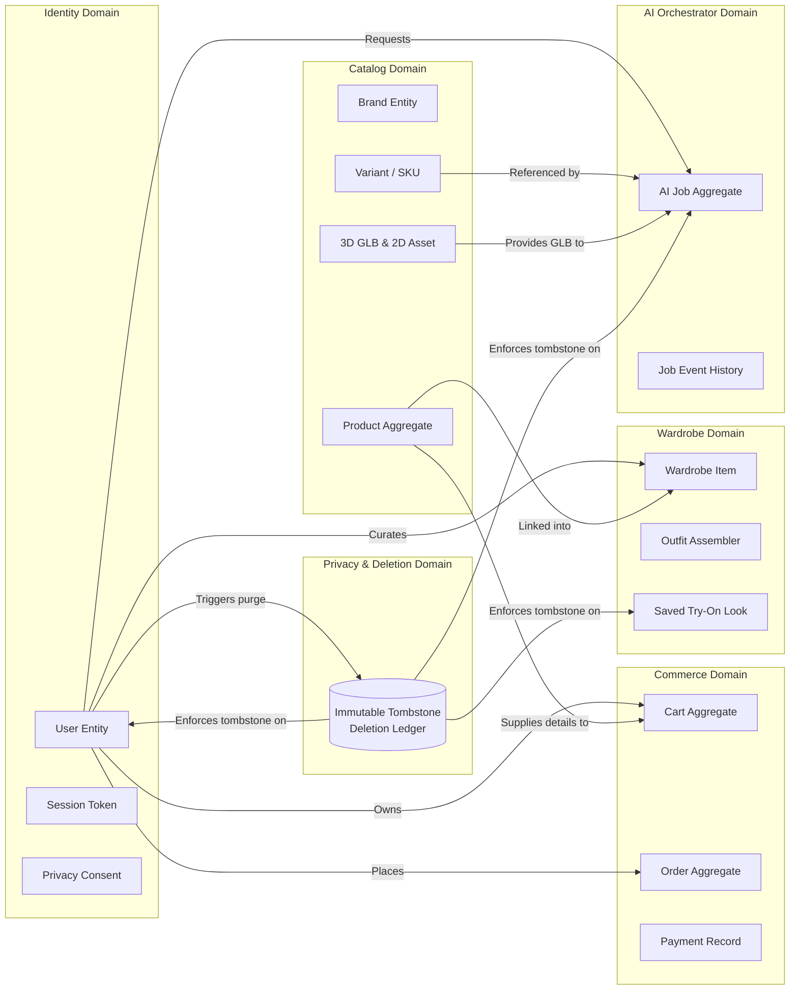
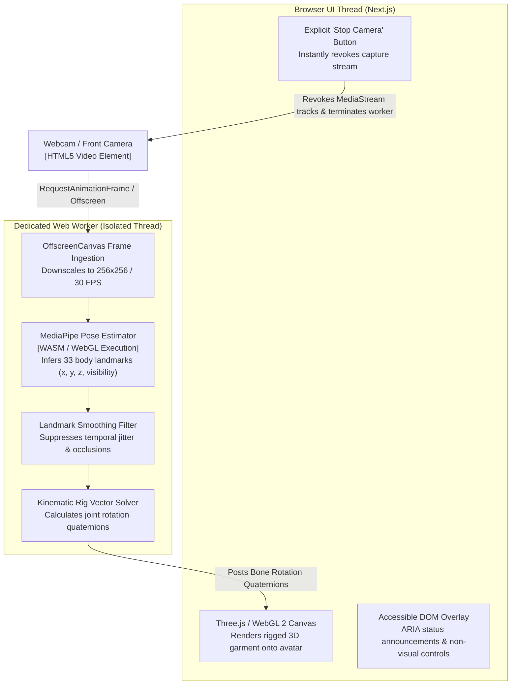
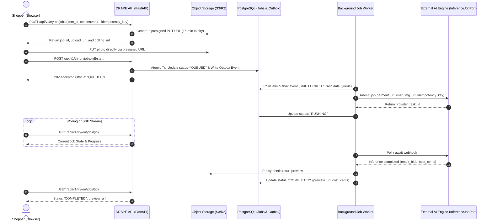
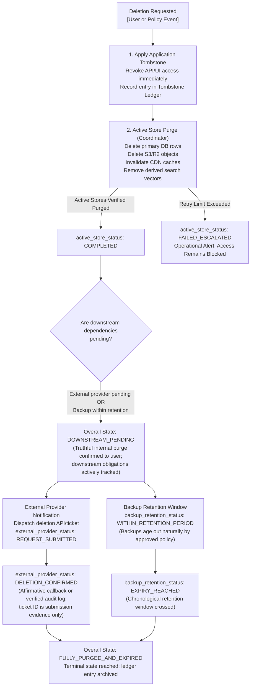

# DRAPE — System Architecture Document (SAD)

**Document:** Authoritative System Architecture Document  
**Version:** 1.0.0 (Milestone 0.7 Architecture Consolidation)  
**Date:** 2026-11-05  
**Status:** **AUTHORITATIVE BASELINE**  
**Roadmap Position:** Milestone 0 (Research, Requirements and Architecture Consolidation) — Prerequisite to Milestone 1  
**Authors / Deciders:** Technical Architect (Antigravity Agent), Human Project Owner  
**Review Authority:** External Architecture Reviewer, Human Project Owner  

---

## Executive Summary

DRAPE is a web-first global fashion e-commerce platform that pairs an editorial luxury shopping experience with a hybrid virtual try-on engine, a smart digital wardrobe, and an AI fashion stylist.

This document synthesizes the requirements from Phase 0.1 ([`PROJECT_BRIEF.md`](file:///Users/soham/Github/Drape/docs/aidlc/PROJECT_BRIEF.md), [`PRD.md`](file:///Users/soham/Github/Drape/docs/aidlc/PRD.md), [`RISK_REGISTER.md`](file:///Users/soham/Github/Drape/docs/aidlc/RISK_REGISTER.md)), the empirical findings from Phase 0.2 research ([`AR_RESEARCH.md`](file:///Users/soham/Github/Drape/docs/research/AR_RESEARCH.md), [`GARMENT_PIPELINE_RESEARCH.md`](file:///Users/soham/Github/Drape/docs/research/GARMENT_PIPELINE_RESEARCH.md), [`VTON_RESEARCH.md`](file:///Users/soham/Github/Drape/docs/research/VTON_RESEARCH.md), [`BACKEND_DATABASE_AI_ARCHITECTURE_RESEARCH.md`](file:///Users/soham/Github/Drape/docs/research/BACKEND_DATABASE_AI_ARCHITECTURE_RESEARCH.md), [`INFRASTRUCTURE_PRIVACY_COST_RESEARCH.md`](file:///Users/soham/Github/Drape/docs/research/INFRASTRUCTURE_PRIVACY_COST_RESEARCH.md)), and the governance rules established in [`PHASE_0_2_RECONCILIATION.md`](file:///Users/soham/Github/Drape/docs/aidlc/PHASE_0_2_RECONCILIATION.md).

It defines the formal technical architecture for DRAPE:
1. **Topology:** A modular monolith backend (FastAPI) paired with a high-performance modern web frontend (Next.js), structured for low operational complexity and strict domain isolation.
2. **Data Authority:** PostgreSQL as the single canonical relational authority for all transactional domains, enforcing strict schema boundaries and defense-in-depth Row-Level Security (RLS).
3. **Hybrid Try-On:** A dual-engine approach combining zero-latency browser-side 3D WebGL rendering (Three.js/R3F) with decoupled asynchronous image-based virtual try-on (VTON).
4. **Decoupled Integrations:** Six hexagonal domain ports isolating replaceable technical services (payments, taxes, identity, object storage, catalog sync, and inference execution).
5. **Truthful Privacy & Lifecycle:** Clear mathematical and legal boundaries separating ephemeral on-device camera processing, consented temporary remote staging, opaque AI inference, and persistent media storage with a verifiable, multi-stage asynchronous deletion lifecycle.

---

## 1. System Topology & Process Model

### 1.1 Core Architectural Principles

The DRAPE system architecture is governed by five non-negotiable architectural principles:

1. **Truthful AI & Visual Preview Boundary:** All virtual try-on outputs (live 3D and image-based VTON) are explicitly defined and labeled as **bounded visual previews**, never as physical sizing, tailoring, or fit guarantees. Synthetic outputs must be clearly badged to prevent consumer deception ([`RSK-001`](file:///Users/soham/Github/Drape/docs/aidlc/RISK_REGISTER.md#rsk-001), [`RSK-002`](file:///Users/soham/Github/Drape/docs/aidlc/RISK_REGISTER.md#rsk-002)).
2. **Editorial-First Brand Luxury:** The user experience balances cutting-edge computer vision with typography, whitespace, and fluid interaction characteristic of high-fashion publications. Technical controls must never degrade core e-commerce discoverability or cart checkout performance ([`PRD Section 3`](file:///Users/soham/Github/Drape/docs/aidlc/PRD.md#3-design-philosophy-editorial-commerce)).
3. **Modular Monolith First:** DRAPE adopts a modular monolith backend architecture. Domain logic is strictly partitioned into encapsulated Python packages with explicit in-memory interfaces. Physical service decomposition (e.g. dedicated microservices or serverless clusters) is explicitly prohibited until sustained, measured production bottlenecks justify extraction ([`ADR-001`](file:///Users/soham/Github/Drape/docs/architecture/adr/ADR-001-backend-modular-monolith.md)).
4. **Defense-in-Depth Security:** Every public endpoint authenticates and authorizes via application middleware, with underlying database multi-tenancy enforced at the schema and Row-Level Security (RLS) layers ([`PRD SEC-001`](file:///Users/soham/Github/Drape/docs/aidlc/PRD.md#sec-001)).
5. **Privacy by Default & Lifecycle Truth:** Camera video streams are strictly processed in volatile browser memory and are never transmitted to DRAPE servers by default. Customer photos submitted for image try-on are isolated in private, short-lived storage with automated lifecycle expiration. Deletion is asynchronous, multi-tiered, and truthfully reported ([`PRD SEC-002`](file:///Users/soham/Github/Drape/docs/aidlc/PRD.md#sec-002), [`ADR-006`](file:///Users/soham/Github/Drape/docs/architecture/adr/ADR-006-privacy-media-lifecycle-deletion.md)).

### 1.2 System Context (C4 Level 1)

The following C4 Level 1 diagram illustrates DRAPE's boundaries with consumers, merchant administrators, external commerce providers, and third-party AI systems:



### 1.3 Container Architecture (C4 Level 2)

The C4 Level 2 container diagram defines the runtime applications, data stores, and execution boundaries:



### 1.4 Runtime & Process Model

1. **ASGI Execution Core:** The core backend runs under Python 3.12+ via Uvicorn workers behind an ASGI reverse proxy. Asynchronous I/O is mandated for network-bound database queries, cache operations, and external port dispatches.
2. **Decoupled Background Tasks:** HTTP request/response loops are strictly protected from long-running operations. Image validation, external AI job dispatching, webhook event processing, and asynchronous deletion orchestration are enqueued onto candidate asynchronous queues (e.g. Redis candidate with ARQ/Celery or PostgreSQL SKIP LOCKED workers) and processed by dedicated background runner processes.
3. **No In-Process Heavy ML / Rendering:** The backend monolith does **not** perform 3D mesh deformation or heavy diffusion model inference within the web process. 3D rendering is executed entirely client-side via WebGL 2, and image diffusion is dispatched via an asynchronous job port to dedicated external or containerized worker runtimes ([`ADR-001`](file:///Users/soham/Github/Drape/docs/architecture/adr/ADR-001-backend-modular-monolith.md), [`ADR-005`](file:///Users/soham/Github/Drape/docs/architecture/adr/ADR-005-asynchronous-ai-job-port.md)).

---

## 2. Modular Domain Boundaries & Hexagonal Ports

### 2.1 Domain Decomposition

The monolith is partitioned into six bounded contexts. Each domain owns its domain models, business logic, and database tables:

1. **Identity & Account Domain (`drape.identity`):**
   - *Responsibilities:* Customer accounts, profiles, authentication tokens, password hashing, session lifecycle, and privacy preferences.
   - *Authoritative Tables:* `identity_users`, `identity_sessions`, `identity_consents`.
2. **Product Catalog & PIM Domain (`drape.catalog`):**
   - *Responsibilities:* Brands, collections, products, SKUs, inventory levels, sizing charts, category taxonomy, and 2D/3D media asset links.
   - *Authoritative Tables:* `catalog_brands`, `catalog_categories`, `catalog_products`, `catalog_variants`, `catalog_assets`.
3. **Commerce Domain (`drape.commerce`):**
   - *Responsibilities:* Shopping carts, pricing calculations, promotion application, order placement, checkout workflows, and payment/tax coordination.
   - *Authoritative Tables:* `commerce_carts`, `commerce_cart_items`, `commerce_orders`, `commerce_order_items`, `commerce_payments`.
4. **Digital Wardrobe Domain (`drape.wardrobe`):**
   - *Responsibilities:* User saved items, outfit assembly, wardrobe categorization, personal style metadata, and saved try-on previews.
   - *Authoritative Tables:* `wardrobe_items`, `wardrobe_outfits`, `wardrobe_saved_looks`.
5. **AI Orchestrator & Job Domain (`drape.ai_orchestration`):**
   - *Responsibilities:* Ingestion of virtual try-on requests, presigned URL coordination, job state tracking, queue polling, retry management, and result delivery.
   - *Authoritative Tables:* `ai_jobs`, `ai_job_events`.
6. **Privacy & Governance Domain (`drape.privacy`):**
   - *Responsibilities:* Consent ledger, data access requests, multi-store deletion orchestration, and the immutable disaster recovery Tombstone Ledger.
   - *Authoritative Tables:* `privacy_consent_logs`, `privacy_deletion_ledger`.

### 2.2 Data Ownership & Domain Boundaries



### 2.3 Inter-Module Communication Rules

1. **In-Process Interface Contracts:** Modules communicate via explicit, typed Python service interfaces (e.g. `CatalogService.get_variant_by_id(variant_id)`).
2. **No Cross-Domain Table Joins:** Code in `drape.commerce` is **strictly forbidden** from executing direct SQL joins across `identity_*` or `catalog_*` tables. Queries must access data through the domain's published repository interface.
3. **Decoupled Domain Events:** Cross-domain side effects (e.g. creating an empty Wardrobe upon user registration, or updating an inventory reservation upon Order completion) must be dispatched as internal domain events processed synchronously or asynchronously by subscribed handlers.

### 2.4 Hexagonal Domain Ports (Decoupled Technical Integrations)

To prevent vendor lock-in and allow technical adapters to evolve without altering core domain logic, DRAPE defines six technical integration ports:

| Port Interface | Primary Responsibility | Decoupled Adapters | Detailed Specification |
|---|---|---|---|
| `PaymentGatewayPort` | Authorize, capture, refund transactions; handle incoming webhooks. | Stripe Adapter, Mock Gateway, Future MoR Adapter | [`payment_gateway_port.md`](file:///Users/soham/Github/Drape/docs/architecture/interfaces/payment_gateway_port.md) |
| `TaxCalculationPort` | Calculate real-time checkout sales tax, VAT, and customs duties. | TaxJar Adapter, Avalara Adapter, Static Matrix Adapter | [`tax_calculation_port.md`](file:///Users/soham/Github/Drape/docs/architecture/interfaces/tax_calculation_port.md) |
| `IdentityPort` | Authenticate credentials, issue tokens, manage social logins & session revocation. | Self-Hosted FastAPI OAuth2/JWT Adapter, Supabase/Clerk Adapter | [`identity_port.md`](file:///Users/soham/Github/Drape/docs/architecture/interfaces/identity_port.md) |
| `ObjectStoragePort` | Generate presigned PUT/GET URLs, delete blobs, set lifecycle headers. | AWS S3 Adapter, Cloudflare R2 Adapter, Local Disk Adapter | [`object_storage_port.md`](file:///Users/soham/Github/Drape/docs/architecture/interfaces/object_storage_port.md) |
| `CatalogSyncPort` | Ingest and synchronize SKUs, stock, and descriptions from external sources. | Headless PIM Adapter (Shopify/Medusa), Direct Admin DB Sync | [`catalog_sync_port.md`](file:///Users/soham/Github/Drape/docs/architecture/interfaces/catalog_sync_port.md) |
| `InferenceJobPort` | Asynchronously submit, poll, and cancel virtual try-on inference jobs. | Self-Hosted GPU Worker Adapter, FASHN API Adapter | [`inference_job_port.md`](file:///Users/soham/Github/Drape/docs/architecture/interfaces/inference_job_port.md) |

### 2.5 Open Decisions Reconciliation: Technical Ports vs. Real-World Dependencies

In accordance with [`OPEN_DECISIONS_REGISTER.md`](file:///Users/soham/Github/Drape/docs/aidlc/OPEN_DECISIONS_REGISTER.md), the DRAPE project maintains an authoritative ledger of **26 unresolved open decisions**. 

Software architecture interfaces decouple technical service protocols; they **cannot eliminate real-world business, legal, operational, or commercial dependencies**. The 26 open decisions are partitioned into five explicit categories:

#### 1. Replaceable Technical Integrations (6 Decisions — Decoupled via Hexagonal Ports in Section 2.4)
These technical vendor dependencies are isolated behind the domain ports specified in Section 2.4:
* `DEC-MKT-003`: Payment Gateway & Currency Adapter (`PaymentGatewayPort`) [Blocking: M2]
* `DEC-MKT-004`: Tax & Customs Calculation Engine (`TaxCalculationPort`) [Blocking: M2]
* `DEC-IDN-001`: Authentication Strategy & Provider (`IdentityPort`) [Blocking: M1 / M2 Gate]
* `DEC-IDN-003`: Session Invalidation & Token Revocation Mechanism (`IdentityPort`) [Blocking: M1 / M2 Gate]
* `DEC-RET-003`: Deletion Propagation Architecture & Truthful Tracking (`ObjectStoragePort`) [Blocking: M2]
* `DEC-CAT-001`: Authoritative Catalog Source / PIM (`CatalogSyncPort`) [Blocking: M2]

#### 2. Business / Product Decisions (6 Decisions — Preserved as Explicit Real-World Inputs)
Strategic policies and scope requiring Human Project Owner resolution:
* `DEC-MKT-001`: Initial Launch Countries & Rollout Scope [Blocking: M2]
* `DEC-MKT-006`: Localization & Initial Supported Languages [Blocking: M2]
* `DEC-IDN-002`: Minimum Age Policy & Age-Gating Controls [Blocking: M2]
* `DEC-RET-001`: Customer Photo Temporary Retention Window [Blocking: M7]
* `DEC-RET-002`: Generated Try-On Preview Retention & Expiry Policy [Blocking: M7]
* `DEC-AI-001`: Feature Sequencing: Live 3D vs Image VTON [Blocking: M0.7 Consolidation]

#### 3. Legal / Privacy Decisions (5 Decisions — Preserved as Explicit Real-World Inputs)
Regulatory compliance and data classification requiring qualified Legal Counsel review:
* `DEC-PRV-001`: Governing Privacy Jurisdictions (GDPR, DPDP, CCPA) [Blocking: M1 / M2 Gate]
* `DEC-PRV-002`: Formal Legal Classification of Photos / Landmarks [Blocking: M3 / M7 Gate]
* `DEC-PRV-003`: Lawful Basis for Camera & Photo Processing [Blocking: M3 / M7 Gate]
* `DEC-PRV-004`: DPIA Completion & Third-Party DPAs [Blocking: M1]
* `DEC-CAT-002`: Commercial Rights Clearance for Product Photos [Blocking: M2]

#### 4. Operational Decisions (6 Decisions — Preserved as Explicit Real-World Inputs)
Logistics, authoring workflows, and standards requiring operational and technical leadership:
* `DEC-MKT-005`: Shipping Logistics & Returns 3PL Partner [Blocking: M2]
* `DEC-RET-004`: Backup Retention Windows & Deletion Ledger Re-Sync [Blocking: M2 / M7 Gate]
* `DEC-CAT-003`: 3D Garment Pipeline (Commissioned vs Brand CAD) [Blocking: M4]
* `DEC-CAT-004`: 3D Garment Budgets (Draw Calls, LODs, Vertices) [Blocking: M4]
* `DEC-A11Y-001`: Target Accessibility Standard (WCAG 2.1 vs 2.2 AA) [Blocking: M2]
* `DEC-A11Y-002`: Keyboard & Screen Reader Scope for 3D/Try-On [Blocking: M3 / M4 Gate]

#### 5. Commercial / Economic Decisions (3 Decisions — Preserved as Explicit Real-World Inputs)
Financial and merchant model decisions requiring Project Owner and Finance validation:
* `DEC-MKT-002`: Merchant of Record (MoR) & Legal Entity Model [Blocking: M2]
* `DEC-AI-002`: Unit Economics Guardrail (Cost/Try-On Session) [Blocking: M0.7 / M7 Gate]
* `DEC-AI-003`: Commercial Success Baselines (Conversion/Returns) [Blocking: M2 / M7 Gate]

> [!IMPORTANT]
> **Summary Reconciliation:** All 26 decisions across all five classes remain tracked in [`OPEN_DECISIONS_REGISTER.md`](file:///Users/soham/Github/Drape/docs/aidlc/OPEN_DECISIONS_REGISTER.md) with their respective owners, dependencies, and blocking milestones. Zero decisions have been silently resolved or eliminated by architectural abstraction.

---

## 3. Database Architecture & Schema Strategy

### 3.1 Canonical Relational Authority

PostgreSQL (version 16+) is selected as the sole authoritative database for all relational, financial, transactional, and audit data across DRAPE ([`ADR-002`](file:///Users/soham/Github/Drape/docs/architecture/adr/ADR-002-database-source-of-truth.md)).

1. **Schema-Level Multi-Tenancy & Naming Conventions:** Tables are prefixed by domain context (`identity_*`, `catalog_*`, `commerce_*`, `wardrobe_*`, `ai_*`, `privacy_*`). Foreign key constraints between domains are strictly maintained to enforce referential integrity.
2. **ACID Transaction Guarantees:** All shopping cart checkouts, inventory deductions, order state transitions, and payment authorizations execute within strict PostgreSQL database transactions with `READ COMMITTED` isolation (elevated to `SERIALIZABLE` or pessimistic row-locking `SELECT FOR UPDATE` during inventory decrement).
3. **Strict Boundary on `jsonb` & PII Reconciliation:**
   - *Permitted Usage:* Unstructured display metadata (`catalog_products.display_attributes`), opaque model execution parameters (`ai_jobs.execution_metadata`), and raw gateway webhook logs (`commerce_payments.raw_gateway_response`).
   - *PII Reconciliation:* Raw gateway responses may contain customer payment metadata; non-essential PII must be sanitized prior to persistence, and financial transaction records are retained strictly to the extent required by documented statutory tax and accounting mandates subject to jurisdiction-specific legal review ([`DEC-PRV-001`](file:///Users/soham/Github/Drape/docs/aidlc/OPEN_DECISIONS_REGISTER.md#dec-prv-001)), without assuming automatic legal exemptions. Core customer identity PII (names, contact info, profile photos) is strictly prohibited from `jsonb` columns.
   - *Explicit Prohibition:* `jsonb` must **never** be used for core entities, foreign key references, monetary amounts, stock counts, or status state machines.

### 3.2 Indexing & Performance Strategy

1. **Primary & Foreign Keys:** All primary keys utilize UUIDv7 or `BIGSERIAL` (with UUIDv7 preferred for customer-facing identifiers to prevent enumeration attacks and preserve sequential B-tree insertion locality). All foreign keys must possess an explicit B-tree index.
2. **Catalog Discovery & Full-Text Search:** Catalog searching is powered natively in M0.7/M1 by PostgreSQL full-text search (`tsvector` generated columns with GIN indexes) combined with structured relational filtering on brand, category, price, and color ([`ADR-007`](file:///Users/soham/Github/Drape/docs/architecture/adr/ADR-007-catalog-retrieval-search-strategy.md)). Search vectors support multilingual tokenization, and composite indexes will be benchmarked and validated against actual customer query patterns in M2.
3. **Provisional Status of `pgvector`:** Vector similarity search using the `pgvector` extension is classified as a **Conditional Candidate**. It will only be activated when personalized stylist embeddings are validated against real catalog embeddings in M6. Dedicated vector databases (e.g. Pinecone, Qdrant) are explicitly deferred.

### 3.3 Schema Evolution & Migrations

All database schema changes are managed strictly via Alembic migrations executed as a gated deployment step. Zero ad-hoc or runtime DDL execution is permitted.

---

## 4. 3D & Client-Side Computer Vision Architecture

### 4.1 Client-Side 3D Rendering Pipeline

DRAPE's 3D Virtual Try-On relies on an entirely client-side rendering pipeline running in the customer's web browser:

1. **Rendering Engine Baseline:** Three.js and React Three Fiber (R3F) running on the **WebGL 2.0** baseline standard ([`ADR-003`](file:///Users/soham/Github/Drape/docs/architecture/adr/ADR-003-3d-garment-webgl-pipeline.md)). WebGPU is classified as a progressive enhancement candidate for future exploration once browser adoption stabilizes.
   - *API Support vs. Real Performance:* While WebGL 2.0 is supported by >98% of modern mobile/desktop browser engines, actual real-time 3D performance (fill-rate, vertex throughput, thermal stability, VRAM limits) varies significantly across client hardware and must be validated empirically against target device matrices in Milestone 4.
2. **Garment Asset Specification:** **GLB (glTF 2.0 Binary, developed by The Khronos Group and standardized as ISO/IEC 12113:2022)** is selected as the **Provisional Research Baseline**. Final approval is gated on M4 empirical validation against the following provisional engineering targets:
   - Triangle count (target): ≤ 40,000 triangles (LOD0) per primary upper garment; automated LOD generation for distant views.
   - Texture maps (target): 2048×2048 maximum resolution, encoded with KTX2 / Basis Universal GPU compression.
   - Draw calls (target): ≤ 10 draw calls per complete avatar scene.
   - File size (target): ≤ 5 MB per individual GLB binary.
3. **Rigging, Deformation & Layering:**
   - Skeletal skinning binds 3D garments to an underlying standardized avatar skeleton driven by tracking landmarks.
   - Multi-layer garments (e.g. jacket over shirt) use hierarchical depth sorting and depth-bias offsets to prevent Z-fighting artifacts.
   - Real-time cloth simulation (mass-spring / Position-Based Dynamics) is classified as a **Conditional Candidate** due to mobile CPU/battery constraints; initial delivery relies on rigged skeletal deformation.

### 4.2 Browser-Side Computer Vision Pipeline



1. **Web Worker Thread Isolation:** All computer vision processing executes inside a dedicated Web Worker off the main UI thread. This prevents pose estimation computations from causing frame drops or blocking cart interactions ([`ADR-004`](file:///Users/soham/Github/Drape/docs/architecture/adr/ADR-004-cv-body-tracking-architecture.md)).
2. **Pose Model Selection & Kinematic Transformation:**
   - Google MediaPipe Pose (running via WebAssembly/WebGL) is the provisional research baseline for real-time 33-point body landmark estimation. These landmarks represent heuristic anatomical keypoints with relative depth, **not** exact physical metric measurements, volumetric scans, or tailored sizing metrics.
   - The 33 landmarks do **not** map 1:1 to a 33-joint garment rig. Instead, an anatomical subset of torso and limb landmarks is smoothed via 1-Euro/Kalman filtering and transformed into relative bone rotation quaternions applied to a simplified avatar skeleton hierarchy (15–20 active bones, via `THREE.Bone.quaternion.slerp(...)`), which deforms the garment vertices via GPU linear blend skinning.
3. **Latency Decomposition & Validation Targets:**
   - The architecture decomposes tracking latency into: frame acquisition (~5–10ms), worker model inference (target: ≤35ms), landmark smoothing/quaternion calculation (~2–5ms), and WebGL rendering (~10–15ms).
   - Target end-to-end latency is ≤ 60ms (20–30 FPS target throughput), treated as an empirical validation target for Milestone 3 rather than an unverified guarantee.
4. **Volatile-Only Memory & Resource Disposal:**
   - Video frames ingested into the worker are held strictly in ephemeral GPU/WASM memory buffers for the duration of landmark inference and immediately discarded.
   - User clicking "Stop Camera" or navigating away invokes immediate MediaStream track termination (`track.stop()`), context destruction, and worker disposal.
   - The architecture acknowledges that client-side garbage collection is controlled by the browser engine; it promises **best-effort resource reference disposal**, not unprovable hardware zeroization ([`PHASE_0_2_RECONCILIATION.md`](file:///Users/soham/Github/Drape/docs/aidlc/PHASE_0_2_RECONCILIATION.md#4-four-tier-processing-and-storage-boundaries)).

---

## 5. AI & Job Architecture

### 5.1 Asynchronous Job Orchestration

Image-based virtual try-on involves non-deterministic execution times (5 to 30 seconds) that cannot run within synchronous HTTP transactions.

To prevent dual-write inconsistencies between the database and the worker queue, DRAPE adopts a **Transactional Outbox pattern**: job record state transitions and outbox events (`JobEnqueuedEvent`) are committed within a single PostgreSQL transaction before tasks are dispatched to workers.



### 5.2 AI Job Lifecycle State Machine

```mermaid
stateDiagram-v2
    [*] --> PENDING_UPLOAD: Job created; presigned URL issued
    PENDING_UPLOAD --> QUEUED: Photo uploaded; job confirmed by user
    PENDING_UPLOAD --> EXPIRED: 15-minute upload window elapsed
    QUEUED --> RUNNING: Worker claims task; dispatches to InferenceJobPort
    QUEUED --> CANCELLED: Customer cancels before worker starts
    RUNNING --> COMPLETED: Inference succeeds; preview persisted
    RUNNING --> FAILED: Model failure / timeout / safety filter triggered
    RUNNING --> CANCELLED: User requests cancellation during execution
    FAILED --> QUEUED: Automatic retry (max 2 retries with jitter)
    FAILED --> TERMINAL_FAILURE: Retries exhausted; customer notified
    COMPLETED --> [*]
    TERMINAL_FAILURE --> [*]
    EXPIRED --> [*]
    CANCELLED --> [*]
```



### 5.3 Fallback State Handling & Cost Guardrails

1. **Graceful Degradation:** If an image VTON job fails, times out, or is rejected by safety filters, the UI automatically falls back to:
   - High-resolution editorial 2D photography (flat lay, model gallery).
   - Interactive 3D WebGL viewer (if 3D asset is available).
2. **Quota & Rate Limiting Guardrails:** To protect commercial unit economics ([`DEC-AI-002`](file:///Users/soham/Github/Drape/docs/aidlc/OPEN_DECISIONS_REGISTER.md#dec-ai-002)), the API enforces strict per-user and per-IP quotas (e.g. max 5 concurrent try-on generations per user, maximum 20 per day) managed via candidate token bucket stores (e.g. Redis candidate adapter or transactional database counters).
3. **Model Licensing Governance:** DRAPE strictly prohibits deploying open diffusion checkpoints licensed under non-commercial restrictions (e.g. CreativeML OpenRAIL-M with NC riders, CC BY-NC-SA 4.0) into commercial production. Only commercially cleared models (via explicit commercial licensing, self-trained clean weights, or commercial API contracts) may be attached to `InferenceJobPort` ([`RSK-003`](file:///Users/soham/Github/Drape/docs/aidlc/RISK_REGISTER.md#rsk-003), [`VTON_RESEARCH.md`](file:///Users/soham/Github/Drape/docs/research/VTON_RESEARCH.md#8-intellectual-property-licensing--rights-chain)).

---

## 6. Security & Authorization Model

### 6.1 Authentication & Tenant Scoping

1. **Stateless JWTs & Session Revocation Strategy:** Authentication tokens are issued as short-lived (15-minute) JWTs paired with long-lived (7-day) refresh tokens stored in HTTP-only, `SameSite=Strict`, Secure cookies. Session revocation (e.g. upon password reset or account deletion) is handled via short token expiration combined with candidate centralized denylist lookups (e.g. Redis or database session tables) in API middleware. Because distributed caches and services experience replication delay and clock skew, revocation cannot be guaranteed as physically instantaneous across all nodes ([`DEC-IDN-003`](file:///Users/soham/Github/Drape/docs/aidlc/OPEN_DECISIONS_REGISTER.md#dec-idn-003)).
2. **PostgreSQL Row-Level Security (RLS) & Bypass Protections:**
   - Multi-tenancy is enforced at the database engine level via PostgreSQL RLS.
   - The application connects using a dedicated non-superuser role (`drape_app`) explicitly lacking `SUPERUSER` and `BYPASSRLS` privileges.
   - All multi-tenant tables (`wardrobe_*`, `commerce_orders`, `ai_jobs`, `privacy_*`) enforce `FORCE ROW LEVEL SECURITY` to prevent table owner bypass.
   - Tenant context is applied on a transaction-local basis (`SET LOCAL app.current_user_id = '...'`) within each transaction block, with connection poolers executing reset commands (`DISCARD ALL`) upon connection return to prevent context leakage across requests ([`ADR-002`](file:///Users/soham/Github/Drape/docs/architecture/adr/ADR-002-database-source-of-truth.md)).

### 6.2 Secrets Management & Network Boundaries

1. **Zero Hardcoded Credentials:** Secrets (database passwords, Stripe keys, S3 credentials) are injected strictly through environment variables validated at boot time via Pydantic Settings.
2. **Presigned Upload & Access Isolation:**
   - Customer image uploads bypass the backend API entirely, streaming directly to private object storage (e.g. S3/R2 candidate adapters) via time-limited (15-minute expiry) presigned PUT URLs restricted by content type and payload size. Because cloud object storage presigned URLs are time-limited authorization tokens rather than inherently single-use at the protocol layer, application-level job tracking marks the upload token as consumed upon job initiation to restrict multi-use.
   - User photos are stored under private tenant-isolated paths (`uploads/{user_id}/{job_id}/source.jpg`) that are never exposed via public CDN edges.
3. **Content Security Policy (CSP):** The Next.js frontend enforces a strict CSP restricting camera access (`camera 'self'`), script execution (`script-src 'self'`), and WebAssembly evaluation (`wasm-unsafe-eval` strictly scoped to the MediaPipe worker).

---

## 7. Privacy & Media Lifecycle Architecture

### 7.1 Four Processing & Storage Modes

DRAPE establishes four strictly segregated processing and storage modes ([`PHASE_0_2_RECONCILIATION.md`](file:///Users/soham/Github/Drape/docs/aidlc/PHASE_0_2_RECONCILIATION.md#4-four-tier-processing-and-storage-boundaries)):

```
+---------------------------------------------------------------------------------------------------+
| 1. ON-DEVICE CAMERA PROCESSING                                                                    |
| Scope: Live 3D try-on; 33-point body tracking in browser Web Worker.                              |
| Data: Ephemeral video frames; volatile client memory only; default non-transmission to server.    |
| Termination: Explicit Stop button; MediaStream.getTracks().forEach(t => t.stop());                |
| Disposal: Best-effort browser GC reference cleanup; no unprovable physical zeroing claims.        |
+---------------------------------------------------------------------------------------------------+
| 2. REMOTE CUSTOMER-IMAGE PROCESSING                                                               |
| Scope: Voluntary customer photo submission for image-based virtual try-on.                        |
| Ingestion: Direct client upload via 15-minute presigned PUT URL into private temporary bucket.     |
| Protection: TLS 1.3 in transit; AES-256 at rest; tenant-isolated storage path.                    |
| Retention: Automated bucket lifecycle expiration clock (configurable per DEC-RET-001).            |
+---------------------------------------------------------------------------------------------------+
| 3. REMOTE AI INFERENCE                                                                            |
| Scope: Execution of diffusion model to generate synthetic preview.                                |
| Governance: Opaque job IDs; strictly NO training or fine-tuning on customer photos.               |
| Output: Watermarked "Synthetic Preview — Not Physical Fit Guarantee".                            |
+---------------------------------------------------------------------------------------------------+
| 4. PERSISTENT MEDIA STORAGE                                                                       |
| Scope: Approved catalog imagery, 3D GLBs, and user-consented saved wardrobe previews.              |
| Delivery: Public CDN for catalog assets; authenticated presigned GET URLs for saved looks.        |
| Deletion: Coordinated multi-stage asynchronous deletion across databases, stores, and caches.    |
+---------------------------------------------------------------------------------------------------+
```

> [!NOTE]
> **Internal Sensitivity Policy vs. Legal Classification:** Within DRAPE's internal design principles, all user photos, video frames, and body keypoints are treated as sensitive customer data requiring strict minimization, access restriction, and isolated storage. However, their formal legal classification (e.g. personal data vs. biometric data under GDPR Art. 9, CCPA, or Texas CUBI) depends on jurisdiction and context, and remains an open legal decision pending qualified counsel review ([`DEC-PRV-002`](file:///Users/soham/Github/Drape/docs/aidlc/OPEN_DECISIONS_REGISTER.md#dec-prv-002)).

### 7.2 Asynchronous Deletion Architecture & Lifecycle Specification

Deletion of customer personal data across DRAPE is an asynchronous, multi-stage lifecycle across heterogeneous internal and external systems ([`ADR-006`](file:///Users/soham/Github/Drape/docs/architecture/adr/ADR-006-privacy-media-lifecycle-deletion.md)):



#### Independent Status Tracking (Multi-Dimensional Ledger)
Each deletion entry in the `privacy_deletion_ledger` maintains three independent status vectors ([`ADR-006`](file:///Users/soham/Github/Drape/docs/architecture/adr/ADR-006-privacy-media-lifecycle-deletion.md)):
1. **`active_store_status`:** `PENDING` → `IN_PROGRESS` → `COMPLETED` | `FAILED_ESCALATED`. Marks verified absence in primary relational tables, private object storage (handling object versioning and delete markers, and catching storage retention lock failures), CDN edge caches, and search indices.
2. **`external_provider_status`:** `NOT_APPLICABLE` → `REQUEST_SUBMITTED` → `REQUEST_ACKNOWLEDGED` → `DELETION_CONFIRMED` | `MANUAL_FOLLOWUP_REQUIRED`. **Crucial Rule:** An email receipt, ticket ID, or HTTP 200 acknowledgement from a third-party AI vendor (e.g. FASHN) is strictly classified as `REQUEST_SUBMITTED`, never `DELETION_CONFIRMED`. Confirmation requires affirmative evidence (cryptographically signed API response or written certification from the vendor's data protection officer).
3. **`backup_retention_status`:** `WITHIN_RETENTION_PERIOD` → `EXPIRY_REACHED`. Acknowledges that database snapshots cannot be selectively pruned in place without compromising archive integrity. Backups remain `WITHIN_RETENTION_PERIOD` until the snapshot retention window naturally expires, verified programmatically against the cloud provider's snapshot catalog metadata ([`DEC-RET-004`](file:///Users/soham/Github/Drape/docs/aidlc/OPEN_DECISIONS_REGISTER.md#dec-ret-004)).

#### Append-Only Tombstone Ledger & Pseudonymous Data Classification
- **Append-Only Protection:** In PostgreSQL, application roles possess strictly `INSERT` and `SELECT` on `privacy_deletion_ledger`; `UPDATE` and `DELETE` are revoked at the SQL grant level. Ledger events are asynchronously mirrored to an isolated, append-only S3 bucket with Object Lock (WORM storage).
- **Pseudonymous Identifiers & Legal Classification:** Under privacy frameworks (such as GDPR Recital 26), pseudonymous identifiers (UUIDs) in the tombstone ledger may remain personal data if linkable through secondary data. The architecture does not assume that legal defense or statutory retention exceptions apply automatically without limitation. Instead, retention of pseudonymous tombstone records requires documented necessity, strict proportionality, access restrictions, defined retention windows, and formal sign-off by qualified legal counsel ([`DEC-PRV-001`](file:///Users/soham/Github/Drape/docs/aidlc/OPEN_DECISIONS_REGISTER.md#dec-prv-001)).

#### Disaster Recovery Tombstone Re-Sync
If the primary PostgreSQL database is restored from a historical backup snapshot, an automated post-restore pipeline re-applies the immutable `privacy_deletion_ledger` to re-purge all restored records before the platform resumes serving public traffic.

---

## 8. Observability & Incident Framework

### 8.1 Structured Logging & PII Masking

1. **JSON Structured Logs:** All backend logs are output as JSON strings containing ISO-8601 UTC timestamps, log levels, service names, and OpenTelemetry-compatible `trace_id` and `span_id`.
2. **Strict PII Redaction Rules:** Logging interceptors redact all customer credentials, full credit card numbers, presigned S3 URLs, customer photo binary streams, and raw 33-point facial/body landmark coordinates.

### 8.2 Telemetry & Health Probes

1. **Probes:**
   - `/healthz` (Liveness): Validates that the ASGI event loop is responsive.
   - `/readyz` (Readiness): Validates read/write connectivity to PostgreSQL, Redis connectivity, and S3 bucket accessibility.
2. **Metrics:** Prometheus-compatible metrics tracking HTTP request latency (p50, p95, p99), cart-to-checkout conversion rates, active CV worker FPS, and AI inference queue wait times.

### 8.3 Error Sanitization & Disaster Recovery Targets

1. **RFC 9457 Problem Details (superseding RFC 7807):** All API errors return sanitized Problem Details JSON objects (`type`, `title`, `status`, `detail`, `instance`). Zero internal database error strings, SQL queries, or Python stack traces are exposed to clients.
2. **Disaster Recovery Architectural Requirements (Design Targets):**
   - **RPO (Recovery Point Objective) Requirement Target:** ≤ 1 hour for transactional order data (via continuous WAL archiving and hourly database snapshots).
   - **RTO (Recovery Time Objective) Requirement Target:** ≤ 4 hours for full platform restoration in a secondary deployment zone.
   - *Note:* These figures represent architectural design requirements and planning targets, not empirically measured platform achievements.

---

## 9. Technology Classification Summary

To preserve governance integrity ([`PHASE_0_2_RECONCILIATION.md`](file:///Users/soham/Github/Drape/docs/aidlc/PHASE_0_2_RECONCILIATION.md#2-authoritative-technology-classification-matrix)), all platform technologies are categorized into five rigorous tiers:

| Tier | Category | Component Technologies | Justification & Governance Rule |
|---|---|---|---|
| **Tier 1** | **Selected** | Web-First Architecture, Editorial Design, TypeScript/Next.js frontend, Python/FastAPI backend core | Formally approved core architecture. |
| **Tier 2** | **Provisional Research Baselines** | Modular Monolith topology, PostgreSQL 16 relational core, **GLB / glTF 2.0 asset format**, Three.js/R3F WebGL 2 rendering, MediaPipe Pose | Primary architectural baseline; GLB asset format is provisional pending M4 performance validation. |
| **Tier 3** | **Conditional Candidates** | `pgvector` extension, MoveNet, ONNX Runtime Web, WebGPU progressive enhancement, Real-time PBD cloth simulation | Requires empirical benchmarking in dedicated milestones before production adoption. |
| **Tier 4** | **Deferred Technologies** | Microservice decomposition, dedicated vector databases (Pinecone/Qdrant), dedicated search clusters (Elasticsearch), Kubernetes, Multi-region deployment | Deferred to post-MVP scaling phases to minimize early operational overhead. |
| **Tier 5** | **Explicit NO-GO** | Non-commercial VTON model weights (CC BY-NC-SA), unconsented customer data training, physical fit/sizing guarantees, in-process heavy ML inference, direct adoption of legacy `prototype.html` | Strictly prohibited on legal, privacy, and architectural grounds. |

---

## 10. Traceability Matrix to Requirements & Risks

| PRD / Risk ID | Requirement / Risk Subject | Architecture Home & Implementation Strategy |
|---|---|---|
| `FR-001`–`FR-008` | Product Catalog, Sizing, Pricing, Discovery | Section 2.1 (`drape.catalog`), Section 3.2, [`ADR-007`](file:///Users/soham/Github/Drape/docs/architecture/adr/ADR-007-catalog-retrieval-search-strategy.md), [`catalog_sync_port.md`](file:///Users/soham/Github/Drape/docs/architecture/interfaces/catalog_sync_port.md) |
| `FR-009`–`FR-014` | Cart, Checkout, Order Management, Currency | Section 2.1 (`drape.commerce`), Section 3.1, [`payment_gateway_port.md`](file:///Users/soham/Github/Drape/docs/architecture/interfaces/payment_gateway_port.md), [`tax_calculation_port.md`](file:///Users/soham/Github/Drape/docs/architecture/interfaces/tax_calculation_port.md) |
| `FR-015`–`FR-022` | Camera Tracking, 3D Canvas, Garment Snapping | Section 4.1, Section 4.2, [`ADR-003`](file:///Users/soham/Github/Drape/docs/architecture/adr/ADR-003-3d-garment-webgl-pipeline.md), [`ADR-004`](file:///Users/soham/Github/Drape/docs/architecture/adr/ADR-004-cv-body-tracking-architecture.md) |
| `FR-023`–`FR-029` | Image VTON Photo Upload, Staging, Generation | Section 5.1, Section 5.2, [`ADR-005`](file:///Users/soham/Github/Drape/docs/architecture/adr/ADR-005-asynchronous-ai-job-port.md), [`inference_job_port.md`](file:///Users/soham/Github/Drape/docs/architecture/interfaces/inference_job_port.md) |
| `FR-030`–`FR-034` | Digital Wardrobe & Saved Looks | Section 2.1 (`drape.wardrobe`), Section 3.1, Section 6.1 (RLS isolation) |
| `NFR-001`–`NFR-003`| Performance, 30 FPS Tracking, WebGL 2 Baseline | Section 1.4, Section 4.1, Section 4.2 (Web Worker isolation) |
| `SEC-001`–`SEC-004`| Security, RLS, Consent Ledger, Deletion SLA | Section 6.1, Section 7.1, Section 7.2, [`ADR-006`](file:///Users/soham/Github/Drape/docs/architecture/adr/ADR-006-privacy-media-lifecycle-deletion.md) |
| `RSK-001`–`RSK-002`| Fit Perception & Sizing Misrepresentation | Section 1.1 (Principle 1), Section 7.1 (Visual preview boundary & labeling) |
| `RSK-003` | Non-Commercial AI License Infringement | Section 5.3 (Strict commercial licensing filter & governance rule) |
| `RSK-004`–`RSK-005`| 3D Asset Complexity & Mobile Rendering Crash | Section 4.1, [`ADR-003`](file:///Users/soham/Github/Drape/docs/architecture/adr/ADR-003-3d-garment-webgl-pipeline.md) (strict polygon and draw call budgets) |
| `RSK-008` | Privacy Compliance & Biometric Liability | Section 7.1, Section 7.2, [`ADR-006`](file:///Users/soham/Github/Drape/docs/architecture/adr/ADR-006-privacy-media-lifecycle-deletion.md) (on-device isolation, multi-stage deletion) |

