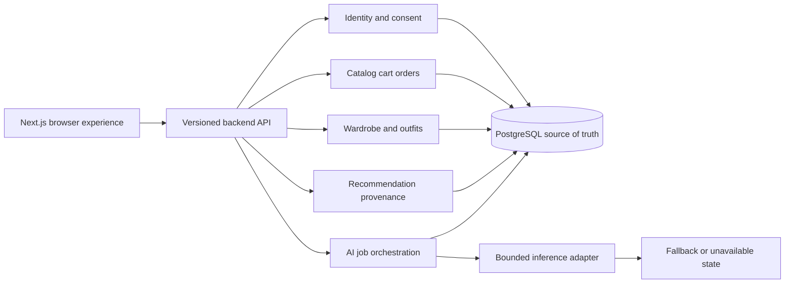
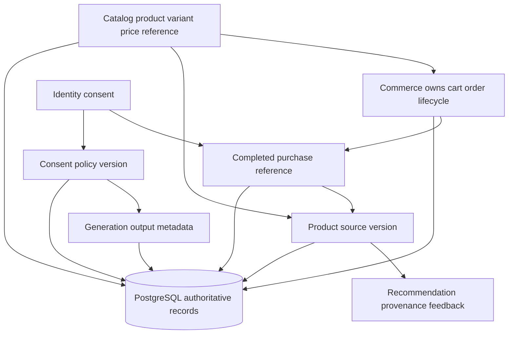
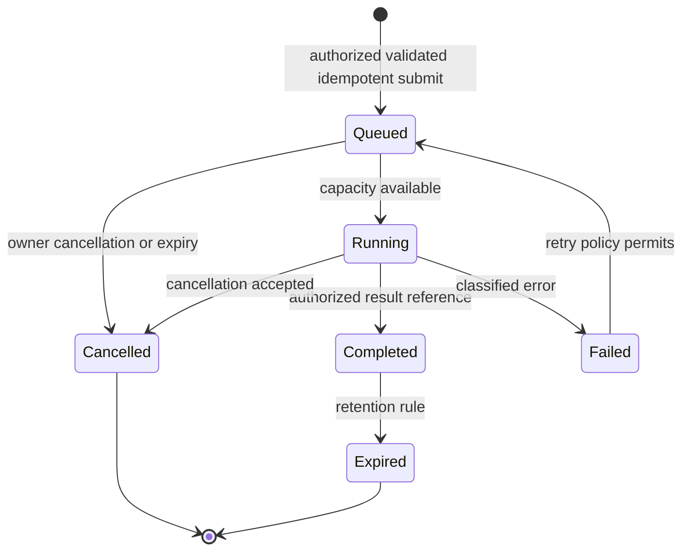
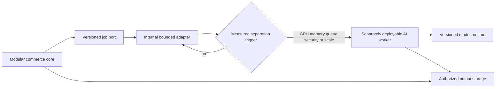

# DRAPE — Workstream D: Backend, Database and AI Architecture Research

**Phase:** 0.2 Technology Evaluation, M0 research supporting M2, M6, and conditional AI workloads.
**Status:** Documentation research complete. No scaffold, schema, model, job runner, provider, benchmark, or deployment is authorized.
**Prepared / sources accessed:** 2026-11-05.

## 1. Executive summary

The preferred modular-monolith approach remains appropriate as a **research baseline**, not an approved implementation decision. DRAPE’s commerce, identity/consent, wardrobe, recommendation provenance, and AI-job metadata can begin within one deployable backend and PostgreSQL source of truth if internal ownership boundaries, authorization, transactions, idempotency, and a versioned job interface are designed before feature work.

PostgreSQL should hold authoritative relational commerce data. `jsonb` is appropriate for bounded evolving metadata, not for ownership, money, orders, consent, or lifecycle controls. PostgreSQL full-text search and structured filters should be evaluated before vector retrieval. pgvector can be added only where a defined semantic-retrieval use case has measured relevance benefit; embeddings remain derived/index data.

PyTorch and ONNX Runtime are runtime candidates, not performance conclusions. Keep CPU as the evaluation baseline. A separately deployable GPU worker/service is justified only by measured model-memory/GPU isolation, commerce-impact, independent-scaling, queue-protection, or sensitive-data-boundary evidence. Current outcome: retain modular-monolith research posture; defer separate AI service, dedicated search/vector service, CUDA/TensorRT adoption, and M1 implementation.

## 2. Research scope and methodology

This report evaluates architecture candidates against Phase 0.1 requirements, risks, and Workstreams A–C. It does not choose a final stack, alter the roadmap, create a schema, or authorize Workstream E/M1.

- **Verified:** directly supported by an official document, repository, license, or standard listed in Section 17.
- **Assumption:** DRAPE-specific data volume, workload, quality, cost, jurisdiction, or deployment premise not measured here.
- **Recommendation:** a proposed boundary/evaluation gate, not an implemented architecture decision.
- No application code, dependencies, models, embeddings, migrations, load tests, or cloud/provider resources were created or run. All DRAPE latency, recall, memory, capacity, availability, and cost figures are **not measured**.

The existing `prototype.html` is a client-only, legacy MediaPipe CDN/2D-canvas demonstration with synthetic catalog/cart state. It supplies no approved backend, database, authentication, persistence, worker, or service architecture.

## 3. Backend architecture options and comparison

| Option | Composition | Benefits | Risks / operational burden | Research posture |
|---|---|---|---|---|
| A. FastAPI modular monolith | Next.js client communicates with one Python/FastAPI deployable and PostgreSQL; bounded same-process/background adapter only for short non-GPU tasks | Lowest initial data-ownership and deployment complexity; transactional commerce boundary; clean internal ports can later move | Long/heavy work can starve API workers; model-loaded workers multiply memory; requires domain discipline | **Preferred baseline for evaluation.** |
| B. Next.js BFF + FastAPI modular core + conditional AI worker | Browser-facing BFF/proxy; FastAPI owns commerce; separate worker only when justified | Can isolate GPU/runtime/queue/sensitive-image lifecycle from commerce; BFF may tailor browser contract | More deployments, auth propagation, observability, idempotency, storage and cost complexity | **Conditional future option.** |
| C. Django/DRF monolith | Django/DRF replaces FastAPI core | Built-in administration/auth/workflow capabilities (S6–S9) | Diverges from current FastAPI preference; does not remove AI/GPU boundary need | **Defer** unless a concrete administration/workflow need is shown. |

### Evidence

FastAPI documents asynchronous request handling, dependency composition, multi-file organization/security patterns, and multiple server workers (S1–S4). Each worker is an independent process, so model-loaded workers require measured memory/VRAM/concurrency evaluation rather than a default count. `BackgroundTasks` is intended for small same-process tasks; FastAPI directs heavy multi-process/server work toward a queue-backed solution (S5).

Next.js documents BFF/proxy/route-handler capability but explicitly distinguishes it from a full backend replacement (S10). Self-hosted multi-instance operations add cache, deployment-version, and encryption-key coordination concerns (S11). Django/DRF is a relevant alternative only where its documented admin/auth/workflow and REST capabilities create a material advantage (S6–S9).

## 4. Proposed modular-monolith domain boundaries

Keep one deployment unit initially, but impose explicit module ownership. A domain service owns its writes; other domains use published application interfaces/read models rather than direct table access. This is a recommendation for later implementation design, not a schema.

| Domain | Owns / source of truth | Must not own |
|---|---|---|
| Identity and consent | Account/profile identity references, authentication linkage, consent/retention choices, access-control subject | Order state, garment catalog truth, generated image binaries |
| Catalog and commerce reference | Products, variants, attributes, prices/inventory references, source/version data | User wardrobe, user consent, order lifecycle |
| Cart, checkout, orders | Cart state, order/order-item lifecycle, payment/shipping provider references, idempotent purchase commands | AI output quality or model state |
| Wardrobe and outfits | Owned items, manual attributes, outfits, visibility/deletion state | Product pricing/inventory authority |
| Recommendations | Request context, provenance, version, feedback/dismissal, explainability references | Canonical product/wardrobe attributes |
| AI job orchestration | Job metadata, owner, consent/policy version, input/output references, status, retry/cancel/retention state | Raw sensitive inputs in ordinary logs; canonical commerce records |
| Audit/notification | Immutable/append-only event references and delivery state | Domain business-state mutation |

### Boundary rules

1. Transactions remain local to a single aggregate/domain operation. Cross-domain effects are represented as versioned application/domain events recorded transactionally for later delivery; they are not assumed to be distributed transactions.
2. Commands subject to retry (checkout, wardrobe import, generation submission) carry idempotency keys and authenticated owner/tenant scope.
3. Authorization is enforced at the application/domain boundary; database mechanisms can add defense in depth but never substitute for service authorization.
4. No module reads/writes another module’s internal persistence structures as an integration shortcut. Publish a stable interface/read model instead.
5. Commerce remains usable when recommendation or AI job paths are unavailable.

## 5. API and versioned inference/job interface proposal

### Browser/backend communication

The Next.js browser layer should use an authenticated, versioned application API owned by the backend. A BFF can be considered only to aggregate browser-facing views, protect server-side secrets, or normalize session/cookie handling; every BFF endpoint is still public HTTP and must authenticate, authorize, validate, rate-limit, and sanitize errors independently. It must not become a parallel commerce source of truth.

### Internal job port

Define a versioned internal contract before a model/provider exists:

| Element | Proposed requirement |
|---|---|
| Submit | Opaque job ID; authenticated owner/tenant; `job_type` and contract version; validated asset references; consent/policy version; idempotency key. |
| States | `queued → running → completed / failed / cancelled / expired`; legal transitions and timestamps recorded. |
| Result | Authorized output references only; model/preprocessor/provider version; sanitized retryable/non-retryable error category; no sensitive payload in ordinary logs. |
| Controls | Owner authorization, quota/concurrency, timeout, cancel semantics, retry policy, retention/deletion state. |
| Adapter boundary | Initial bounded adapter may be internal; a later worker/service implements the same contract without changing commerce/wardrobe domains. |

This contract is relevant to any future VTON, recommendation, or model-backed capability; it does not authorize execution. It responds to NFR-005/006/007 and SEC-001–006 while preserving the conditional M7 boundary.

## 6. Database source-of-truth and data ownership model

PostgreSQL is the proposed initial authoritative store for users/profiles, catalog/variant references, price/inventory references, cart/orders/order items, wardrobe/outfits, preferences/consent, AI-job/output metadata, and recommendation provenance. PostgreSQL is permissively licensed (S12).

### Relational versus JSONB

**Relational mandatory:** identifiers/ownership, foreign-key-like relationships, money/price, order state, consent, retention/deletion, authorization-bearing scope, idempotency, audit references, product/variant links, wardrobe/outfit membership, recommendation provenance, and job lifecycle. These require explicit integrity/query/audit semantics.

**`jsonb` conditional:** bounded evolving catalog attributes, model/provider metadata, or external payload fragments where fields are versioned, access-controlled, and not the authority for core relationships. PostgreSQL documents `jsonb` as decomposed binary data with indexing support and recommends it for most cases over `json` when exact input representation is unnecessary; it does not preserve whitespace/key order/duplicate keys (S13). It is not a substitute for normalized commerce data.

### Data lifecycle and isolation

Every user-owned record must have ownership/tenant scope at the application boundary. PostgreSQL Row-Level Security can restrict queried/modified rows and defaults to deny when enabled with no policy, but owners/superusers/BYPASSRLS roles may bypass it (S15). **Recommendation:** use RLS, if later chosen, as defense in depth after application authorization, privileged-role control, migration/review discipline, and cross-tenant tests.

Derived outputs (embeddings, recommendation candidates, generated-output metadata) must reference source entity/version, derivation model/version, state, owner scope, retention/deletion state, and invalidation/recompute rule. Delete or materially change the source record and the derived record must be invalidated/deleted/recomputed under an approved lifecycle.

## 7. PostgreSQL, JSONB, full-text search, and pgvector evaluation

PostgreSQL full-text search supports documents, configurations, dictionaries, indexes, ranking, highlighting, triggers, and query planning (S14). Start catalog/wardrobe retrieval with structured relational filters and full-text search.

pgvector performs exact nearest-neighbor search by default; HNSW and IVFFlat are approximate alternatives. pgvector documents HNSW as having a better speed/recall trade-off but slower builds/higher memory, while IVFFlat builds faster/uses less memory with a lower speed/recall trade-off (S16). Approximate filtering applies after index scanning, so low-selectivity/filter/tenant queries require measured recall and may need filter indexes, partial indexes, partitioning, or iterative scans (S16). pgvector and PostgreSQL use permissive PostgreSQL licenses (S12, S17).

### Retrieval position

1. Use structured category, colour, season, occasion, style/preference, ownership and availability filters first.
2. Add PostgreSQL full-text search for catalog/wardrobe text discovery.
3. Add embeddings/pgvector only when a defined semantic question cannot be answered sufficiently by filters/text and an offline relevance study shows material benefit.
4. For vector use, compare exact, HNSW, and IVFFlat on representative data; use hybrid search only with explicit filters, text signals, vector candidates, provenance, and explainability.
5. Do not introduce a dedicated vector/search service unless PostgreSQL/pgvector fails pre-approved relevance, latency, memory/write, isolation, reliability, or cost evidence after tuning.

## 8. AI runtime and ONNX compatibility assessment

PyTorch can export models to ONNX and supports export/verification workflows, but export must be evaluated for selected model/operator coverage and output parity (S18). ONNX Runtime supports CPU and accelerator execution providers, including CUDA and TensorRT; provider/graph/operator/hardware behavior is not uniform (S19–S21).

**Recommendation:** CPU is the baseline for evaluation. ONNX Runtime is **defer** until a rights-cleared model exports, passes pre-approved output-quality parity, and shows measured deployment benefit. CUDA is **defer** until a cleared candidate shows approved quality/latency/cost benefit over CPU. TensorRT is **defer** until an NVIDIA-specific compatible workload demonstrates measured benefit over CUDA ORT/PyTorch; it adds version/build/cache/operator constraints.

Model initialization, cold starts, worker count, RAM/VRAM, concurrency, queue wait, throughput, retries, and idle utilization must be measured. FastAPI worker processes can multiply loaded model/runtime memory (S3). ONNX Runtime documents memory and threading tuning, supporting measurement rather than assumed defaults (S22–S23). PyTorch and ONNX Runtime licenses do not clear weights, datasets, CUDA/TensorRT distribution terms, preprocessing, or output rights (S24–S25).

## 9. AI stylist retrieval architecture and evaluation methodology

### Proposed retrieval flow

1. Authorize the user and determine the current wardrobe/product scope.
2. Apply relational filters (owned/available, category, colour, season, occasion, preference, market/price where relevant).
3. Apply text search for product/wardrobe descriptions where it materially helps.
4. Add semantic/vector candidates only for a defined task and only after filtering/recall behavior is measured.
5. Generate recommendation candidates with source IDs/versions and rule/model version.
6. Persist explanation/provenance and user feedback/dismissal; do not claim certainty or fit.

Embeddings are not source of truth. They need source/model/version/time/state provenance and a stale/deleted-source lifecycle. The system should avoid embeddings for attributes already accurately answered by relational queries.

### Evaluation protocol

Use a rights-cleared, non-production relevance set covering wardrobe composition, product complement, colour/category/occasion/style filters, sparse wardrobes, conflicting preferences, stale/deleted records, no-result/fallback, and tenant-isolation cases. Compare structured-only, full-text, vector-only, and hybrid approaches. Measure recall@k/ranking relevance, latency distribution, index size/build/write overhead, memory, filtering behavior, stale/deleted-source behavior, explanation completeness, and cross-tenant isolation. All targets are **TBD — requires explicit approval before testing.** Semantic similarity alone is not recommendation quality or preference certainty.

## 10. Security, privacy, and operational boundary analysis

- Carry authenticated subject/tenant and authorization context through every request/job; never use browser-provided role/ownership claims as facts.
- Store secrets/model artifacts in controlled locations; pin version/provenance/license and avoid embedding them in code/logs.
- Keep images, prompts, embeddings, raw inputs, auth tokens, signed URLs, and sensitive model outputs out of ordinary logs/telemetry. NIST log-management guidance supports deliberate log control (S26).
- Audit consent, job submission/state, recommendation version/provenance, access/deletion actions, and privileged administration without recording sensitive payloads.
- Enforce idempotency, timeouts, quotas, concurrency caps, cancellation, retry/error classification, tenant isolation, and output authorization.
- Define backup/restore and deletion propagation for source and derived records before production data; AI-job failure must not impair checkout/orders.
- Isolate a separate AI runtime only when it provides measurable failure, memory/GPU, scale, security, or sensitive-data-lifecycle benefit that exceeds new operational exposure.

## 11. Cost and capacity model

No workload, deployment region, hardware, service, or current price is approved; no monthly cost is estimated. A future cost/capacity model must declare assumptions and capture:

| Cost/capacity variable | Required evidence |
|---|---|
| API | Request mix, CPU/RAM, worker/process count, p50/p95, error/timeout, headroom. |
| PostgreSQL | Record/index growth, connection/query mix, storage/backup, CPU/memory/IO, recovery target. |
| pgvector | Embedding dimension/count, exact/HNSW/IVFFlat index size/build/write cost, recall/latency, memory. |
| Model runtime | Checkpoint/preprocessor size, cold/warm memory/VRAM, CPU/GPU utilization, model load, concurrency, retries/failures. |
| Jobs | Arrival rate, queue wait, timeout/cancel, success/failure, quota, retention/deletion. |
| Images | Temporary/output object storage, delivery/egress, retention, access logging. |
| Operations | Monitoring, alerting, security, incident response, backup/restore, staff/maintenance. |

### Proposed measurable triggers

- **Scale modular monolith:** observed API/database saturation or resilience targets fail after approved profiling/tuning.
- **Add background worker:** an asynchronous workload has defined idempotency, retry/cancel/timeout, data lifecycle and a measured need not safely served in request path.
- **Separate AI service:** measured GPU/model-memory conflict, commerce latency/availability impact, independent scaling/queue requirement, sensitive-data boundary, or incident isolation benefit exceeds deployment/security/cost complexity.
- **Dedicated vector/search system:** measured PostgreSQL/pgvector relevance, latency, index-memory/write, filtering/tenant-isolation, reliability, or cost gates fail after approved tuning.

Every threshold remains **TBD — requires explicit approval before testing.**

## 12. Mermaid architecture and data-flow diagrams

All diagrams are proposed research designs; none depicts implemented infrastructure.

### Proposed modular-monolith logical architecture

### Data ownership and source-of-truth flow

### Proposed AI job and inference lifecycle

### Conditional future AI-service separation

## 13. Licensing and dependency inventory

| Component | Verified license / terms | Required independent review |
|---|---|---|
| Next.js | MIT (S27) | Exact version, deployment provider, plugins, BFF dependencies. |
| React / TypeScript | MIT / Apache-2.0 (S28–S29) | Exact versions and application dependencies. |
| FastAPI | MIT (S4) | Exact server/ASGI/runtime and deployment dependencies. |
| Django / DRF | BSD (S8–S9) | Only if material alternative is evaluated. |
| PostgreSQL / pgvector | PostgreSQL License (S12, S17) | Exact server/extension releases and operating dependencies. |
| PyTorch / ONNX Runtime | BSD-style / MIT (S24–S25) | Model/checkpoint/data/preprocessor/provider/CUDA/TensorRT/output rights independently. |
| Model artifacts / datasets / images | None selected | Every artifact requires provenance, commercial rights, retention/deletion and jurisdiction review. |

Permissive framework/runtime licensing never clears model weights, training/evaluation datasets, customer images, derived embeddings, generated outputs, cloud images, CUDA/TensorRT distribution, or provider terms.

## 14. Risks, unresolved questions, and evidence gaps

- No product volume, concurrent users, catalog/wardrobe size, region, tenancy model, recovery target, retention policy, or performance/relevance threshold exists.
- No model/checkpoint/preprocessor is commercially cleared for VTON; Workstream C remains no-go for commercial integration.
- Worker memory/VRAM multiplication, ONNX export parity/operator support, CUDA/TensorRT benefit, retrieval recall, vector filtering, RLS/authorization behavior, and all cost/capacity facts remain unmeasured.
- Approximate pgvector filtering can affect recall; tenant/filter strategy needs explicit evaluation (S16).
- RLS can be bypassed by owners/superusers/BYPASSRLS roles and cannot replace application authorization (S15).
- Existing prototype claims/performance do not provide architecture evidence. It remains outside the approved architecture.
- No Phase 0.1 requirement/roadmap inconsistency was found.

## 15. Recommendations with confidence levels

- **Modular monolith:** retain as baseline. **Moderate confidence**; it matches current unknown scale and avoids premature distributed operations, subject to explicit boundaries.
- **PostgreSQL source of truth:** retain. **Moderate confidence** for current scope; relational core and controlled `jsonb` use fit stated requirements, but volume/recovery evidence is absent.
- **Full-text before vector:** recommend. **Moderate confidence**; vector use needs a defined semantic need and measured value.
- **pgvector:** conditional. **Low-to-moderate confidence** until data volume/relevance/filtering/index costs are measured.
- **ONNX Runtime/CUDA/TensorRT:** defer. **High confidence** that export/provider/benefit evidence is required; low confidence in any specific future runtime choice.
- **Separate AI worker/service:** defer. **High confidence** that a measurable exception is required; low confidence in the future need before workload data.

## 16. GO / NO-GO / DEFER decisions

| Question | Decision | Gate |
|---|---|---|
| Use modular monolith as research baseline | **GO (research posture only)** | Preserve ownership/job boundaries; no M1 implementation authorization. |
| PostgreSQL as initial source-of-truth candidate | **GO (research posture only)** | Later schema/recovery/authorization evidence. |
| `jsonb` for bounded metadata | **GO (conditional)** | Not for core relational/authorization/lifecycle data. |
| pgvector | **DEFER** | Defined semantic use case and measured relevance/latency/memory/filtering evidence. |
| Dedicated search/vector system | **NO-GO now** | Only after PostgreSQL/pgvector evidence fails approved gates. |
| In-process heavy/GPU inference | **NO-GO now** | Heavy work must not impair commerce; no workload evidence. |
| Background worker | **DEFER** | Approved async workload, lifecycle/error contract, and measured need. |
| Separate AI worker/service | **DEFER** | Measured GPU/queue/scale/security/incident benefit exceeds complexity. |
| ONNX Runtime | **DEFER** | Rights-cleared model exports with parity and deployment benefit. |
| CUDA / TensorRT | **DEFER** | Measured compatible-model benefit and justified cost/operations. |

## 17. Primary-source register

All sources were accessed 2026-11-05. “Current” documentation/repository URLs are mutable and need version/revision pinning before later use.

| ID | Exact URL | Organization | Version / license | Claims supported |
|---|---|---|---|---|
| S1 | https://fastapi.tiangolo.com/async/ | FastAPI | Current documentation | Async request behavior. |
| S2 | https://fastapi.tiangolo.com/tutorial/bigger-applications/ | FastAPI | Current documentation | Multi-file composition. |
| S3 | https://fastapi.tiangolo.com/deployment/server-workers/ | FastAPI | Current documentation | Multiple worker processes. |
| S4 | https://github.com/fastapi/fastapi/blob/master/LICENSE | FastAPI | MIT | FastAPI license. |
| S5 | https://fastapi.tiangolo.com/tutorial/background-tasks/ | FastAPI | Current documentation | Small-task/background queue guidance. |
| S6 | https://www.djangoproject.com/start/overview/ | Django | Current documentation | Django admin/auth/workflow context. |
| S7 | https://www.django-rest-framework.org/ | DRF | Current documentation | API/auth/permissions/throttle/versioning context. |
| S8 | https://github.com/django/django/blob/main/LICENSE | Django | BSD | Django license. |
| S9 | https://github.com/encode/django-rest-framework/blob/master/LICENSE.md | DRF | BSD | DRF license. |
| S10 | https://nextjs.org/docs/app/guides/backend-for-frontend | Vercel | Current documentation | BFF limits and route/proxy context. |
| S11 | https://nextjs.org/docs/app/guides/self-hosting | Vercel | Current documentation | Multi-instance cache/deployment/key concerns. |
| S12 | https://www.postgresql.org/about/licence/ | PostgreSQL Global Development Group | PostgreSQL License | PostgreSQL license. |
| S13 | https://www.postgresql.org/docs/current/datatype-json.html | PostgreSQL Global Development Group | PostgreSQL 18 current docs | `json`/`jsonb` semantics and indexing. |
| S14 | https://www.postgresql.org/docs/current/textsearch.html | PostgreSQL Global Development Group | PostgreSQL 18 current docs | Full-text search features. |
| S15 | https://www.postgresql.org/docs/current/ddl-rowsecurity.html | PostgreSQL Global Development Group | PostgreSQL 18 current docs | RLS/default deny/bypass caveats. |
| S16 | https://github.com/pgvector/pgvector | pgvector | Current repository; exact release TBD | Exact/HNSW/IVFFlat, filtering, hybrid search, monitoring. |
| S17 | https://github.com/pgvector/pgvector/blob/master/LICENSE | pgvector | PostgreSQL License | pgvector license. |
| S18 | https://docs.pytorch.org/docs/2.15/onnx.html | PyTorch | PyTorch 2.15 documentation | ONNX export/verification context. |
| S19 | https://onnxruntime.ai/docs/execution-providers/ | ONNX Runtime | Current documentation | Execution provider overview. |
| S20 | https://onnxruntime.ai/docs/execution-providers/CUDA-ExecutionProvider.html | ONNX Runtime | Current documentation | CUDA EP requirements/behavior. |
| S21 | https://onnxruntime.ai/docs/execution-providers/TensorRT-ExecutionProvider.html | ONNX Runtime | Current documentation | TensorRT EP requirements/behavior. |
| S22 | https://onnxruntime.ai/docs/performance/tune-performance/memory.html | ONNX Runtime | Current documentation | ORT memory tuning. |
| S23 | https://onnxruntime.ai/docs/performance/tune-performance/threading.html | ONNX Runtime | Current documentation | ORT threading tuning. |
| S24 | https://github.com/pytorch/pytorch/blob/main/LICENSE | PyTorch | BSD-style | PyTorch license. |
| S25 | https://github.com/microsoft/onnxruntime/blob/main/LICENSE | Microsoft | MIT | ONNX Runtime license. |
| S26 | https://csrc.nist.gov/pubs/sp/800/92/final | NIST | SP 800-92 | Log-management guidance. |
| S27 | https://github.com/vercel/next.js/blob/canary/license.md | Vercel | MIT | Next.js license. |
| S28 | https://github.com/facebook/react/blob/main/LICENSE | Meta | MIT | React license. |
| S29 | https://github.com/microsoft/TypeScript/blob/main/LICENSE.txt | Microsoft | Apache-2.0 | TypeScript license. |
