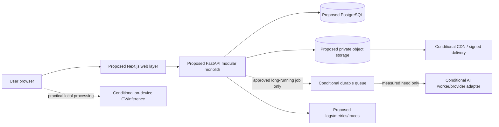
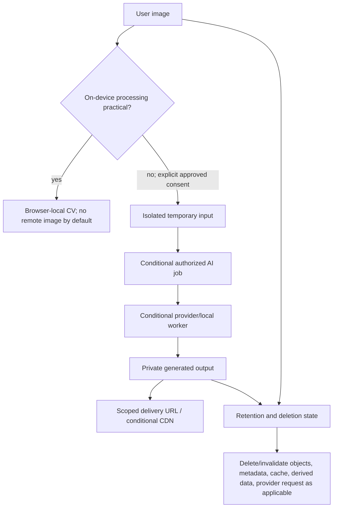
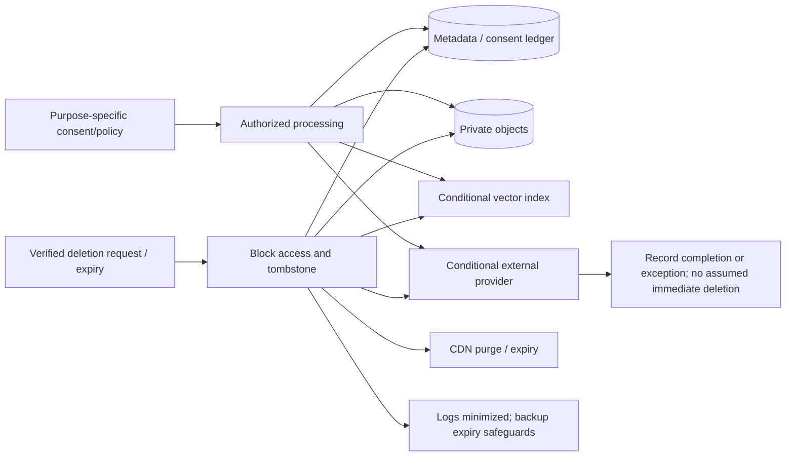
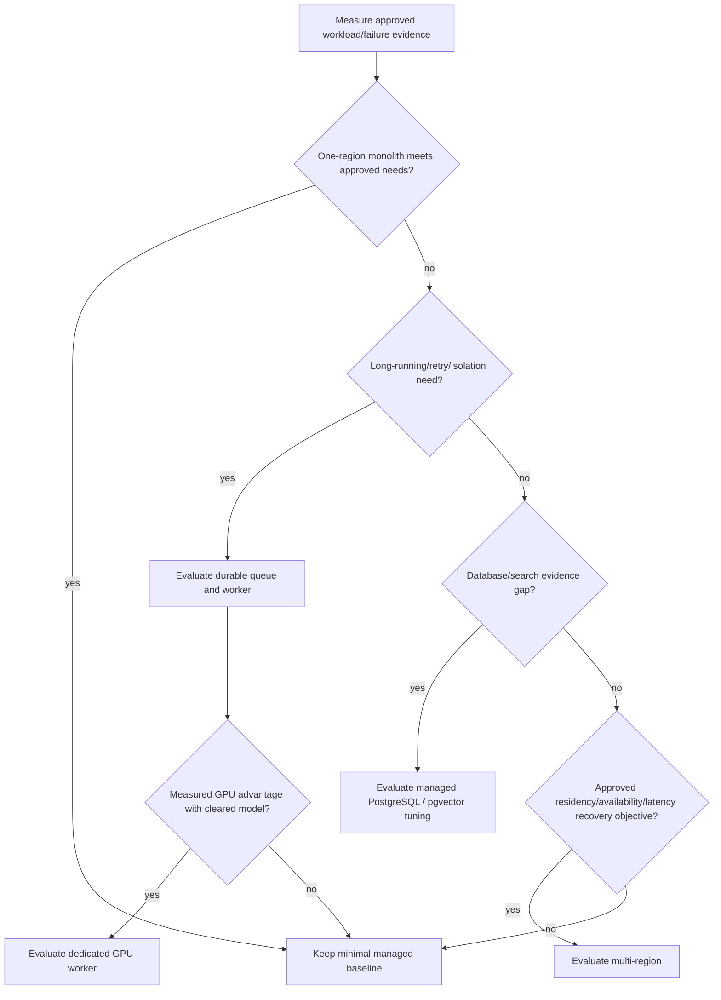

# DRAPE — Workstream E: Infrastructure, Privacy and Cost Research

**Phase:** 0.2 Technology Evaluation, M0 research.
**Status:** Research complete; external review required. No provider, deployment, or implementation is approved.
**Prepared / sources accessed:** 2026-11-05.

## 1. Executive summary

**Recommendation:** evaluate a small modular-monolith deployment—Next.js web layer, FastAPI core, PostgreSQL as relational source of truth, and private object storage—for a future initial release. This is not a selected architecture. Keep camera/landmark processing on-device where practical; remote image generation must be explicit, consented, asynchronous and separately governed.

Managed application hosting, managed PostgreSQL and object storage/CDN can reduce initial operations, but create regional, retention, egress, support and lock-in questions. Browser inference avoids image transfer and GPU cost where a rights-cleared device/model matrix supports it. Server/GPU inference remains conditional on measured quality, latency, throughput, privacy and cost evidence.

**Outcome:** GO for further evidence planning; NO-GO for production infrastructure, customer-media processing and commercial VTON integration; DEFER provider selection and scaling services. No DRAPE performance, cost, recovery, availability or compliance outcome has been measured.

## 2. Research scope and methodology

This report covers E1–E6 without repeating Workstreams A–D. It evaluates deployment, privacy/security, media lifecycle, cost, reliability and scaling for Workstream D's modular-monolith research baseline. `prototype.html` remains an unmodified, client-only reference; it supplies no approved hosting, persistence, security or lifecycle design.

- **Verified:** directly supported by a primary source in Section 19.
- **Assumption:** hypothetical DRAPE workload or unresolved product/legal premise.
- **Recommendation:** a proposed future control/evaluation gate, not approval.
- **Unresolved:** missing jurisdiction, contract, price, workload or measurement evidence.

No accounts, cloud resources, models, uploads, benchmarks, dependencies, code, deployment, schema or final M0.7 architecture work was created.

## 3. Deployment architecture options

| Option | Benefits | Limits / burden | Posture |
|---|---|---|---|
| Managed app services | Low setup/patching/deployment effort | Function/runtime limits; platform routing/logging/build coupling | **Evaluate** |
| Container platform | Portable service boundary | Images, registry, networking, scaling, patching and secrets operations | **Conditional** |
| Virtual machines | Maximum runtime/network control | OS/database operations, capacity, recovery and on-call burden | **Defer** |
| Browser-first inference | Less image transfer/GPU demand | Device coverage, model rights and quality unmeasured | **Preferred direction where viable** |
| Async AI worker | Isolates long jobs and commerce latency | Queue, lifecycle, idempotency, provider and cost complexity | **Defer until measured need** |

FastAPI distinguishes small same-process background tasks from heavier queue-backed work (S1). Next.js documents BFF/proxy capability, not replacement for a full backend (S2). These support a bounded API core and conditional worker boundary, not an implemented topology.

## 4. Hosting and provider comparison

| Category / examples | Published capability / cost model | Residency / lock-in | Suitability |
|---|---|---|---|
| Managed web/app: Vercel, Render | Both publish plans; Vercel documents regions/function limits; Render documents services/workers and regions (S3–S6). Free allowances/limits are plan dependent. | Verify data path/region/terms. Build, routing and logs are platform-coupled. | Candidates for low-ops evaluation; no selection. |
| Containers | Compute/runtime/network pricing; explicit image boundary | Runtime/network/provider coupling persists. | Only if managed-service limits block a verified need. |
| VM | Compute/disk/network charged separately | More control, but DRAPE owns patching, backup and recovery. | Not an early default. |
| Managed PostgreSQL: Neon, Supabase, RDS-class | Published plan/usage pricing; Supabase/RDS document backup capability (S7–S10). | Region, extension, export, retention, egress and support differ. | Leading evaluation path; restore/region/cost/DPA evidence required. |
| Self-managed PostgreSQL | Software is permissively licensed; DRAPE bears hosting/operations | Highest portability and operational responsibility. | Defer without a concrete managed-service gap. |
| Object/CDN: Cloudflare R2, S3-compatible | R2 documents storage/operations/retrieval pricing and lifecycle; S3 documents presigned URLs (S11–S13). | Verify location, cache purge, lifecycle and legal hold. | Evaluate private storage plus app authorization; no provider choice. |
| Browser vs server/GPU | Device compute vs queue/GPU/provider cost; Triton documents serving features (S14). | Hardware/runtime/provider trade-off. | Keep both hypotheses pending Workstreams A/C/D evidence. |

**Provider-published illustration only:** R2's 2026-10-30 page lists standard storage at $0.015/GB-month, Class A $4.50/million, Class B $0.36/million and no Internet egress charge (S11). That volatile figure excludes the rest of DRAPE and is not a budget.

## 5. Data storage and media architecture

**Recommendation:** PostgreSQL holds authoritative structured records and opaque references; private object storage holds approved binaries. Object keys/URLs are not authorization. Product imagery and 3D assets retain Workstream B provenance/rights metadata; user media retains owner/consent/retention metadata. A CDN is distribution/cache, not authority.

| Data | Location/access | Authority | Retention/deletion |
|---|---|---|---|
| Account, consent, wardrobe, job metadata | PostgreSQL; tenant-scoped authorization | Authoritative | Policy/legal retention; trigger dependent actions. |
| Original user photo | Private objects; scoped short-lived access | Non-regenerable input | Short purpose window; no default training reuse. |
| Temporary inference input | Browser memory where practical, otherwise isolated temp store | Transport derivative | Fast expiry; never raw-log. |
| Generated try-on | Private object/provider path pending approval | Derived/regenerable only with valid source | User/policy retention; CDN expiry is not record deletion. |
| Product photos / GLB | Controlled origin/CDN; provenance | Licensed source asset | Contract/catalog lifecycle; purge if rights withdrawn. |
| Landmarks, embeddings, recommendations | Device-first; protected DB/conditional vector index | Derived/recomputable | Minimize; delete/invalidate with source/account. |
| Jobs/audit/logs | Restricted operational store | Operational evidence | Redacted/minimized; separate schedule. |

Encryption in transit/at rest, least privilege, tenant checks, scoped signed URLs and audit trails are technical recommendations. A presigned URL is a time-limited bearer capability—not authorization, validation or deletion (S13).

## 6. Privacy and regulatory analysis

**Legal texts, not compliance conclusions:** GDPR Articles 5, 6–7, 12–22, 25, 28, 32–34 and 44+ establish principles, lawful basis/consent, rights, privacy by design, processors, security/breach and transfer requirements where applicable (S15). Photo, landmark and embedding classification—including possible biometric/special-category analysis—requires legal assessment.

India's DPDP Act covers certain digital processing related to offering goods/services in India and addresses notice/consent, withdrawal, safeguards, breach notification and erasure subject to law (S16). Notified DPDP Rules 2025 have staged commencement, which must be checked for the launch date/scope (S17). California's CCPA material describes applicable access, deletion/correction, verification/timing and service-provider obligations; applicability/exceptions require counsel (S18).

| Classification | Treatment |
|---|---|
| Confirmed legal source | Establishes obligations where applicable, not that DRAPE is subject or compliant. |
| Technical recommendation | Purpose-bound consent ledger, inventory, encryption, role/tenant authorization, secure upload, deletion orchestration, processor due diligence and incident playbook. |
| Proposed policy | On-device first where practical; separate explicit opt-in for remote AI; no default model-training reuse; no customer media in dev/staging. |
| Legal/procurement review | Markets, roles, lawful basis, age, sensitive/biometric status, notices, transfers, DSAR, retention, processors/DPA, payment/provider terms. |

## 7. AI and media data lifecycle

Workstream C remains controlling: no commercial VTON provider/model is selected. FASHN says request records are not automatically deleted; URL strings remain in records, base64 processing copies delete on completion with a one-day cleanup backstop, CDN outputs are scheduled for deletion after three days, and base64 outputs expire after 60 minutes (S19). Output expiry does **not** delete request records. Its manual deletion route requires `legal@fashn.ai`, organization and prediction IDs; it is not API-based, automatic, immediate or guaranteed (S19).

Replicate terms (last update 2026-04-01) define Customer Data as inputs/outputs and include service-related rights, including the stated Customer Derivative Model context; output rights remain subject to third-party model terms (S20). A platform agreement does not clear model, dataset, output or subprocessor restrictions.

**Recommendation:** record owner, purpose/consent-policy version, region/provider, source/derivation, expiry and deletion state. A deletion coordinator blocks access, then idempotently deletes/invalidates metadata, source/output objects, CDN cache, temporary space, vector data, jobs, logs and provider request as applicable. Backups need expiry/restore safeguards; failed external deletion goes to a visible exception path, never a false-complete state.

## 8. Consent, retention, and deletion strategy

| Event | Proposed control | Limitation |
|---|---|---|
| Upload | Purpose notice; authorization; allowlisted type/size; generated name; private isolated store | Exact limits/scanning policy TBD; upload boundary is high risk (S21). |
| Remote AI | Separate opt-in/policy version; least data; approved transient transfer; record provider/region | Consent does not replace rights, contract or security review. |
| Access/export/correction | Verify requester and scope; audit process | Jurisdiction, exceptions, format and timing need approval. |
| Source/account deletion | Block/tombstone; remove objects/references/derived data; purge cache; cancel jobs; request provider action | Copies are distinct; no universal immediate-erasure promise. |
| Backup recovery | Restricted restore; reapply deletion ledger before access where possible | RPO/RTO, legal hold and re-deletion need test/approval. |

## 9. Security architecture

**Recommendation:** TLS; authenticated authorization for every object/job; least-privilege identities; centralized secret storage; scoped delivery URLs; server-side validation; rate limits; audit records. Never put raw photos/URLs, secrets, payment details or prompts in ordinary logs.

OWASP recommends layered upload safeguards including allowlists, generated filenames, limits, isolated storage and authorization (S21). Logging guidance warns logs can contain sensitive data (S22); secrets guidance supports access control, rotation/revocation and recovery planning (S23). These are safeguards, not proof of security/compliance.

## 10. Reliability and observability

**Recommendation:** health/readiness checks; UTC structured logs/correlation IDs; availability, latency, error, saturation, upload, job, queue-age/depth, retry, provider, backup and deletion metrics; traces; alerting; generic external errors; rollback; restore drills and an incident playbook. OpenTelemetry supplies traces/metrics/logs frameworks, not a selected monitoring service (S24).

| Environment | Proposed posture |
|---|---|
| Development | Isolated credentials/non-production data; no customer photos by default. |
| Staging | Synthetic or explicitly approved test data; production-like lifecycle/restore checks. |
| Production | Separate access, controlled deploy/rollback, monitoring, backup/restore drills and change audit. |

RDS documents point-in-time restore to a new instance within configured retention and transaction-log uploads every five minutes (S10). That is an example capability, not proof of DRAPE recovery. NIST CSF/Privacy Framework are risk-management frameworks, not certificates (S25–S26).

## 11. Cost and capacity scenarios

All figures are **assumptions**, USD/month, single unselected region—not DRAPE forecasts. Totals are unresolved: plan, region, tax, cache hit rate, request mix, retention, terms and current price are unverified.

| Assumption | A: prototype / low traffic | B: small launch | C: meaningful AI |
|---|---:|---:|---:|
| MAU / DAU | 100 / 10 | 5,000 / 500 | 50,000 / 7,500 |
| API requests/month | 10,000 | 1,000,000 | 30,000,000 |
| Catalog / assets | 100 / 10 GB | 5,000 / 250 GB | 50,000 / 2 TB |
| Uploads/month; average input/output | 50; 3 MB / 2 MB | 5,000; 3 MB / 2 MB | 100,000; 3 MB / 2 MB |
| Remote AI requests/month | 0 unless separately approved | 0–500 evaluation-only | 0–20,000 only after approval |
| Retention / inference | TBD-short; browser only | TBD; browser-first/conditional remote | TBD; browser plus conditional async remote/GPU |

| Cost category | Driver |
|---|---|
| Fixed | App/API/database base plans, domains, minimum monitoring/support. |
| Usage | Requests, runtime/concurrency, DB compute/storage/backups. |
| Storage/egress | GB-month, operations, cache miss, bytes served, image transformations. |
| AI | Successful request price/credit or GPU runtime plus retries and failed jobs. FASHN's one-credit/output statement is not DRAPE dollar cost/SLA (S27). |
| Operations | Monitoring ingestion/retention, scanning, recovery and support/on-call. |

## 12. Cost optimization recommendations

1. Use cleared browser-local processing where viable, without excluding unsupported users.
2. Set approved short retention/lifecycle policies for originals and outputs; measure cache hit/egress before CDN commitment.
3. Require user-initiated AI, quotas, cancellation, idempotency and bounded retries.
4. Compare current calculators/quotes, region and total operations cost—not only headline unit price—at procurement.
5. Redact/sample telemetry within an approved retention policy; do not remove recovery/audit evidence without legal and recovery review.

## 13. Infrastructure scaling decision gates

Every threshold is **TBD — requires DRAPE workload measurements and approval.**

| Decision | Evidence gate |
|---|---|
| Local to hosted | Shared protected environment need plus approved data policy, secrets, deployment/rollback ownership. |
| Managed PostgreSQL | Region, extensions, encryption, PITR, export/restore, retention/cost and contract evidence. |
| Object/CDN | Rights-cleared volume/private delivery/cache/egress/deletion need; lifecycle/purge verification. |
| Durable queue | Long work, retry/cancel, reliability or API-isolation need cannot safely stay synchronous. |
| Separate AI service | Measured memory/GPU conflict, scaling, sensitive boundary or commerce impact. |
| GPU | Cleared candidate shows approved quality/latency/throughput/cost advantage. |
| Dedicated search/vector | PostgreSQL/full-text/conditional pgvector fails approved relevance/latency/isolation/cost evidence. |
| Multi-region | Approved availability, latency, residency and recovery objectives exceed one region. |
| More backup/DR | Approved RPO/RTO, legal hold, volume or restore evidence exceeds tested plan. |

## 14. Mermaid diagrams

### Proposed deployment architecture

### User image and AI output lifecycle

### Privacy, consent and deletion propagation

### Scaling and service-separation decision flow

## 15. Licensing and provider terms

A cloud/service account does not grant rights to fonts, editorial photography, garment assets, model weights, datasets, outputs or customer data. Workstream B provenance and Workstream C restrictive-VTON conclusions remain. Evaluate terms, DPA, subprocessors, region, retention/deletion, security, output/model terms, export/termination and price-change terms before procurement.

FASHN says no model training on Customer Content without express opt-in through a separate agreement, while its retention/manual-deletion distinctions remain (S19). Replicate platform terms do not override model terms (S20). Neither provider is selected.

## 16. Risks and unresolved questions

- Launch jurisdictions, controller/processor role, age policy, lawful basis and transfer mechanism are undecided.
- Photos, landmarks and embeddings may be linkable personal data; classification needs counsel.
- Output/URL expiry does not prove deletion from request records, caches, logs, providers or backups.
- Free tiers, prices, limits, regions, subprocessors and contract commitments change; procurement evidence is absent.
- Managed hosting/database does not prove RPO/RTO, deletion, recovery, security or compliance; restore is untested.
- AI remains the dominant uncertain cost/rights/quality variable; Workstream C is still no-go for commercial VTON.
- Telemetry can create sensitive data stores; retries can duplicate work/cost without idempotency.

## 17. Recommendations with confidence levels

| Recommendation | Confidence | Basis / limitation |
|---|---|---|
| Evaluate one-region managed primitives before containers/VMs/Kubernetes | Medium | Lower operating surface; actual region/runtime/cost evidence missing. |
| Local-first camera/photo processing; remote path needs separate consent/control | High | Minimization and A/C posture; device coverage unmeasured. |
| Private media, scoped delivery, lifecycle/deletion orchestration, provenance | High | Needed for access/lifecycle control; provider unselected. |
| Queue/worker/GPU/vector/multi-region only behind evidence gates | High | Workstream D/E evidence; workload absent. |
| Restore drills and privacy/security review before customer data | High | Legal/lifecycle/recovery gaps. |

## 18. GO / NO-GO / DEFER decisions

| Decision | Outcome | Reason |
|---|---|---|
| Continue Phase 0.2 evidence documentation | **GO** | E identifies gates without implementation. |
| Deploy infrastructure/process customer media/create provider accounts | **NO-GO** | No authorization, legal policy, provider decision, security design or recovery test. |
| Select hosting/cloud/database/object/CDN provider | **DEFER** | Region, DPA, limits, price, recovery, lock-in and workload evidence incomplete. |
| Queue, worker, GPU, dedicated search/vector, Kubernetes, multi-region | **DEFER** | Each needs Section 13 evidence. |
| Commercial image-based VTON | **NO-GO** | Workstream C rights/provider evidence remains unresolved. |

## 19. Primary-source register

All sources accessed 2026-11-05 unless noted.

| ID | Organization / source | URL | Version/date | Supports |
|---|---|---|---|---|
| S1 | FastAPI Background Tasks | https://fastapi.tiangolo.com/tutorial/background-tasks/ | current | Small tasks versus queue-backed heavy work. |
| S2 | Next.js Backend for Frontend | https://nextjs.org/docs/app/getting-started/backend-for-frontend | current | BFF capability/limits. |
| S3 | Vercel pricing | https://vercel.com/docs/pricing | current | Plans/usage pricing. |
| S4 | Vercel regions/functions | https://vercel.com/docs/regions | current | Region/runtime evaluation. |
| S5 | Render pricing | https://render.com/pricing | current | Managed-service pricing. |
| S6 | Render regions | https://render.com/docs/regions | current | Region documentation. |
| S7 | Neon pricing | https://neon.com/pricing | current | Managed PostgreSQL pricing. |
| S8 | Supabase pricing | https://supabase.com/pricing | current | Service pricing dimensions. |
| S9 | Supabase backups | https://supabase.com/docs/guides/platform/backups | current | Backup documentation. |
| S10 | AWS RDS PITR | https://docs.aws.amazon.com/AmazonRDS/latest/UserGuide/USER_PIT.html | current | Restore behavior. |
| S11 | Cloudflare R2 pricing | https://developers.cloudflare.com/r2/pricing/ | 2026-10-30 | Published storage/operation/egress figures. |
| S12 | Cloudflare R2 lifecycles | https://developers.cloudflare.com/r2/buckets/object-lifecycles/ | current | Lifecycle capability. |
| S13 | AWS S3 presigned URLs | https://docs.aws.amazon.com/AmazonS3/latest/userguide/using-presigned-url.html | current | Time-limited bearer URL behavior. |
| S14 | NVIDIA Triton | https://docs.nvidia.com/deeplearning/triton-inference-server/user-guide/docs/ | current | Serving capability, not recommendation. |
| S15 | EU GDPR | https://eur-lex.europa.eu/legal-content/EN/TXT/PDF/?uri=CELEX:32016R0679 | official text | GDPR obligations where applicable. |
| S16 | India DPDP Act | https://www.meity.gov.in/static/uploads/2024/06/2bf1f0e9f04e6fb4f8fef35e82c42aa5.pdf | official Act | Scope/consent/safeguards/erasure. |
| S17 | India DPDP Rules 2025 | https://www.meity.gov.in/static/uploads/2025/11/53450e6e5dc0bfa85ebd78686cadad39.pdf | 2025-11-13 | Staged commencement. |
| S18 | California AG CCPA | https://oag.ca.gov/privacy/ccpa | current | Rights/verification/timing overview. |
| S19 | FASHN retention/privacy | https://docs.fashn.ai/api-overview/data-retention-privacy | current | Retention, training, manual deletion route. |
| S20 | Replicate terms | https://replicate.com/terms/ | updated 2026-04-01 | Customer Data/output/model terms. |
| S21 | OWASP File Upload | https://cheatsheetseries.owasp.org/cheatsheets/File_Upload_Cheat_Sheet.html | current | Upload controls. |
| S22 | OWASP Logging | https://cheatsheetseries.owasp.org/cheatsheets/Logging_Cheat_Sheet.html | current | Sensitive logging. |
| S23 | OWASP Secrets Management | https://cheatsheetseries.owasp.org/cheatsheets/Secrets_Management_Cheat_Sheet.html | current | Secret lifecycle. |
| S24 | OpenTelemetry overview | https://opentelemetry.io/docs/what-is-opentelemetry/ | current | Traces, metrics, logs. |
| S25 | NIST CSF 2.0 | https://www.nist.gov/publications/nist-cybersecurity-framework-csf-20 | 2.0 | Risk-management framework. |
| S26 | NIST Privacy Framework | https://www.nist.gov/privacy-framework | 1.0/1.1 | Privacy framework. |
| S27 | FASHN Try-On v1.6 | https://docs.fashn.ai/api-reference/tryon-v1-6 | current | Vendor credit/processing details. |
